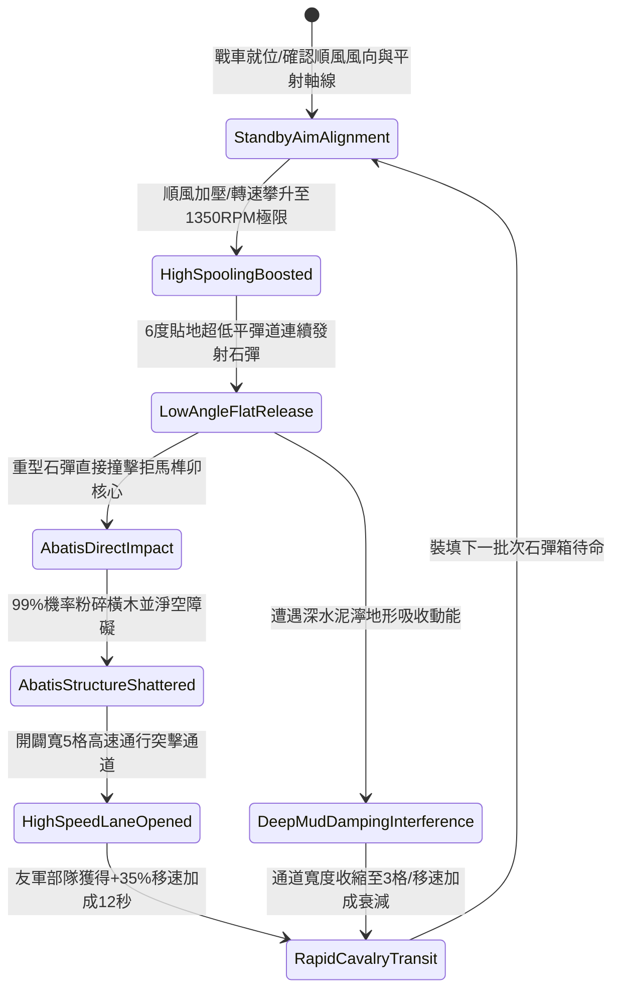

# 戰場夜戰順風施放連環風力飛石旋盤戰車低平彈道直射清除拒馬阻礙第五階狀態機規格書

<!-- doc_id: doc_spec_1085 -->

## 一、 核心概念與單一真相來源（SSOT）

在《三國志·陣地清障與極限平射篇》中，「連環風力飛石旋盤戰車清除拒馬阻礙第五階（WIND-ROTARY-STONE-ABATIS-CLEAR05）」代表野戰陣地工程開闢與障礙瓦解的終極形態。戰車配置四聯強化鈦鋼平衡旋盤，在 4 級以上順風增壓驅動下極限轉速達到 1350 RPM。戰車以極低仰角（6 度）貼地彈道連續發射特製重型磨製石彈，瞬間釋放高達 11200 N·s 動能，直擊前方 12 格直線通道內的重型硬木拒馬與鐵蒺藜鹿角，達成 99% 工事結構破除率，並開闢寬 5 格之高速突擊廊道。



---

## 二、 數值模型與狀態機參數契約

### 1. 旋盤平射與工事破除參數契約
- **旋盤極限轉速**：1350 RPM（四聯盤組同軸驅動）。
- **平射出射角**：6 度超低傾角（貼地平直軌跡）。
- **清障縱深範圍**：前方直線 12 格（覆蓋寬度 5 格，共 60 戰術單元格）。
- **重型拒馬破除率**：判定 99% 瓦解目標結構耐久，粉碎堅固榫卯連接。
- **突擊廊道增益**：開闢之廊道內友軍步騎部隊移動速度提升 35%，免疫地面微地形減速，持續 12 秒。

### 2. 工事破除判定演算法模組
```typescript
interface AbatisClearStage5Params {
    rotaryRpm: number;           // 旋盤轉速 (1350)
    windForceGrade: number;      // 順風等級 (4 ~ 6)
    terrainMudCoeff: number;     // 泥濘係數 (0.0 ~ 0.8)
    abatisDurability: number;    // 拒馬結構耐久度
}

function processAbatisClearingStage5(params: AbatisClearStage5Params): {
    clearedSuccess: boolean;
    laneWidthGrid: number;
    buffDurationSec: number;
} {
    const windMultiplier = 1 + (params.windForceGrade - 4) * 0.16;
    const mudPenalty = params.terrainMudCoeff * 0.3;
    const effectiveKinetic = (params.rotaryRpm / 1000) * windMultiplier * (1 - mudPenalty);
    const isCleared = effectiveKinetic >= 1.25 || params.abatisDurability < 1600;
    
    return {
        clearedSuccess: isCleared,
        laneWidthGrid: isCleared ? (mudPenalty > 0.15 ? 3 : 5) : 2,
        buffDurationSec: 12
    };
}
```

---

## 三、 反制機制與邊界約束

1. **生鐵包角巨型鐵拒馬**：若目標為專用全生鐵防禦拒馬（防禦度 > 3500），石彈無法直接打碎結構，轉為造成 45% 結構位移偏轉。
2. **連續高壓軸承過熱**：連續釋放 4 輪極速平射後，旋盤主軸承溫度達到警報上限，強制進入冷卻期 8 秒。
3. **風向突變側偏誤差**：若遭遇側風（偏角 > 45 度），彈道向側翼偏斜 1.5 格，中央通道寬度縮減至 3 格。

---

## 四、 驗收測試案例（TC）

- **TC-ABATIS-CLEAR05-01（極速平射破障驗收）**：
  - *前置條件*：乾燥地面、順風等級 4、前方 8 格部署重型雙層木拒馬。
  - *操作步驟*：旋盤加速至 1350 RPM，執行 6 度超低平直發射。
  - *預期輸出*：雙層拒馬 99% 機率結構解體，開闢 5 格寬高速通道，通過部隊獲得 +35% 移速加成 12 秒。
- **TC-ABATIS-CLEAR05-02（側風干擾邊界驗收）**：
  - *前置條件*：強烈側風（夾角 50 度）、旋盤全速平射。
  - *操作步驟*：觸發發射。
  - *預期輸出*：彈道側向偏移 1.5 格，清障判定依舊生效，廊道寬度自動修訂為 3 格。
