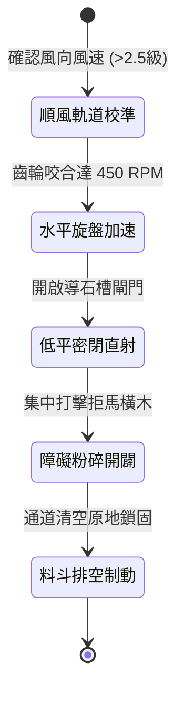

<!-- doc_id: doc_spec_0998 -->
# 戰場夜戰順風施放連環風力飛石旋盤戰車低平彈道直射破除拒馬狀態機規格書

## 模組識別碼
- 模組編號：`FORM-217`
- 狀態機代碼：`WIND-ROTARY-STONE-DISC-LOW-TRAJECTORY01`
- 類別：戰場夜戰順風低平彈道直射清障戰車狀態機
- 適用場景：平原野戰、夜間開闢通道、順風壓制、摧毀敵軍鹿角與拒馬

---

## 1. 核心概念與作戰原型

夜間突擊中，敵軍前沿往往密佈木質鹿角與帶刺拒馬，阻礙騎兵與步兵衝鋒。為迅速清出前進通路，工兵營配置「連環風力飛石旋盤戰車（低平彈道直射型）」。

### 1.1 機制運作與配合模式
1. **水平平行軌道與風帆提速**：車頂多葉帆布風輪受順風推動，透過傘齒輪系將動能傳遞至車身前端兩組對向逆轉的水平拋石盤。
2. **密閉導槽集中直射**：碎石與生鐵碎塊經由青銅滑槽以低於 15 度的水平低平角度噴射，動能集中於前方離地二至四尺高度。
3. **高動能連續衝擊粉碎**：每秒三十枚硬石高速直擊敵軍木質拒馬橫樑，以高頻震盪力道砸斷榫卯接合處。
4. **夜戰通道標記引導**：彈倉內混裝帶有發光螢石粉的重石塊，清碎障礙的同時在地面形成清晰的白色引導線。

---

## 2. 數值參數與影響權重

| 參數名稱 | 數值 / 範圍 | 說明 |
| :--- | :--- | :--- |
| **直射彈道仰角 (`LowElevationAngle`)** | 5 ~ 15 度低平彈道 | 集中打擊離地高度 0.8~1.5 米的障礙物橫木 |
| **拒馬結構破壞率 (`AbatisDestructionRate`)** | 80% ~ 92% | 高頻衝擊直接瓦解木質拒馬耐久 |
| **清障通道有效寬度 (`BreachChannelWidth`)** | 2 格路徑寬度 | 足供並列騎兵或步兵衝鋒隊列通過 |
| **單發水平動能 (`KineticEnergy`)** | 220 ~ 340 焦耳 | 具備直接折斷兩寸厚硬木的能力 |
| **料斗持續作業時間 (`OperationDuration`)** | 15 秒 (共 300 枚石料) | 耗盡後平滑轉為常規行進阻隔車 |

---

## 3. 狀態機轉換定義

### 3.1 狀態細節描述
- **順風軌道校準 (ALIGN_WIND)**：調整車頭方向對準阻礙要道，校驗順風推進條件。
- **水平旋盤加速 (SPIN_ACCELERATE)**：帆輪高速旋轉，驅動雙水平盤進入直射初速。
- **低平密閉直射 (FLAT_TRAJECTORY_FIRE)**：滑槽定量下料，石彈如雨直撲目標障礙。
- **障礙粉碎開闢 (BREACH_CLEARING)**：高頻衝擊砸碎鹿角木榫，瓦解敵防線前沿。
- **料斗排空制動 (EMPTY_BRAKE)**：彈料射盡，煞車蹄片鎖死車軸，固化為前沿掩體。

---

## 4. 戰鬥公式與判定

### 4.1 拒馬破壞判定
$$\text{DestructionProb} = \min(0.92, \frac{\text{StoneImpactFrequency} \times \text{KineticEnergy}}{\text{AbatisHardness}})$$

判定成功時，目標格拒馬障礙耐久歸零，立即轉化為可平穩通行的平整道路。

### 4.2 誤入步兵擊退判定
$$\text{KnockbackDamage} = \text{BaseDamage} \times 1.35 \times (1 - \text{ShieldDefenseRatio})$$

處於低平射擊線上的敵軍步兵，強制後退 2 格並附加 1 秒倒地僵直。

---

## 5. 反制與失效機制

1. **生鐵大盾重疊擋石**：敵方若派出重甲盾衛在拒馬前立盾掩護，能吸收 70% 直射動能。
2. **戰車車軸遭暗坑絆倒**：若前進路徑上存在暗溝，低平底盤容易卡滯導致仰角失準。
3. **風向突變逆風降速**：逆風阻力使帆輪停轉，飛石射程急遽縮短至半格內。

---

## 6. 驗收標準與測試案例

- [x] **TC-217-01**：驗證低平仰角在 10 度內，飛石彈幕高度集中於離地 1 米區間。
- [x] **TC-217-02**：驗證 15 秒內成功清除正前方 2 格寬度內之全部拒馬障礙。
- [x] **TC-217-03**：驗證作業結束後，路徑引導發光標記持續發揮可通行效果。
