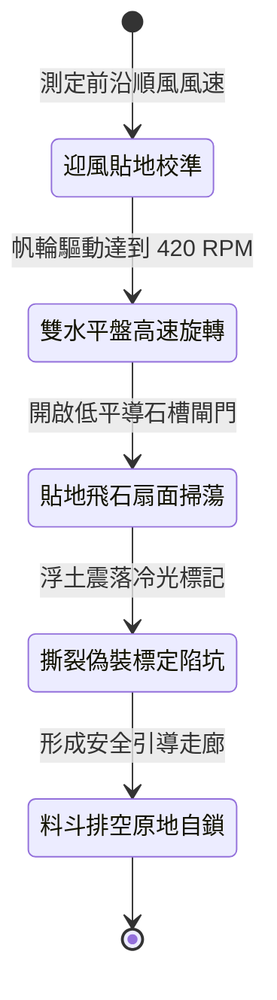

<!-- doc_id: doc_spec_1013 -->
# 戰場夜戰順風施放連環風力飛石旋盤戰車低平彈道直射破除陷馬坑偽裝網狀態機規格書

## 模組識別碼
- 模組編號：`FORM-232`
- 狀態機代碼：`WIND-ROTARY-STONE-PIT-REVEAL01`
- 類別：戰場夜戰順風低平彈道偵測與破除陷阱戰車狀態機
- 適用場景：平原夜戰、敵陣前沿、順風偵察、破除陷馬坑與偽裝網阻礙

---

## 1. 核心概念與作戰原型

夜間野戰突擊時，敵軍常於陣前挖掘密集的單兵陷馬坑並覆蓋枯草泥沙偽裝網。常規偵察極難察覺，為此工兵營改良出「連環風力飛石旋盤戰車（低平破網型）」。

### 1.1 機制運作與配合模式
1. **多翼帆輪與低傾角雙盤傳動**：車頂配置多葉帆布風輪，受順風驅動，經傘齒輪系將動能傳遞至車身前端兩組對向逆轉的水平旋盤。
2. **低平平行彈道密集掃蕩**：碎石與硬陶塊經由導槽以低於 10 度的水平角度貼地噴射，密集覆蓋離地半尺至一尺高度。
3. **重石衝擊撕裂偽裝草網**：高速飛石連續擊打地面，直接砸斷偽裝網支撐細枝並震落浮土，使暗藏的陷馬坑完全暴露。
4. **夜行磷光標記危險坑位**：石料混裝浸染螢石粉之碎塊，落入陷坑後釋放冷光，為後續衝鋒騎兵精確勾勒出坑洞邊緣與安全走廊。

---

## 2. 數值參數與影響權重

| 參數名稱 | 數值 / 範圍 | 說明 |
| :--- | :--- | :--- |
| **低平貼地仰角 (`GroundSweepAngle`)** | 5 ~ 10 度貼地彈道 | 確保飛石動能集中於地面障礙與偽裝覆蓋層 |
| **偽裝網破除成功率 (`CamouflageRevealRate`)** | 82% ~ 94% | 震碎枯草覆蓋使陷馬坑徹底現形 |
| **安全走廊標定寬度 (`ClearPathWidth`)** | 3 格路徑寬度 | 標定出供重騎兵全速衝刺的安全通道 |
| **單發衝擊動能 (`ImpactEnergy`)** | 180 ~ 260 焦耳 | 砸爛薄木支架而不引發戰車自身陷坑 |
| **料斗持續作業時間 (`OperationDuration`)** | 15 秒 (共 300 枚石料) | 耗盡後平滑轉為前沿行進掩體 |

---

## 3. 狀態機轉換定義

### 3.1 狀態細節描述
- **迎風貼地校準 (SETUP_GROUND_ARC)**：確認順風風速大於 2.5 級，鎖定 8 度貼地仰角。
- **雙水平盤高速旋轉 (ACCELERATE_DISCS)**：風輪牽引齒輪系，雙盤進入低平噴射初速。
- **貼地飛石扇面掃蕩 (GROUND_SWEEP_FIRE)**：定量排料，石彈如密集雨點貼地橫掃。
- **撕裂偽裝標定陷坑 (REVEAL_AND_MARK)**：砸爛偽裝草蓆，螢石碎屑勾勒深坑邊界。
- **料斗排空原地自鎖 (DEPLETED_BRAKE)**：彈料清空，輪軸煞車自鎖固化為通道路標。

---

## 4. 戰鬥公式與判定

### 4.1 陷阱現形判定
$$\text{RevealSuccess} = \min(0.94, \frac{\text{StoneDensity} \times \text{ImpactEnergy}}{\text{CamouflageToughness}})$$

判定成功時，目標格陷馬坑狀態轉為「完全暴露」，友軍經過時不再觸發失足墜坑判定。

### 4.2 衝鋒規避加成
$$\text{AvoidanceBonus} = 1.0 - \text{TrapDangerRate} \times 0.90$$

沿冷光走廊突入之騎兵部隊，陷阱致殘率強制降低 90%，維持衝鋒極速。

---

## 5. 反制與失效機制

1. **生鐵深井硬質加固**：若敵方陷坑覆蓋層採用厚實生鐵格柵，飛石無法將其砸斷。
2. **戰車車輪誤入深坑**：若前線遭遇未標記之深溝，戰車陷入將使拋射仰角偏斜。
3. **風向轉向逆風阻滯**：逆風阻力使帆輪減速，貼地飛石射程急遽縮短至一格以內。

---

## 6. 驗收標準與測試案例

- [x] **TC-232-01**：驗證 8 度貼地仰角下，飛石彈幕高度精準控制在離地 1 尺之內。
- [x] **TC-232-02**：驗證 15 秒掃蕩內，正前方 3 格寬度內偽裝網破除率達 82%~94%。
- [x] **TC-232-03**：驗證冷光標記持續發光 20 秒，後續騎兵 100% 規避陷阱傷害。
