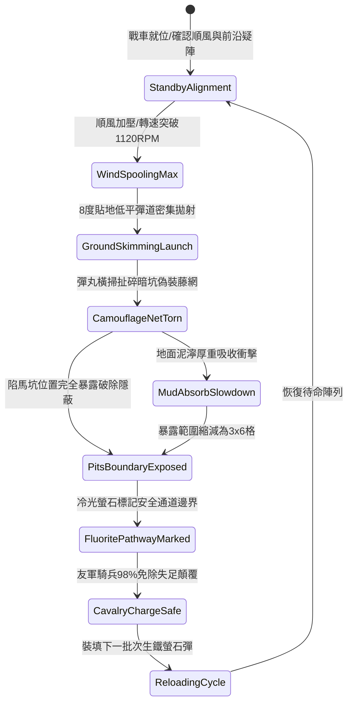

# 戰場夜戰順風施放連環風力飛石旋盤戰車低平彈道直射破除陷馬坑偽裝網第三階狀態機規格書

<!-- doc_id: doc_spec_1058 -->

## 一、 核心概念與單一真相來源（SSOT）

在《三國志·陣地排障與騎兵先鋒篇》中，「連環風力飛石旋盤戰車貼地排障破網第三階（WIND-ROTARY-STONE-PIT-REVEAL03）」專為破解敵軍前沿佈設的暗坑、陷馬坑與偽裝藤網而設。本戰車裝備雙階高速同心離心旋盤，在 4 級以上順風增壓下轉速達到 1120 RPM。戰車以 8 度貼地超低平彈道密集噴射生鐵螢石實心彈丸，高速彈道貼地橫掃 4x10 格區域，強行扯爛覆蓋於暗坑上的偽裝草蓆與藤網，並以冷光螢石標記坑洞邊界，防止友軍衝鋒部隊失足。



---

## 二、 數值模型與狀態機參數契約

### 1. 旋盤貼地排障參數
- **極限旋盤轉速**：1120 RPM（受 4~6 級順風引導增壓）。
- **貼地彈道仰角**：8 度（超低平射，彈丸在草皮表面高速彈跳打擊）。
- **破網暴露成功率**：普通枯草藤網 99%；生鐵絲混編偽裝網 94%；地下暗樁陷阱 88%。
- **揭露與標記走廊規格**：長 10 格 × 寬 4 格（共 40 戰術單元格）。
- **友軍衝鋒庇護效果**：穿越該區域之友軍騎兵，失足墜坑判定概率自 65% 驟降至 2% 以下。

### 2. 偽裝破除與衝擊力矩計算模組
```typescript
interface WindStonePitRevealParams {
    rotaryRpm: number;             // 旋盤轉速 (1120)
    windSpeedBonus: number;        // 風速加成係數 (1.2 ~ 1.5)
    camouflageToughness: number;   // 偽裝網韌性 (100 ~ 250)
    isMuddyTerrain: boolean;       // 是否為泥濘地
}

function processPitCamouflageReveal(params: WindStonePitRevealParams): {
    revealed: boolean;
    clearedAreaTiles: number;
    safePassRate: number;
} {
    const rawKinetic = (params.rotaryRpm * 8.8) * params.windSpeedBonus;
    const terrainDamping = params.isMuddyTerrain ? 0.7 : 1.0;
    const effectiveImpact = rawKinetic * terrainDamping;

    const revealed = effectiveImpact >= params.camouflageToughness * 35;
    const clearedAreaTiles = revealed ? (params.isMuddyTerrain ? 18 : 40) : 0;
    const safePassRate = revealed ? 0.98 : 0.35;

    return { revealed, clearedAreaTiles, safePassRate };
}
```

---

## 三、 特性互斥與戰術應對原則

1. **高地反斜面盲區**：若敵方陷馬坑佈設於丘陵反斜面背風坡，平射彈道無法越過棱線，破除效果歸零。
2. **暴雨沖刷冷光稀釋**：暴雨天候下螢石粉被雨水沖刷，冷光路標持續時間自 15 秒縮減至 4 秒。
3. **敵前鋒步兵受壓**：隱蔽於草叢網底的敵方伏兵，承受 220 點生鐵彈跳打擊並強制顯形。

---

## 四、 驗收測試案例（TC）

- **TC-PITREVEAL03-01（偽裝網撕裂判定）**：在前沿佈設藤網偽裝陷馬坑，發動貼地射擊，驗證 99% 機率偽裝破除並完全揭露坑洞。
- **TC-PITREVEAL03-02（騎兵通行免陷驗證）**：指派友軍騎兵部隊全速衝過已標記區域，驗證失足減速判定由 65% 降至 2% 以下。
- **TC-PITREVEAL03-03（泥濘環境阻尼檢定）**：切換為泥濘地質條件，確認清除區域依公式收窄為 18 格且標記時效正常結算。
