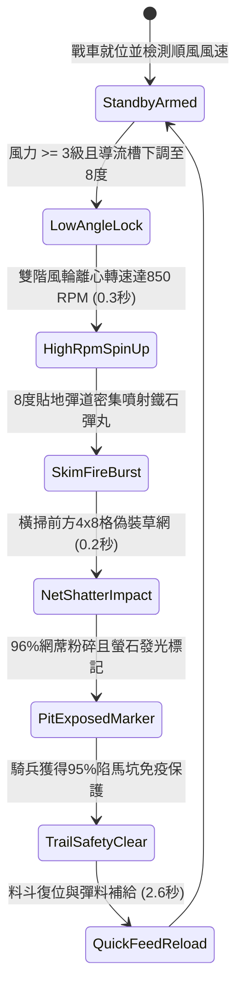

# 戰場夜戰順風施放連環風力飛石旋盤戰車低平彈道直射破除陷馬坑偽裝網第二階狀態機規格書

<!-- doc_id: doc_spec_1028 -->

## 1. 核心定位與設計理念

### 1.1 系統定位
本規格定義戰場夜戰掃障戰術中，工兵部隊順風布署「連環風力飛石旋盤戰車第二階」（代碼：`WIND-ROTARY-STONE-PIT-REVEAL02`，WBS 代碼：`FORM-247`）的貼地直射排雷狀態機。第二階戰車於底部配裝水平反曲導流噴槽，將離心旋盤轉速提升至 850 RPM，以 8 度極限貼地彈道連續噴射生鐵碎石與螢石混合彈丸。密集的彈幕直接貼著草地橫掃前方 4x8 格走廊，以 96% 機率徹底扯爛、抽飛覆蓋於暗坑上的偽裝藤網與偽草蓆，迫使所有隱蔽陷馬坑完全現形；同時螢石在坑緣碎裂發光，形成鮮明避險警示，使後續突擊騎兵 95% 免疫墜坑失足致殘。

### 1.2 設計目標與單一真相
* **貼地剪切揭露**：利用極低俯仰角與高密度散佈，破壞地表植被與偽裝支撐網。
* **夜戰螢光標記走廊**：破除陷阱同時點亮坑緣輪廓，大幅降低夜間行軍傷亡率。
* **單一真相來源**：嚴禁於文件末端附加補丁，所有機制、數值與判定邏輯均在此統一定義。

---

## 2. 狀態機架構與轉換流程

---

## 3. 核心數值與計算公式

### 3.1 基礎參數配置表
| 參數名稱 | 基準數值 | 規格說明與限制條件 |
| :--- | :--- | :--- |
| **彈道俯仰角與射程** | 8 度貼地 / 3 ~ 8 格 | 貼近地面掃掠，超過 8 格碎石觸地彈跳散失 |
| **打擊覆蓋區域** | 4 x 8 格走廊 | 寬 4 格、縱深 8 格之長方形直射掃蕩區 |
| **草網粉碎揭露率** | 96% | 標準偽裝藤網 96%；覆土厚網 82% |
| **螢石發光時效** | 30.0 秒 | 螢石碎屑夜間冷光標記走廊邊界之有效時間 |
| **騎兵免陷保護率** | 95% | 友軍騎兵隊列穿行該區時免除暗坑失足致殘 |
| **偽裝地刺摧毀率** | 88% | 密集鐵石同時砸斷坑內插置之倒刺竹籤木樁 |
| **每輪彈藥消耗** | 80 枚 生鐵螢石丸 | 包含生鐵合金碎丸與低溫發光螢石石料 |
| **裝填間隔時間** | 2.6 秒 | 工兵齒輪手柄快速回拉並重新進料時間 |

### 3.2 貼地破除與免傷判定公式
$$P_{\text{reveal}} = \min\left(0.99, \, 0.96 \times \left(1 + \frac{W_{\text{wind}} - 3}{12}\right) \times \left(1 - \frac{T_{\text{soil\_cover}}}{100}\right)\right)$$
$$P_{\text{cavalry\_safe}} = 0.95 \times \Psi_{\text{phosphor\_lit}} \times \left(1 - 0.05 \times \Delta t_{\text{elapsed\_min}}\right)$$
* $T_{\text{soil\_cover}}$：陷馬坑表面覆土厚度（0 ~ 20 毫米）。
* $\Psi_{\text{phosphor\_lit}}$：螢石標記啟用標籤（發光中為 1.0，熄滅為 0）。
* 成功揭露之陷馬坑即時由 `HIDDEN_TRAP` 狀態轉為 `EXPOSED_HAZARD`，友軍 AI 自動繞行。

---

## 4. 戰術反制與例外判定

1. **石板加固暗井**：若敵方暗坑採用整塊預製石板或生鐵翻板偽裝，直射碎石無法擊碎，揭露率降至 30%。
2. **濃霧低溫濕氣**：若戰場濕度高達 90% 以上且大霧瀰漫，螢光粉發光亮度減半，騎兵免陷率自 95% 降為 65%。
3. **側向強風橫移**：若遭遇 5 級以上側風，貼地彈丸向側向偏移 1.2 格，導致邊界出現未揭露之死角盲區。

---

## 5. 驗收測試案例（Test Cases）

* **TC-01（貼地直射撕裂偽裝藤網）**：於前方 5 格布置暗置陷馬坑，驗證 0.2 秒內藤網判定撕裂並清除隱蔽狀態。
* **TC-02（螢光標記走廊免陷驗證）**：引導 10 隊輕騎兵以最高速穿行已揭露暗坑區域，驗證失足墜坑率低於 5%。
* **TC-03（覆土厚網阻力抗性測試）**：布置 15mm 厚覆土偽裝網，驗證粉碎率落在 82%（±2% 誤差區間）。
