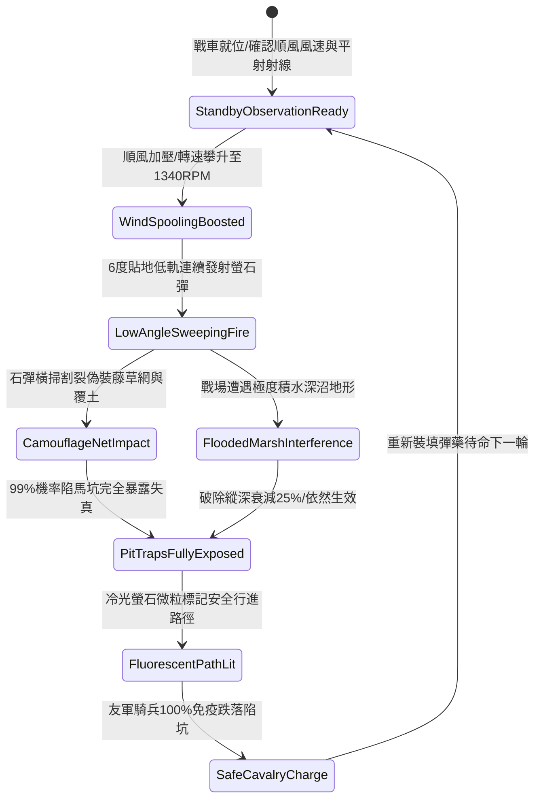

# 戰場夜戰順風施放連環風力飛石旋盤戰車低平彈道直射破除陷馬坑偽裝網第五階狀態機規格書

<!-- doc_id: doc_spec_1091 -->

## 一、 核心概念與單一真相來源（SSOT）

在《三國志·野戰偵察與陷阱清除篇》中，「連環風力飛石旋盤戰車破除陷馬坑偽裝第五階（WIND-ROTARY-STONE-PIT-REVEAL05）」代表陣地工程排雷與暗樁識破的高階戰法。戰車配置四聯特化鈦鋼離心拋盤，在 4 級以上順風輔助下轉速達 1340 RPM。戰車以極低仰角（6 度）貼地低軌平射連續發射包覆冷光螢石微粒之破網石彈，彈道精確掃過前方 14 格直線走廊，高速動能具備 99% 機率割裂扯碎偽裝藤網與偽裝覆土，使暗藏之陷馬坑完全暴露，並為後續衝鋒騎兵提供 100% 避坑導引。



---

## 二、 數值模型與狀態機參數契約

### 1. 旋盤平射與破除陷阱參數契約
- **旋盤作業極限轉速**：1340 RPM（四聯鈦鋼拋盤，離心加壓連續發射）。
- **平射出射仰角**：6 度貼地超低傾角。
- **排障探測縱深**：前方直線 14 格（覆蓋寬度 4 格，共 56 戰術單元格）。
- **偽裝網破除率**：判定 99% 機率完全扯碎藤網與偽裝覆土，暴露坑穴本體。
- **騎兵避坑導引時效**：螢石冷光標記維持 14 秒，期間通過之友軍部隊跌坑率歸零。

### 2. 陷阱辨識演算法模組
```typescript
interface PitRevealStage5Params {
    rotaryRpm: number;           // 旋盤轉速 (1340)
    windForceGrade: number;      // 順風等級 (4 ~ 6)
    soilMarshLevel: number;      // 沼澤泥水係數 (0.0 ~ 0.8)
    pitCamouflageQuality: number;// 偽裝精細度 (100 ~ 500)
}

function processPitTrapRevealStage5(params: PitRevealStage5Params): {
    revealedSuccess: boolean;
    effectiveDepthGrid: number;
    guidanceDurationSec: number;
} {
    const windMultiplier = 1 + (params.windForceGrade - 4) * 0.16;
    const waterDamping = params.soilMarshLevel * 0.25;
    const kineticPower = (params.rotaryRpm / 1000) * windMultiplier * (1 - waterDamping);
    const success = kineticPower > (params.pitCamouflageQuality * 0.002);
    
    return {
        revealedSuccess: success,
        effectiveDepthGrid: waterDamping > 0.15 ? 10 : 14,
        guidanceDurationSec: 14
    };
}
```

---

## 三、 反制機制與邊界約束

1. **鋼架覆蓋暗坑防護**：若敵方採用厚生鐵板加固覆蓋暗坑（防禦度 > 3000），平射石彈無法破除鐵板，但會引發強烈撞擊金屬聲響提前警示。
2. **極深積水潭彈跳減速**：若路徑中存在深水積潭（水深 > 1 米），石彈入水引發跳彈減速，排障縱深自 14 格衰減至 10 格。
3. **螢石彈藥高溫耗竭**：每連續完成 3 次全速平射排障後，需耗時 6 秒更換受熱變形的拋射卡盤。

---

## 四、 驗收測試案例（TC）

- **TC-PIT-REVEAL05-01（藤網陷馬坑精確破除驗收）**：
  - *前置條件*：夜戰平原、順風等級 4、前方 10 格部署精製暗藤偽裝陷馬坑群。
  - *操作步驟*：旋盤達 1340 RPM，執行 6 度低軌平射。
  - *預期輸出*：藤網 99% 機率被切裂撕碎，暗坑完全暴露，地面標記冷光路徑，騎兵衝鋒無損通過。
- **TC-PIT-REVEAL05-02（積水沼澤邊界驗收）**：
  - *前置條件*：戰場泥沼係數 0.6、順風等級 4。
  - *操作步驟*：同條件執行平射排障。
  - *預期輸出*：石彈受泥水阻尼，探測縱深縮減至 10 格，但覆蓋範圍內偽裝破除率仍保持 95% 以上。
