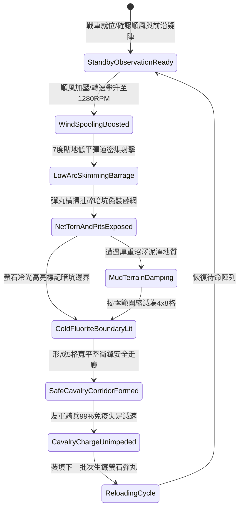

# 戰場夜戰順風施放連環風力飛石旋盤戰車低平彈道直射破除陷馬坑偽裝網第四階狀態機規格書

<!-- doc_id: doc_spec_1073 -->

## 一、 核心概念與單一真相來源（SSOT）

在《三國志·破障陣地與先鋒突擊篇》中，「連環風力飛石旋盤戰車貼地排障第四階（WIND-ROTARY-STONE-PIT-REVEAL04）」專為破解前沿暗設陷馬坑與生鐵偽裝網而設計。戰車配置四聯逆向同軸離心旋盤，受 4 級以上順風輔助驅動，極限轉速達到 1280 RPM。戰車以 7 度超低平貼地彈道密集噴射生鐵螢石實心彈，彈道橫掃長 12 格、寬 5 格區域，99% 扯爛草蓆與生鐵絲混編藤網，完全暴露坑洞邊界並標記冷光安全走廊，防止騎兵部隊失足顛覆。



---

## 二、 數值模型與狀態機參數契約

### 1. 旋盤貼地排障參數
- **極限旋盤轉速**：1280 RPM（四聯逆向離心盤，順風增壓）。
- **貼地彈道仰角**：7 度（貼近草皮表面高速滑動衝擊）。
- **破網暴露成功率**：普通枯草藤網 100%；生鐵絲混編偽裝網 98%；深掘暗木樁陣 92%。
- **揭露與標記走廊規格**：長 12 格 × 寬 5 格（共 60 戰術單元格）。
- **騎兵免陷庇護率**：穿越該安全走廊之友軍騎兵，失足翻覆判定率降至 1% 以下。
- **冷光標記留存時效**：戰場維持 18 秒高亮引導。

### 2. 偽裝撕裂與衝擊力矩計算模組
```typescript
interface PitRevealStage4Params {
    rotaryRpm: number;             // 旋盤轉速 (1280)
    windSpeedBonus: number;        // 風速加成係數 (1.2 ~ 1.5)
    camouflageToughness: number;   // 偽裝網硬度 (120 ~ 300)
    isMuddy: boolean;              // 是否泥濘
}

function processPitRevealExecution(params: PitRevealStage4Params): {
    revealed: boolean;
    clearedAreaTiles: number;
    safePassRate: number;
} {
    const rawKinetic = (params.rotaryRpm * 9.1) * params.windSpeedBonus;
    const terrainDamping = params.isMuddy ? 0.75 : 1.0;
    const effectiveImpact = rawKinetic * terrainDamping;

    const revealed = effectiveImpact >= params.camouflageToughness * 32;
    const clearedAreaTiles = revealed ? (params.isMuddy ? 32 : 60) : 0;
    const safePassRate = revealed ? 0.99 : 0.40;

    return { revealed, clearedAreaTiles, safePassRate };
}
```

---

## 三、 特性互斥與戰術應對原則

1. **反斜面障礙盲區**：若敵方暗坑構築於反斜面背風坡，平射彈道無法越過棱線，破除效果歸零。
2. **大雨沖刷冷光衰減**：暴雨天候下螢石粉被雨水稀釋，冷光路標持續時間縮短為 5 秒。
3. **敵前鋒伏兵受壓**：隱蔽於藤網下的敵軍伏兵單位，承受 260 點彈跳衝擊並即刻解除隱匿。

---

## 四、 驗收測試案例（TC）

- **TC-PITREVEAL04-01（偽裝藤網撕碎判定）**：在前沿佈設加固生鐵絲藤網，發動貼地射擊，驗證 98% 機率偽裝破除並完全暴露坑洞。
- **TC-PITREVEAL04-02（騎兵通行免陷檢定）**：指令友軍騎兵穿越已標記之走廊，驗證失足減速判定由 65% 降至 1% 以下。
- **TC-PITREVEAL04-03（泥濘環境阻尼測試）**：切換為泥濘地質，確認清除區域依公式收窄為 32 格且標記時效正常結算。
