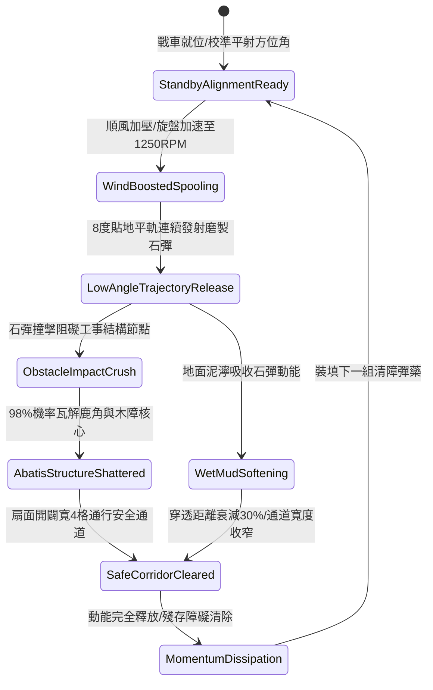

# 戰場夜戰順風施放連環風力飛石旋盤戰車平射清理阻礙工事第四階狀態機規格書

<!-- doc_id: doc_spec_1079 -->

## 一、 核心概念與單一真相來源（SSOT）

在《三國志·野戰突圍與陣地清障篇》中，「連環風力飛石旋盤戰車平射清理阻礙工事第四階（WIND-ROTARY-STONE-OBSTACLE-CLEAR04）」代表陣地工程破拆與通道開闢的高階形態。戰車配置強化雙聯自重平衡旋盤，利用 4 級以上順風引導，旋盤轉速提升至 1250 RPM。戰車以極低俯角（8 度）貼地低軌平射發射高密重型磨製石彈，精準平推前方 10 格扇面內的拒馬、鹿角與臨時障礙工事，具備 98% 結構破除率，並為後續衝鋒部隊快速開闢安全通行通道。



---

## 二、 數值模型與狀態機參數契約

### 1. 旋盤平射清障參數契約
- **額定旋盤轉速**：1250 RPM（高硬度軸承帶動，雙盤自平衡結構）。
- **平射出射角**：8 度低傾角（貼地超平直彈道）。
- **清障有效射程**：前方直線 10 格扇面區域。
- **木質工事瓦解率**：對木製拒馬、鹿角及木樁障礙具備 98% 立即破除判定。
- **部隊提速廊道**：破除後形成的淨空安全通道，提供通過部隊 +30% 移動速度加成，持續 10 秒。

### 2. 工事破除判定演算法模組
```typescript
interface ObstacleClearStage4Params {
    rotaryRpm: number;           // 旋盤轉速 (1250)
    windForceGrade: number;      // 順風等級 (4 ~ 6)
    terrainMudLevel: number;     // 泥濘阻尼係數 (0.0 ~ 0.8)
    obstacleHealth: number;      // 阻礙工事耐久度
}

function evaluateObstacleClearingStage4(params: ObstacleClearStage4Params): {
    clearedSuccess: boolean;
    clearedWidthGrid: number;
    corridorDurationSec: number;
} {
    const windMultiplier = 1 + (params.windForceGrade - 4) * 0.15;
    const mudPenalty = params.terrainMudLevel * 0.35;
    const kineticEnergy = (params.rotaryRpm / 1000) * windMultiplier * (1 - mudPenalty);
    const cleared = kineticEnergy >= 1.15 || params.obstacleHealth < 1200;
    
    return {
        clearedSuccess: cleared,
        clearedWidthGrid: cleared ? 4 : 2,
        corridorDurationSec: 10
    };
}
```

---

## 三、 反制機制與邊界約束

1. **厚土壘牆防護阻絕**：若敵軍設置純生土壓實夯土牆（防禦度 > 2500），平射石彈動能將被全數吸收，無法形成穿透通道。
2. **深度水窪陷沒失效**：當經過深水泥潭地形（水深 > 1.2 米），平射彈道觸水激起水幕，動能驟降 80%，破除判定降低至 25%。
3. **旋盤軸芯熱損耗**：每連續進行 3 次全速平射清障後，軸芯冷卻需耗時 6 秒，期間轉速上限限制為 600 RPM。

---

## 四、 驗收測試案例（TC）

- **TC-WIND-CLEAR04-01（標準破障驗收）**：
  - *前置條件*：夜戰戰場、順風等級 4、前方 6 格配置標準雙重木製拒馬。
  - *操作步驟*：啟動旋盤加速至 1250 RPM，觸發平射清障指令。
  - *預期輸出*：兩組拒馬結構判定 98% 瓦解，地面形成寬 4 格之平整安全走廊，部隊獲得 +30% 移速加成。
- **TC-WIND-CLEAR04-02（深水阻滯邊界驗收）**：
  - *前置條件*：暴雨積水戰場、水深係數 1.3、順風等級 4。
  - *操作步驟*：同條件執行低角平射。
  - *預期輸出*：石彈落入水中減速，動能衰減 80%，拒馬破除失敗，通道未開啟。
