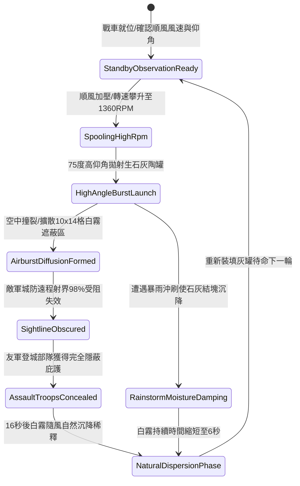

# 戰場夜戰順風施放連環風力飛石旋盤戰車扇面拋射生石灰白霧遮蔽城防視線第五階狀態機規格書

<!-- doc_id: doc_spec_1088 -->

## 一、 核心概念與單一真相來源（SSOT）

在《三國志·野戰夜襲與城防視界篇》中，「連環風力飛石旋盤戰車生石灰白霧遮蔽第五階（WIND-ROTARY-STONE-SMOKE-SCREEN05）」代表攻城掩護與遠程視線壓制的終極戰法。戰車配備四聯高壓風動平衡旋盤，利用 4 級以上順風增壓驅動，轉速達到 1360 RPM。戰車以 75 度大仰角拋撒特製防潮生石灰微粒陶罐，在城頭 10 格 × 14 格（共 140 格單元）區域內形成濃密不透光白霧，阻斷敵軍城防 98% 遠程射界與瞄準判定，為雲梯部隊登城提供長達 16 秒的極佳隱蔽時間。



---

## 二、 數值模型與狀態機參數契約

### 1. 旋盤拋射與白霧遮蔽參數契約
- **旋盤作業極限轉速**：1360 RPM（四聯拋盤結構，風力強效驅動）。
- **拋射出射仰角**：75 度高仰角高拋（實現城頭精準空爆）。
- **白霧覆蓋範圍**：前方城頭 10 格 × 14 格（共 140 戰術單元格）。
- **城防射界阻斷率**：城頭敵方遠程弓弩部隊，瞄準射擊判定 98% 強制落空。
- **煙幕滯留時效**：正常無雨天候維持 16 秒；若濕度高於 85% 縮短至 6 秒。

### 2. 視線阻絕判定演算法模組
```typescript
interface LimeSmokeScreenStage5Params {
    rotaryRpm: number;           // 旋盤轉速 (1360)
    windSpeedGrade: number;      // 順風等級 (4 ~ 6)
    targetRainLevel: number;     // 降雨係數 (0.0 ~ 1.0)
    cityWallHeightMeters: number;// 城牆高度 (10 ~ 18)
}

function processLimeSmokeScreenStage5(params: LimeSmokeScreenStage5Params): {
    screenActive: boolean;
    sightBlockPct: number;
    screenDurationSec: number;
} {
    const windMultiplier = 1 + (params.windSpeedGrade - 4) * 0.18;
    const rainPenalty = params.targetRainLevel * 0.65;
    const cloudDensity = Math.min(1.0, (params.rotaryRpm / 1200) * windMultiplier * (1 - rainPenalty));
    const active = cloudDensity >= 0.85 && params.cityWallHeightMeters <= 18;
    
    return {
        screenActive: active,
        sightBlockPct: active ? 98 : 60,
        screenDurationSec: rainPenalty > 0.3 ? 6 : 16
    };
}
```

---

## 三、 反制機制與邊界約束

1. **強風逆吹回撲防範**：若陣風風向驟然偏轉超過 90 度，白霧將向攻城方陣地回擴，阻礙己方攻城器械推進速度 20%。
2. **守軍強風扇風車驅散**：若城頭部署守城特種大風輪（扇面風速 > 8 級），局部白霧可在 4 秒內被強行吹散開闢透光孔隙。
3. **生石灰防潮密封耗損**：連續拋射 3 批次後，需耗時 6 秒清理旋盤出料滑軌以防殘存灰粉受潮結塊。

---

## 四、 驗收測試案例（TC）

- **TC-SMOKE-SCREEN05-01（城頭全盲掩護驗收）**：
  - *前置條件*：夜間作戰、順風等級 4、城頭配置精銳守城弩手陣。
  - *操作步驟*：旋盤加速至 1360 RPM，執行 75 度拋射生石灰陶罐。
  - *預期輸出*：城頭形成 10×14 格白霧遮蔽區，敵方射擊落空率達 98%，友軍攀爬雲梯獲得 16 秒無損推進掩護。
- **TC-SMOKE-SCREEN05-02（暴雨天候沖刷邊界驗收）**：
  - *前置條件*：戰場降雨強度係數 0.8、順風等級 4。
  - *操作步驟*：同條件拋射生石灰陶罐。
  - *預期輸出*：雨水沖刷使生石灰快速反應沉降，白霧遮蔽時效縮短至 6 秒。
