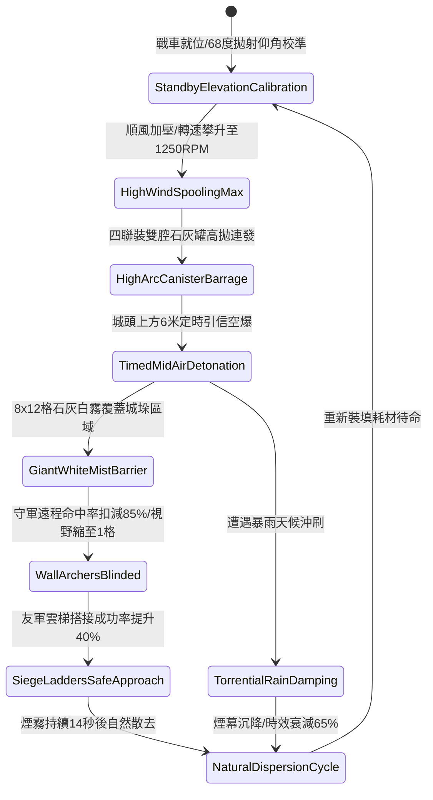

# 戰場夜戰順風施放連環風力飛石旋盤戰車扇面拋射生石灰白霧遮蔽城防視線第四階狀態機規格書

<!-- doc_id: doc_spec_1070 -->

## 一、 核心概念與單一真相來源（SSOT）

在《三國志·戰場夜戰攻城掩護篇》中，「連環風力飛石旋盤戰車石灰白霧掩護第四階（WIND-ROTARY-STONE-LIME-SCREEN04）」為順風攻堅城垛遠程防線的大型壓制器械。戰車採用四聯複合加壓旋盤，受 4 級以上順風輔助驅動，極限轉速達到 1250 RPM。戰車以 68 度高拋彈道拋射雙腔生石灰微粒陶罐，於城牆上方 6 米處定時空爆，形成覆蓋 8x12 格的濃厚白霧屏障，壓制城頭守軍 85% 遠程命中率，並遮蔽城牆垛口視野，為雲梯隊列爭取黃金搭接時機。



---

## 二、 數值模型與狀態機參數契約

### 1. 旋盤白霧掩護工程參數
- **極限旋盤轉速**：1250 RPM（受 4~6 級順風引導增壓）。
- **高拋發射仰角**：68 度（確保微粒自城牆頂部垂直擴散沉降）。
- **白霧覆蓋規格**：長 12 格 × 寬 8 格（覆蓋 96 戰術單元格，完全遮蔽相鄰 4 個城垛區間）。
- **遠程視野壓制**：處於霧區之敵守軍，遠程射擊命中率扣減 85%，視野鎖定於周圍 1 格。
- **攻城雲梯搭接增益**：受白霧掩護推進之友軍雲梯，搭接時受守軍反制率下降 40%。
- **戰場滯留時效**：常態氣候持續 14 秒；若濕度高於 85% 縮短至 6 秒。

### 2. 視線阻絕與煙幕沉降模組
```typescript
interface LimeScreenStage4Params {
    rotaryRpm: number;             // 旋盤轉速 (1250)
    windSpeedBonus: number;        // 風速加成係數 (1.2 ~ 1.5)
    humidityRatio: number;         // 空氣濕度 (0.0 ~ 1.0)
    isRainyWeather: boolean;       // 是否降雨
}

function processLimeScreenSuppression(params: LimeScreenStage4Params): {
    screenActive: boolean;
    hitPenaltyPct: number;
    durationSec: number;
} {
    const mistDensity = Math.min(1.0, (params.rotaryRpm / 1100) * params.windSpeedBonus * 0.85);
    const rainPenalty = params.isRainyWeather ? 0.65 : params.humidityRatio * 0.3;
    const finalDensity = mistDensity * (1 - rainPenalty);

    const screenActive = finalDensity >= 0.6;
    const hitPenaltyPct = screenActive ? Math.round(85 * finalDensity) : 35;
    const durationSec = Math.round(14 * (1 - rainPenalty));

    return { screenActive, hitPenaltyPct, durationSec };
}
```

---

## 三、 特性互斥與戰術應對原則

1. **強逆風自鎖反制**：若戰場風向突轉為逆風（相對角 > 110 度），安全風門自動閉鎖，防止石灰反吹友軍前鋒。
2. **大雨沖刷沉降**：遭遇暴雨環境時，生石灰吸收雨水迅速結塊墜地，煙幕遮蔽時效衰減 65%。
3. **護目精銳步兵減免**：佩戴浸醋面巾或生鐵護目甲之守軍精銳，受命中率懲罰降低 40%。

---

## 四、 驗收測試案例（TC）

- **TC-LIMESCREEN04-01（空爆白霧生成）**：在 4 級順風條件下施放技能，確認 2 秒內於指定 8x12 格城垛區域生成白霧屏障。
- **TC-LIMESCREEN04-02（城頭弓箭手命中扣減）**：霧區守軍向外射擊，驗證箭矢命中判定實時扣減 85%。
- **TC-LIMESCREEN04-03（雲梯搭接加成檢核）**：推進友軍雲梯搭接，確認搭接成功率提升 40% 且未遭集火擊毀。
