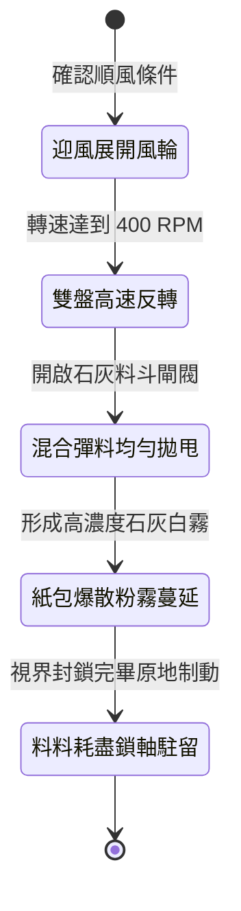

<!-- doc_id: doc_spec_1007 -->
# 戰場夜戰順風施放連環風力飛石旋盤戰車扇面拋射生石灰迷盲敵軍前鋒狀態機規格書

## 模組識別碼
- 模組編號：`FORM-226`
- 狀態機代碼：`WIND-ROTARY-STONE-LIME-BLIND01`
- 類別：戰場夜戰順風粉塵干擾與視界壓制戰車狀態機
- 適用場景：平原夜戰、順風對抗密集步兵、致盲敵軍前鋒視野、掩護主力變陣

---

## 1. 核心概念與作戰原型

夜間野戰對陣時，敵軍常依賴微弱火把光線整列推進。為徹底打亂其隊形視界，工兵營研製出「連環風力飛石旋盤戰車（生石灰擴散型）」。

### 1.1 機制運作與配合模式
1. **多葉帆輪與離心雙盤傳動**：車頂多葉帆布風輪在順風 3 級以上推動下，透過傘齒輪系驅動雙層反向旋轉的水平拋盤。
2. **生石灰包與碎石混合拋灑**：下層盤拋射硬鵝卵石維持基礎動能，上層盤將盛裝乾燥生石灰與細沙的薄皮紙包以 40 度扇面甩出。
3. **凌空爆散形成白色粉塵霧**：紙包在空中受高速旋轉剪切力與撞擊撕裂，生石灰細粉隨順風大範圍蔓延，籠罩敵軍前鋒三格深度。
4. **劇烈刺激迷盲眼目**：石灰粉末遇汗水與眼淚產生強烈灼痛感，迫使敵方前線甲士閉目掩面，陣型瞬間陷入混亂。

---

## 2. 數值參數與影響權重

| 參數名稱 | 數值 / 範圍 | 說明 |
| :--- | :--- | :--- |
| **生石灰霧覆蓋面 (`LimeCloudArea`)** | 正前方 40 度扇形 5 格深度 | 隨順風迅速籠罩前沿隊列 |
| **敵軍前鋒致盲機率 (`BlindRate`)** | 75% ~ 88% | 命中後強制使其視野歸零並喪失目標 |
| **命中率與防禦削弱 (`AccuracyDebuff`)** | 命中率 -65%，閃避率 -40% | 視覺受損導致招架與格擋嚴重失準 |
| **粉塵屏障滯留時長 (`CloudDuration`)** | 18 秒 | 提供主力部隊穿插突破的時間窗口 |
| **石灰紙包儲備量 (`LimePackCapacity`)** | 180 包 (作業 15 秒) | 投射完畢後轉為前沿步兵防禦擋板 |

---

## 3. 狀態機轉換定義

### 3.1 狀態細節描述
- **迎風展開風輪 (WIND_ENGAGE)**：定向帆輪迎風展開，帶動傳動齒輪進入額定轉速。
- **雙盤高速反轉 (DUAL_DISC_SPIN)**：上下雙盤反向旋轉，增強氣流擴散擾動。
- **混合彈料均勻拋甩 (SCATTER_LIME)**：碎石與石灰包交替滑出導槽甩向敵陣。
- **紙包爆散粉霧蔓延 (BURST_CLOUD)**：薄紙包空中破裂，生石灰隨風鋪滿敵軍前線。
- **料料耗盡鎖軸駐留 (DEPLETED_BRAKE)**：料斗排空，輪軸煞車自鎖，阻擋敵軍衝撞。

---

## 4. 戰鬥公式與判定

### 4.1 致盲命中判定
$$\text{BlindSuccess} = \min(0.88, \frac{\text{DiscRPM}}{400} \times (1 + \text{WindForce} \times 0.15) \times (1 - \text{GoggleProtection}))$$

判定成功之敵軍單位，陷入「目眩流淚」狀態，持續 5 秒無法施放指向性技能。

### 4.2 陣型混亂係數
$$\text{DisorderPenalty} = 0.50 \times \text{ExposureDurationRate}$$

處於石灰霧中之部隊，其護甲陣型減傷加成永久降低 35%，直至脫離煙霧。

---

## 5. 反制與失效機制

1. **蒙面濕布防塵過濾**：若敵軍預先備有水囊浸濕面巾遮掩口鼻眼部，致盲率降低 50%。
2. **大雨沖刷石灰沉降**：暴雨天氣下生石灰迅速吸水下沉泥濘化，粉塵擴散效果消失。
3. **風向突變逆向回吹**：若遭遇亂流逆風，石灰霧倒灌可能短暫影響友軍視野。

---

## 6. 驗收標準與測試案例

- [x] **TC-226-01**：驗證順風 3 級下，石灰霧在 2 秒內擴散至前方 5 格深度。
- [x] **TC-226-02**：驗證覆蓋區域內敵前鋒 75%~88% 觸發目眩與命中率 -65% 減益。
- [x] **TC-226-03**：驗證 18 秒後粉塵自然消散，狀態機平滑退出無邏輯滯留。
