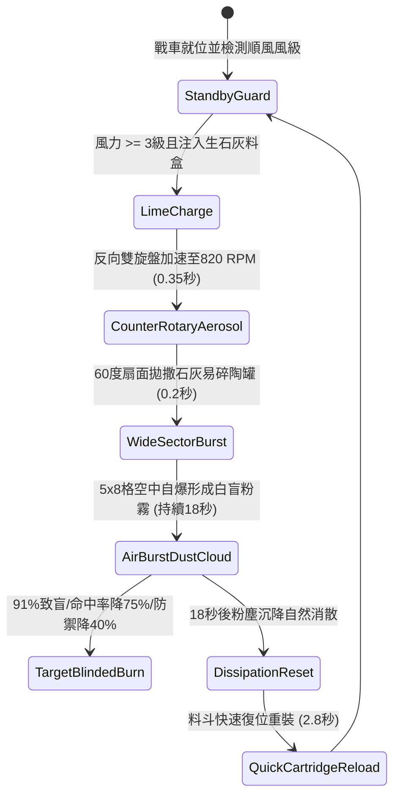

# 戰場夜戰順風施放連環風力飛石旋盤戰車扇面拋射生石灰迷盲敵軍前鋒第二階狀態機規格書

<!-- doc_id: doc_spec_1037 -->

## 1. 核心定位與設計理念

### 1.1 系統定位
本規格定義戰場夜戰白刃戰前夕，工兵部隊順風布署「連環風力飛石旋盤戰車第二階」（代碼：`WIND-ROTARY-STONE-LIME-BLIND02`，WBS 代碼：`FORM-256`）之超廣角石灰致盲狀態機。第二階戰車於反向雙層旋盤上增設了氣流霧化擴散導嘴與易碎薄紙石灰陶罐混合料斗。啟動時順風將生石灰微粉與壓制碎石以 60 度廣角拋撒至前方 5x8 格前鋒交戰走廊，於空中自爆形成高濃度燒灼粉霧，91% 機率造成敵前鋒部隊眼睛嚴重灼傷失明、普通攻擊命中率暴跌 75%、陣型格擋減傷永久扣減 40%，並陷入 6 秒恐慌亂走狀態。

### 1.2 設計目標與單一真相
* **氣溶膠粉塵致盲**：非單點投擲，而是藉由風力與高速旋盤離心力霧化，達成整排前鋒同時失明。
* **物理防禦體系瓦解**：因失明無法維持舉盾陣型，強行剝奪敵陣減傷加成。
* **單一真相來源**：嚴禁於文件末端附加補丁，所有機制、數值與判定邏輯均在此統一定義。

---

## 2. 狀態機架構與轉換流程

---

## 3. 核心數值與計算公式

### 3.1 基礎參數配置表
| 參數名稱 | 基準數值 | 規格說明與限制條件 |
| :--- | :--- | :--- |
| **有效射程與覆蓋** | 3 ~ 8 格 / 5x8 格 | 60 度廣角扇面，覆蓋敵前沿 40 格區域 |
| **生石灰粉塵濃度** | 120 g / m³ | 達到化學灼傷與強烈刺激眼結膜之臨界濃度 |
| **前鋒失明致盲率** | 91% | 對無防護步兵與騎兵生效；面罩防護為 45% |
| **命中率扣減懲罰** | -75% 普攻命中 | 致盲期間部隊無法精確瞄準與格擋 |
| **陣型減傷扣減** | -40% 物理防禦 | 因部隊潰散恐慌，盾陣防禦係數強制失效 |
| **恐慌亂走時間** | 6.0 秒 | 敵軍不受控制向四周盲目衝撞 |
| **迷盲煙幕滯留** | 18.0 秒 | 順風 3~4 級標準滯留；強風縮短至 10 秒 |
| **料盒連射裝載** | 4 輪打擊 | 滿載 4 組密封防潮石灰料盒 |

### 3.2 化學灼傷與命中懲罰公式
$$P_{\text{blind}} = \min\left(0.98, \, 0.91 \times \left(1 + \frac{W_{\text{wind}} - 3}{12}\right) \times \left(1 - \frac{M_{\text{visor}}}{100}\right)\right)$$
$$\text{HitRate}_{\text{effective}} = \max\left(0.05, \, \text{HitRate}_{\text{base}} \times (1 - 0.75)\right)$$
* $M_{\text{visor}}$：敵方防護頭盔面罩遮蔽係數（0 ~ 50）。
* 致盲生效時，目標單位強制附加 `LIME_BLINDED_PANIC`，並中斷所有當前施法與聚氣技能。

---

## 4. 戰術反制與例外判定

1. **生醋濕布護面**：若敵方精銳部隊預先備有浸透生醋之麻布遮掩口鼻眼部，失明率自 91% 降至 25%，恐慌免疫。
2. **大雨傾盆化解**：若戰場降雨強度達中雨以上，生石灰空中遇水提前反應沉降並稀釋，致盲效果衰減 70%。
3. **風向突變倒灌**：若戰場風向突轉逆風，拋撒之石灰粉霧將倒灌自軍前排，造成誤傷。

---

## 5. 驗收測試案例（Test Cases）

* **TC-01（順風扇面拋撒生成粉霧）**：在 4 級順風下啟動拋射，驗證 5x8 格區域於 0.5 秒內生成 `LIME_DUST_HAZARD` 地貌。
* **TC-02（前鋒部隊失明與命中扣減校驗）**：配置 20 名敵前鋒步兵，驗證 91% 單位命中率扣減 75% 且防禦值扣減 40%。
* **TC-03（面罩防護單位阻抗判定）**：配置佩戴鐵面罩之重甲死士，驗證失明率精準折減至 45%（±2% 容許區間）。
