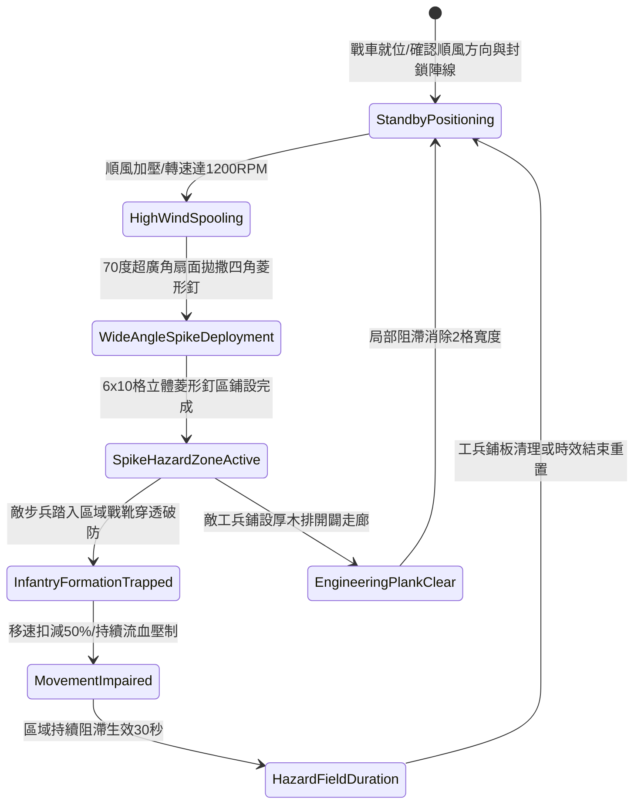

# 戰場夜戰順風施放連環風力飛石旋盤戰車扇面拋射生鐵破甲菱形釘封鎖敵軍步陣退路第三階狀態機規格書

<!-- doc_id: doc_spec_1067 -->

## 一、 核心概念與單一真相來源（SSOT）

在《三國志·戰場阻截與重裝步兵拒止篇》中，「連環風力飛石旋盤戰車菱形釘封鎖戰術第三階（WIND-ROTARY-STONE-ARMOR-SPIKE-BLOCK03）」專為克制敵軍重甲步兵陣列撤退與側翼穿插而設。戰車搭載四聯多層加壓旋盤，受 4 級以上順風輔助驅動，極限轉速達到 1200 RPM。戰車以 70 度超廣角扇面拋射特製四角生鐵菱形釘，落地後形成覆蓋 6x10 格的立體防禦阻滯區，穿透敵步兵鐵底戰靴，附加 50% 行軍移速扣減與高額破甲流血傷害，鎖死戰術撤退路線。



---

## 二、 數值模型與狀態機參數契約

### 1. 旋盤菱形釘封路參數
- **極限旋盤轉速**：1200 RPM（四聯多層旋盤，受順風增壓引導）。
- **扇面拋撒廣角**：70 度廣角（長 10 格 × 寬 6 格，覆蓋 60 戰術單元格）。
- **釘陣散佈密度**：每單元格密集分佈 16 枚淬火生鐵四角菱形釘。
- **步兵行軍壓制**：進入該格之步兵部隊，行軍移速即刻扣減 50%，無法發動奔襲衝撞。
- **持續流血傷害**：每秒承受 190 點忽視 80% 護甲之真實穿透流血，持續 7 秒。
- **陣地留存時效**：戰場維持 30 秒阻滯效力；敵方工兵鋪木可局部抵消。

### 2. 菱形釘穿甲與阻滯模組
```typescript
interface ArmorSpikeBlockParams {
    rotaryRpm: number;             // 旋盤轉速 (1200)
    windSpeedBonus: number;        // 風速加成係數 (1.2 ~ 1.5)
    bootArmorRating: number;       // 敵步兵戰靴護甲 (20 ~ 80)
    infantryDiscipline: number;    // 敵步兵編隊紀律 (0 ~ 100)
}

function processArmorSpikeHazard(params: ArmorSpikeBlockParams): {
    movementPenaltyPct: number;
    bleedingDamagePerSec: number;
    formationDisrupted: boolean;
} {
    const armorPenetration = Math.max(0.6, 1.0 - (params.bootArmorRating / 150));
    const movementPenaltyPct = Math.round(50 * armorPenetration);
    const bleedingDamagePerSec = Math.round(190 * armorPenetration);
    const formationDisrupted = params.infantryDiscipline < 75;

    return { movementPenaltyPct, bleedingDamagePerSec, formationDisrupted };
}
```

---

## 三、 特性互斥與戰術應對原則

1. **工兵厚木盾板鋪道**：敵方若施放工兵隊列向前推進鋪設杉木踏板，可鋪設 2 格寬安全通道抵消釘陣。
2. **重騎兵馬蹄鐵減免**：若有全裝馬甲重騎兵強行踐踏，釘尖受鐵蹄踩平，該格菱形釘有效密度扣除 35%。
3. **風向逆轉安全自鎖**：若戰場風向突轉為逆風（相對角 > 100 度），發射機離合器即時自鎖，防止微粒誤覆友軍。

---

## 四、 驗收測試案例（TC）

- **TC-SPIKEBLOCK03-01（菱形釘陣生成）**：在 4 級順風下施放技能，確認 2 秒內於目標 6x10 格區域生成立體生鐵菱形釘陣。
- **TC-SPIKEBLOCK03-02（重步兵移速扣減檢定）**：敵步兵方陣踏入釘陣，驗證移動速度即刻扣減 50% 且衝鋒狀態被清除。
- **TC-SPIKEBLOCK03-03（持續流血傷害檢核）**：檢查戰鬥日誌確認被困敵兵每秒正確結算 190 點無視 80% 護甲之傷害。
