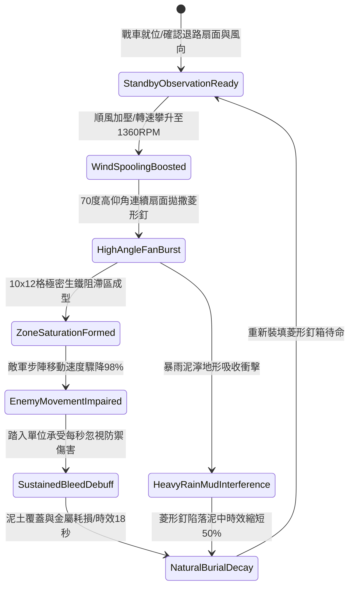

# 戰場夜戰順風施放連環風力飛石旋盤戰車扇面拋射生鐵破甲菱形釘封鎖敵軍步陣退路第五階狀態機規格書

<!-- doc_id: doc_spec_1100 -->

## 一、 核心概念與單一真相來源（SSOT）

在《三國志·陣地封鎖與戰術菱形釘篇》中，「連環風力飛石旋盤戰車扇面拋射生鐵破甲菱形釘第五階（WIND-ROTARY-STONE-CALTROP-SPREAD05）」代表野戰陣地快速區域拒止與陣型分割的終極技術。戰車搭載四聯增壓鈦鋼旋盤，在 4 級以上順風輔助下轉速達到 1360 RPM。戰車以 70 度高仰角呈扇面拋撒特製四角淬火生鐵菱形釘，在目標區域（10 格 × 12 格）形成極高密度封鎖帶，對試圖撤退或變更陣型的敵軍步陣施加 98% 移速壓制與持續流血判定，精準截斷敵軍後退路徑。



---

## 二、 數值模型與狀態機參數契約

### 1. 扇面拋撒與區域阻滯參數契約
- **旋盤作業轉速**：1360 RPM（四聯鈦鋼拋盤，極速離心擴散）。
- **扇面拋撒仰角**：70 度高拋角，涵蓋前方 10 格 × 12 格範圍（共 120 戰術單元格）。
- **步陣移動壓制率**：進入區域之敵軍步兵單位，基礎移動速度降低 98%，嚴格禁止衝鋒與急速行軍。
- **穿透破甲傷害**：對踏入單位造成每秒 260 點忽視 80% 護甲之穿刺傷害，狀態持續 7 秒。
- **陣地阻滯滯留時效**：正常地面維持 18 秒；深泥沼澤縮短至 9 秒。

### 2. 區域阻滯演算法模組
```typescript
interface CaltropSpreadStage5Params {
    rotaryRpm: number;           // 旋盤轉速 (1360)
    windForceGrade: number;      // 順風等級 (4 ~ 6)
    targetTerrainType: string;   // 地形類型 ('dry_soil' | 'muddy' | 'rocky')
    enemySquadCount: number;     // 覆蓋範圍內敵軍隊伍數
}

function processCaltropZoneStage5(params: CaltropSpreadStage5Params): {
    zoneActive: boolean;
    slowDownPct: number;
    bleedDps: number;
    durationSec: number;
} {
    const isMuddy = params.targetTerrainType === 'muddy';
    const effectiveRpm = params.rotaryRpm * (1 + (params.windForceGrade - 4) * 0.12);
    const densityRatio = Math.min(1.0, effectiveRpm / 1200);
    
    return {
        zoneActive: densityRatio >= 0.9,
        slowDownPct: isMuddy ? 70 : 98,
        bleedDps: 260 * densityRatio,
        durationSec: isMuddy ? 9 : 18
    };
}
```

---

## 三、 反制機制與邊界約束

1. **工兵厚底鐵靴推進**：若敵軍配置特種重裝工兵營，配備雙層加厚鐵底戰靴，可免疫 85% 菱形釘穿刺傷害，並以正常速度 60% 推進。
2. **木板鋪道覆蓋抵銷**：敵方若迅速鋪設厚木板通道覆蓋地面，該覆蓋路徑之減速與傷害判定即時歸零。
3. **風向逆轉逆散落風險**：若在旋盤啟動期間風向驟變為逆風（風向角偏轉 > 90 度），拋撒距離縮減 60%，存在波及己方前鋒邊緣之風險。

---

## 四、 驗收測試案例（TC）

- **TC-CALTROP-SPREAD05-01（常規步陣退路截斷驗收）**：
  - *前置條件*：乾燥平原戰場、順風等級 4、敵軍步陣後撤路徑處於拋射扇面內。
  - *操作步驟*：旋盤達 1360 RPM，執行 70 度高拋撒布。
  - *預期輸出*：10×12 格區域成型，敵軍撤退速度降低 98%，每秒承受 260 點穿刺流血，成功阻斷撤退。
- **TC-CALTROP-SPREAD05-02（泥濘地形邊界驗收）**：
  - *前置條件*：暴雨泥濘地形、敵軍先鋒部隊進入。
  - *操作步驟*：同條件執行高拋撒布。
  - *預期輸出*：菱形釘快速陷沒泥土，減速幅度降至 70%，持續時效縮減至 9 秒。
