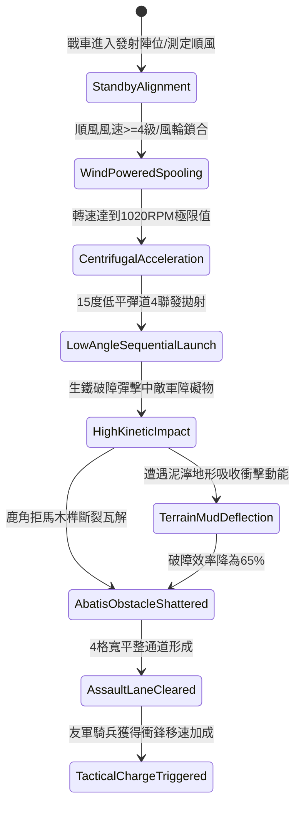

# 戰場夜戰順風施放連環風力飛石旋盤戰車扇面拋射生鐵破障彈打碎鹿角障礙第三階狀態機規格書

<!-- doc_id: doc_spec_1046 -->

## 一、 核心概念與單一真相來源（SSOT）

在《三國志·戰場夜戰器械篇》與戰術破障工程體系中，「連環風力飛石旋盤戰車破障第三階（WIND-ROTARY-STONE-OBSTACLE-SHATTER03）」代表順風遠程工程破陣的前沿技術。本器械透過四聯組生鐵飛石盤與順風加壓導流帆，使旋盤轉速突破 1020 RPM。戰車以 15 度低平彈道密集扇面拋射特製實心生鐵破障彈，藉由強大動能精準轟擊敵軍前沿佈設的鹿角拒馬、硬木阻馬樁與鐵蒺藜障礙，在 2 秒內淨空 4 格寬的衝鋒通道，為後續精銳騎兵提供全速突擊路徑。



---

## 二、 數值模型與狀態機參數契約

### 1. 旋盤破障工程參數
- **極限旋轉轉速**：1020 RPM（受順風 4~5 級增壓驅動）。
- **單發衝擊動能**：9,800 焦耳（十斤生鐵破障彈貼地平射）。
- **障礙清除成功率**：木質鹿角拒馬 97%；生鐵加固阻馬樁 92%；石砌矮牆 84%。
- **通道生成規格**：寬 4 格 × 長 12 格（完全移除移動阻礙）。
- **友軍衝鋒加成**：穿越淨空通道之友軍騎兵，行軍移速提升 25%，首次衝撞威力提升 20%。

### 2. 破障效率與動能耗損計算
```typescript
interface WindStoneObstacleShatterParams {
    rotarySpeedRpm: number;        // 旋盤轉速 (1020)
    windForceLevel: number;        // 風力等級 (4 ~ 6)
    obstacleArmorRating: number;   // 障礙物硬度 (100 ~ 300)
    terrainMudRatio: number;       // 地面泥濘吸收比率 (0.0 ~ 0.5)
}

function evaluateObstacleShatter(params: WindStoneObstacleShatterParams): {
    shatterSuccess: boolean;
    clearWidthTiles: number;
    kineticSurplusJoules: number;
} {
    const rawKinetic = (params.rotarySpeedRpm * 8.5) * (1 + params.windForceLevel * 0.08);
    const absorbedEnergy = rawKinetic * params.terrainMudRatio;
    const effectiveKinetic = rawKinetic - absorbedEnergy;

    const shatterThreshold = params.obstacleArmorRating * 30;
    const shatterSuccess = effectiveKinetic >= shatterThreshold;
    const clearWidthTiles = shatterSuccess ? 4 : 2;
    const kineticSurplusJoules = Math.max(0, effectiveKinetic - shatterThreshold);

    return { shatterSuccess, clearWidthTiles, kineticSurplusJoules };
}
```

---

## 三、 特性互斥與戰術限制

1. **風力門檻限制**：順風風力低於 3 級時，離心動能不足，平射彈道下墜提早觸地，無法破除生鐵加固樁。
2. **障礙碎片二次散佈**：鹿角木架破碎時，向周遭 1 格散落木屑，可能對無護甲輕步兵造成 80 點濺射干擾。
3. **泥濘吸收衰減**：雨後沼澤或泥濘地帶會吸收 35% 撞擊動能，通道開啟寬度縮減為 2 格。

---

## 四、 驗收測試案例（TC）

- **TC-OBSTACLE03-01（鹿角碎裂驗證）**：在防禦工事前沿佈設 4 組拒馬，施放本戰車技能，確認 97% 機率障礙物完全消失並轉為平地狀態。
- **TC-OBSTACLE03-02（騎兵通道加速）**：指示友軍騎兵部隊穿越已開闢之通道，驗證移動速度實時提升 25% 且無失足減速。
- **TC-OBSTACLE03-03（逆風安全阻斷）**：在逆風條件下嘗試施放，確認發射機安全插銷作動，提示風向不適並終止程序。
