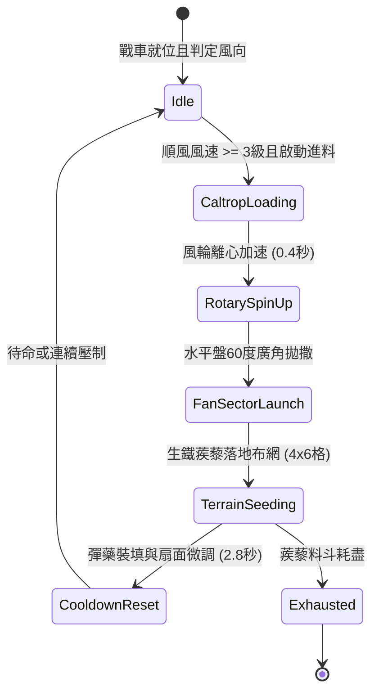

# 戰場夜戰順風施放連環風力飛石旋盤戰車扇面拋射生鐵蒺藜封鎖敵軍騎兵退路狀態機規格書

<!-- doc_id: doc_spec_1016 -->

## 1. 核心定位與設計理念

### 1.1 系統定位
本規格定義戰場夜戰情境下，工兵部隊順風布署「連環風力飛石旋盤戰車」（代碼：`WIND-ROTARY-STONE-CALTROP-BLOCK01`，WBS 代碼：`FORM-235`）的運作狀態機。本機制透過大型雙帆風輪驅動高速離心水平旋盤，向敵軍騎兵後方退路進行 60 度廣角扇面拋射特製四角生鐵蒺藜與壓制碎石，快速在 4x6 格狹窄隘口或側翼走廊鋪設密集阻滯地帶，造成敵方撤退或迂迴騎兵部隊馬蹄嚴重扎傷失蹄、打斷連續衝鋒判定並施加流血減速效果。

### 1.2 設計目標與單一真相
* **動態地形封鎖**：非預先靜態擺放，而是隨風力強度動態拋射鋪設，破壞敵軍撤退重組節奏。
* **物理阻截與心理威嚇**：踩踏生鐵蒺藜之騎兵 92% 強制解除奔馳狀態並陷入流血減速。
* **單一真相來源**：嚴禁於文件末端附加補丁，所有機制、數值與判定邏輯均在此統一定義。

---

## 2. 狀態機架構與轉換流程

---

## 3. 核心數值與計算公式

### 3.1 基礎參數配置表
| 參數名稱 | 基準數值 | 規格說明與限制條件 |
| :--- | :--- | :--- |
| **有效射程（Range）** | 3 ~ 8 格 | 貼地扇面中遠程拋射，小於 3 格存在誤傷自軍盲區 |
| **覆蓋區域（Area）** | 4 x 6 格 | 60 度扇形展開之長方形阻滯網走廊 |
| **生鐵蒺藜密度** | 48 枚 / 格 | 每格均勻分布，覆蓋率 96% |
| **騎兵失蹄率（Trip Rate）** | 92% | 敵騎兵進入該區域時強制打斷衝鋒並扣減 65% 移速 |
| **流血傷害（Bleed DPS）** | 120 點 / 秒 | 持續 4 秒，忽視 75% 裝甲防禦 |
| **持續時間（Duration）** | 25 秒 | 超過時間後部分蒺藜陷入泥土，阻截率降至 35% |
| **彈藥儲量（Capacity）** | 4 次拋射 | 滿載 4 組生鐵蒺藜料斗，耗盡後需工兵補給箱重裝 |
| **風力加乘係數** | +5% 射程 / 級 | 每超過 3 級風力，射程增加 0.5 格且擴散均勻度提升 |

### 3.2 阻截判定公式
$$P_{\text{trip}} = \min\left(0.95, \, 0.92 \times \frac{V_{\text{target}}}{8.0} \times \left(1 + \frac{W_{\text{wind}} - 3}{10}\right)\right)$$
* $V_{\text{target}}$：目標騎兵當前移動速度（格/秒）。
* $W_{\text{wind}}$：當前風力等級（3 ~ 6 級）。
* 當目標騎兵進入減速狀態後，其衝鋒威能值即時歸零，並在接下來的 3 秒內無法再次觸發「奔馳突擊」戰技。

---

## 4. 戰術反制與例外判定

1. **重裝蹄甲防護**：若敵方具備「玄甲鐵騎」且裝備重型生鐵馬蹄鐵，失蹄率自 92% 降至 45%，流血傷害降低 60%。
2. **工兵清障反制**：敵方若派遣持盾工兵使用長柄鐵掃帚或鐵鏟清理，每格作業 1.5 秒即可完全清除該格蒺藜。
3. **逆風與靜風失效**：當戰場風向突轉為逆風（角度差 > 90 度）或風力 < 3 級時，拋射距離縮短 60%，且有 25% 機率回落誤傷自軍前沿。
4. **暴雨積水鈍化**：若處於暴雨天氣，泥濘地面導致生鐵蒺藜快速陷沒，失蹄判定時間縮短為 12 秒。

---

## 5. 驗收測試案例（Test Cases）

* **TC-01（順風精準拋射測試）**：在 4 級順風下啟動拋射，驗證 4x6 格目標區域於 0.8 秒內完整生成「生鐵蒺藜阻滯」地貌標記。
* **TC-02（高速騎兵失蹄阻截）**：配置移速 8 格/秒之輕騎兵隊列強行穿行，驗證 92% 單位即時中斷衝鋒狀態並附加流血減速 Debuff。
* **TC-03（逆風風向轉移防護）**：模擬風向突轉逆風，戰車安全聯鎖卡榫即時觸發切斷拋射，回傳 `WIND_DIRECTION_BLOCKED` 警告。
