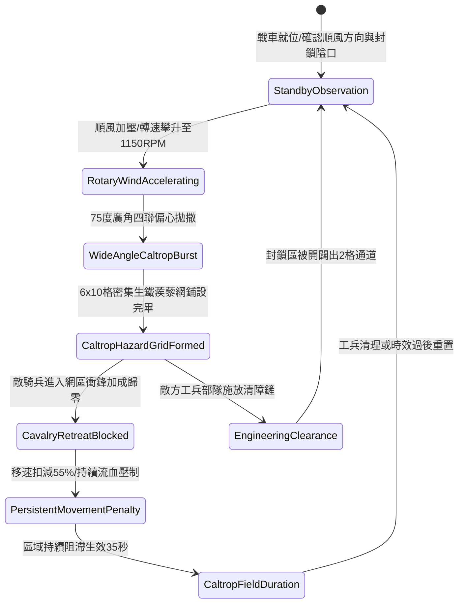

# 戰場夜戰順風施放連環風力飛石旋盤戰車扇面拋射生鐵蒺藜封鎖敵軍騎兵退路第三階狀態機規格書

<!-- doc_id: doc_spec_1061 -->

## 一、 核心概念與單一真相來源（SSOT）

在《三國志·戰場阻截與陣地拒止篇》中，「連環風力飛石旋盤戰車蒺藜封路戰術第三階（WIND-ROTARY-STONE-CALTROP-BLOCK03）」為夜戰截斷敵騎退路與阻礙包抄的高效陣地器械。戰車配備四聯雙向偏心旋盤，在 4 級以上順風輔助下轉速達到 1150 RPM。戰車以 75 度超廣角拋撒特製八角生鐵蒺藜，於 2 秒內在目標區域鋪設一條覆蓋 6x10 格的立體阻滯網，使敵軍騎兵衝鋒動能清零並附加持久流血與移速壓制，徹底封鎖戰略撤退通道。



---

## 二、 數值模型與狀態機參數契約

### 1. 旋盤蒺藜封路參數
- **極限旋盤轉速**：1150 RPM（四聯偏心離心盤，順風增速）。
- **扇面拋撒廣角**：75 度超廣角（覆蓋長 10 格 × 寬 6 格，共 60 戰術單元格）。
- **阻滯網密度**：每單元格散佈 18 枚八角生鐵蒺藜。
- **騎兵動能壓制**：部隊進入蒺藜格，衝鋒速度即刻歸零，移動速度扣減 55%。
- **持續傷害效應**：每秒承受 180 點忽視 85% 護甲之穿透流血傷害，持續 8 秒。
- **地形留存時效**：戰場維持 35 秒阻滯效果；若遭敵工兵清理則縮減。

### 2. 阻滯效果與部隊受創計算模組
```typescript
interface WindStoneCaltropBlockParams {
    rotaryRpm: number;             // 旋盤轉速 (1150)
    windFactor: number;            // 順風係數 (1.2 ~ 1.5)
    cavalryBardingType: "unarmored" | "lightLeather" | "heavyIron";
    traverseSpeed: number;         // 穿越速度 (格/秒)
}

function processCaltropBlockHazard(params: WindStoneCaltropBlockParams): {
    chargeSuppressed: boolean;
    speedReductionPct: number;
    bleedingDamagePerSec: number;
} {
    const bardingResist = params.cavalryBardingType === "heavyIron" ? 0.35 :
                          params.cavalryBardingType === "lightLeather" ? 0.15 : 0.0;
    const speedReductionPct = Math.round(55 * (1 - bardingResist * 0.5));
    const bleedingDamagePerSec = Math.round(180 * (1 - bardingResist));

    return { chargeSuppressed: true, speedReductionPct, bleedingDamagePerSec };
}
```

---

## 三、 特性互斥與戰術應對原則

1. **工兵厚底踏板推進**：若敵方派遣鋪設厚木踏板的重裝工兵前導，可抵消該路徑的蒺藜穿透效果。
2. **重甲步兵推進抗性**：重裝鐵甲步兵因行軍速度較慢且甲靴加固，受流血傷害降低 50%，移速扣減降為 25%。
3. **風向逆轉拋撒鎖定**：若風向轉為逆風（夾角 > 100 度），發射機離合器自動斷開，禁止施放以防覆蓋友軍。

---

## 四、 驗收測試案例（TC）

- **TC-CALTROP03-01（廣角蒺藜網生成）**：在順風條件下施放技能，確認 2 秒內於指定 6x10 格區域生成立體生鐵蒺藜阻滯格。
- **TC-CALTROP03-02（騎兵衝鋒截斷檢定）**：敵騎兵衝入蒺藜區域，驗證衝鋒狀態即時解除且移速扣減 55%。
- **TC-CALTROP03-03（持續流血數值檢驗）**：檢查戰鬥日誌確認被困部隊每秒正確扣除 180 點流血傷害。
