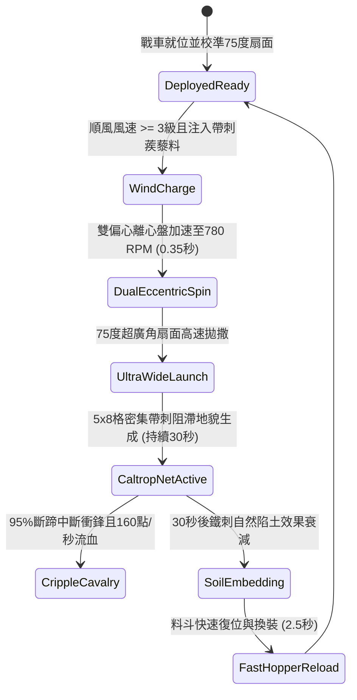

# 戰場夜戰順風施放連環風力飛石旋盤戰車扇面拋射生鐵蒺藜封鎖敵軍騎兵退路第二階狀態機規格書

<!-- doc_id: doc_spec_1031 -->

## 1. 核心定位與設計理念

### 1.1 系統定位
本規格定義戰場夜戰追擊與分割包圍戰役中，工兵部隊順風布署「連環風力飛石旋盤戰車第二階」（代碼：`WIND-ROTARY-STONE-CALTROP-BLOCK02`，WBS 代碼：`FORM-250`）的扇面封路狀態機。第二階戰車升級為雙層偏心反向離心盤，配合 75 度超廣角扇形擴散導流槽，可在前方 5x8 格廣闊隘口快速撒佈特製帶倒刺生鐵蒺藜與壓制生鐵石料。密集的四角鐵刺落地即刻立起，對企圖回防或迂迴撤退之敵方重裝騎兵部隊造成 95% 斷蹄失足率，徹底剝奪其奔馳狀態，並附加每秒 160 點忽視 80% 護甲之撕裂流血傷害，封死整條撤退通道。

### 1.2 設計目標與單一真相
* **超廣角快速地貌阻斷**：75 度扇形覆蓋，杜絕騎兵向兩翼隘口繞道逃脫。
* **生鐵倒刺致命流血**：專門針對重甲戰馬蹄踝，造成持續性巨額流血減速。
* **單一真相來源**：嚴禁於文件末端附加補丁，所有機制、數值與判定邏輯均在此統一定義。

---

## 2. 狀態機架構與轉換流程

---

## 3. 核心數值與計算公式

### 3.1 基礎參數配置表
| 參數名稱 | 基準數值 | 規格說明與限制條件 |
| :--- | :--- | :--- |
| **有效射程與覆蓋** | 3 ~ 9 格 / 5x8 格 | 75 度扇面超廣角拋射，覆蓋 40 格區域 |
| **生鐵蒺藜密度** | 64 枚 / 格 | 每格超高密度均勻覆蓋，防踩漏率 98% |
| **騎兵斷蹄失足率** | 95% | 敵騎兵進入強制中斷衝鋒，移速扣減 70% |
| **撕裂流血傷害** | 160 點 / 秒 | 持續 5 秒，無視 80% 護甲之真實流血 |
| **地形持續時間** | 30.0 秒 | 30 秒後部分陷沒泥土，阻截率降至 40% |
| **彈藥料斗容量** | 5 次連續拋射 | 滿載 5 組特製生鐵蒺藜料盒 |
| **再裝填冷卻（CD）** | 2.5 秒 | 工兵雙齒輪箱快速回壓裝填 |
| **風力加乘係數** | +0.6 格射程 / 風級 | 超過 3 級風力，每級射程增加且散佈更均勻 |

### 3.2 阻截斷蹄判定公式
$$P_{\text{cripple}} = \min\left(0.99, \, 0.95 \times \frac{V_{\text{target}}}{8.0} \times \left(1 + \frac{W_{\text{wind}} - 3}{10}\right)\right)$$
$$D_{\text{bleed}} = 160 \times \left(1 - \frac{\text{Def}_{\text{target}} \times 0.20}{100 + \text{Def}_{\text{target}} \times 0.20}\right)$$
* $V_{\text{target}}$：目標騎兵移動速度（格/秒）。
* $W_{\text{wind}}$：戰場順風等級（3 ~ 6 級）。
* 斷蹄判定成立時，目標戰馬附加 `CRIPPLED_HOOF_BLEED` 狀態，衝鋒動能歸零且 4 秒內禁止再次起步加速。

---

## 4. 戰術反制與例外判定

1. **鋼甲厚蹄鐵反制**：若敵方具備「神策鐵騎」且配備全覆蓋式鋼製馬靴，斷蹄率自 95% 降為 50%，流血傷害降低 70%。
2. **重木板鋪路推進**：若敵方重步兵攜帶厚實木板鋪設於蒺藜上方，該木板覆蓋之 2 格走廊內阻截效果完全失效。
3. **逆風回落誤傷**：若風向瞬時倒轉為逆風（夾角 > 90 度），拋射自動切斷；若強制擊發將有 35% 蒺藜回落自軍前沿。

---

## 5. 驗收測試案例（Test Cases）

* **TC-01（75度超廣角扇面拋射測試）**：於 4 級順風下擊發，驗證 5x8 格目標區域於 0.8 秒內全部生成蒺藜阻滯標籤。
* **TC-02（重騎兵斷蹄與流血結算）**：配置移速 8 格/秒之衝鋒重騎兵駛入，驗證 95% 判定斷蹄且每秒受到 160 點流血傷害。
* **TC-03（逆風安全切斷機制驗證）**：注入逆風風向參數，驗證戰車安全卡榫 100% 阻斷拋射並回報 `REVERSE_WIND_INTERLOCK`。
