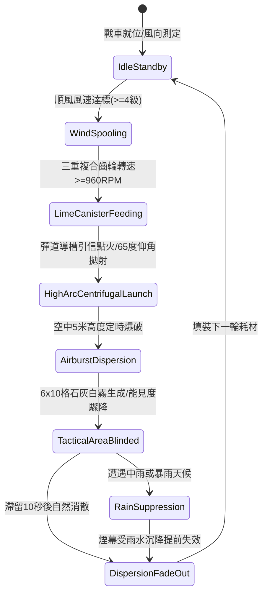

# 戰場夜戰順風施放連環風力飛石旋盤戰車扇面拋射石灰煙幕阻礙敵軍視野第三階狀態機規格書

<!-- doc_id: doc_spec_1043 -->

## 一、 核心概念與單一真相來源（SSOT）

在《三國志·戰場夜戰器械篇》與戰術陣型體系中，「連環風力飛石旋盤戰車第三階（WIND-ROTARY-STONE-LIME-SCREEN03）」為野戰與夜戰夜幕掩護戰術的進階形態。透過三重齒輪同軸加速與風帆鼓風機構，旋盤轉速突破 960 RPM，以 65 度高拋俯角將改進型生石灰脆殼陶罐高頻率扇面拋射至敵軍前鋒縱深陣列。石灰罐落地前藉引信爆開，形成覆蓋 6x10 格區域的微粒懸浮白霧，大幅削弱目標遠程命中率與行軍動能，為友軍突擊創造戰術縱深。



---

## 二、 數值模型與狀態機參數契約

### 1. 旋盤拋射與煙幕參數
- **基準轉速（Base RPM）**：960 RPM（需順風 >= 4 級風力加持）。
- **扇面散佈縱深**：長 10 格 × 寬 6 格（覆蓋 60 戰術單元格）。
- **視野阻隔減益**：處於煙霧格內之敵軍部隊，遠程攻擊命中率扣減 80%，近戰視野縮減為周圍 1 格。
- **動能壓制與失衡**：進入煙霧覆蓋區的騎兵衝鋒加成完全無效，部隊行軍移速扣減 35%，士氣持續衰退 8 點/秒。
- **持續滯空時間**：常態氣候持續 10 秒；若戰場濕度高於 85% 縮短至 5 秒。

### 2. 戰術傷害與干擾公式
```typescript
interface WindStoneLimeScreenParams {
    rotarySpeedRpm: number;        // 當前轉速（960）
    canisterCount: number;         // 連裝陶罐數量（4罐）
    windFactor: number;            // 順風加成係數（4級風=1.25，5級風=1.45）
    targetGritResist: number;       // 目標護目與防護係數 (0.0 ~ 0.5)
}

function calculateLimeScreenSuppression(params: WindStoneLimeScreenParams): {
    accuracyPenalty: number;
    speedReduction: number;
    cloudDurationSec: number;
} {
    const effectiveDensity = Math.min(1.0, (params.rotarySpeedRpm / 900) * params.windFactor * 0.7);
    const accuracyPenalty = Math.max(0.4, 0.85 * effectiveDensity * (1 - params.targetGritResist));
    const speedReduction = Math.min(0.5, 0.35 * effectiveDensity);
    const cloudDurationSec = 10 * (params.windFactor >= 1.4 ? 0.8 : 1.0);

    return { accuracyPenalty, speedReduction, cloudDurationSec };
}
```

---

## 三、 特性互斥與天候反制原則

1. **強逆風阻斷（Headwind Lockout）**：若戰場風向轉為逆風（相對航向角 > 120 度），發射機自鎖機構啟動，禁止施放以防石灰微粒倒灌友軍。
2. **暴雨沉降（Rainstorm Quench）**：雨天環境石灰吸水結塊迅速沉降，煙幕持續時間衰減 70%，且無法阻礙敵方視線。
3. **精銳蒙面部隊減免**：佩戴濕面巾或護面甲冑之精銳先鋒，受視野懲罰降低 50%。

---

## 四、 驗收測試案例（TC）

- **TC-LIME03-01（順風發射判定）**：在 4 級順風環境下點擊施放，確認戰車 1.2 秒內完成提速並精準在指定 6x10 格扇面區域生成白色煙霧粒子。
- **TC-LIME03-02（命中率懲罰檢驗）**：被覆蓋之敵軍弓手部隊發射箭矢，驗證其命中率確實依公式實時扣減 80%。
- **TC-LIME03-03（逆風自鎖機制）**：動態將戰場風向調整為逆風，觸發警告提示並確認按鈕鎖定不可施放。
