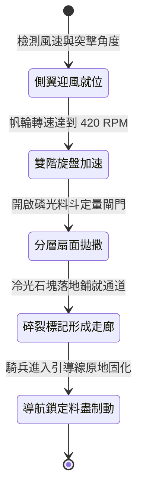

<!-- doc_id: doc_spec_1004 -->
# 戰場夜戰順風施放連環風力飛石旋盤戰車扇面拋射磷光標記導引騎兵突擊狀態機規格書

## 模組識別碼
- 模組編號：`FORM-223`
- 狀態機代碼：`WIND-ROTARY-STONE-PHOSPHOR-FLANK01`
- 類別：戰場夜戰順風扇面引導與突擊標記戰車狀態機
- 適用場景：平原夜戰、順風引導騎兵側翼包抄、標定敵軍弱點通道

---

## 1. 核心概念與作戰原型

夜間大兵團交鋒中，騎兵穿插極易因視線不良而誤入敵軍深溝或鹿角重圍。為在無明火暴露的前提下指引突擊路徑，工兵營配置「連環風力飛石旋盤戰車（磷光扇面導引型）」。

### 1.1 機制運作與配合模式
1. **多翼帆輪驅動雙階離心盤**：戰車頂部裝設六葉帆布風輪，在順風條件下透過傘齒輪系驅動兩組不同直徑的離心拋石盤。
2. **扇形分層拋撒磷光重石**：大盤拋射外徑較遠，小盤覆蓋內側，將浸染螢石粉與松脂的白色硬石呈 45 度扇面均勻散佈於敵陣側翼。
3. **撞擊碎裂形成夜間光標**：磷光石落地碎裂後釋放微弱冷光，於地面鋪就一條清晰可見的三格寬安全引導線。
4. **騎兵衝鋒動能精準導航**：後續奔襲的輕重騎兵依循光標全速突擊，不僅避開地面障礙，且獲得目標鎖定增益。

---

## 2. 數值參數與影響權重

| 參數名稱 | 數值 / 範圍 | 說明 |
| :--- | :--- | :--- |
| **扇面引導角 (`GuidanceArcAngle`)** | 45 度扇形深度 6 格 | 精確劃定騎兵側翼突擊走廊 |
| **引導路徑加速加成 (`CorridorSpeedBuff`)** | +25% 移動速度 | 循光前進免除夜戰行軍阻力與減速懲罰 |
| **突擊暴擊率提升 (`CavalryCritBonus`)** | +15% 暴擊機率 | 依照光標鎖定敵陣薄弱結合部 |
| **磷光持續滯留時長 (`PhosphorDuration`)** | 24 秒 | 提供足夠時間讓整支騎兵大隊穿插通過 |
| **彈料儲備容量 (`AmmoCapacity`)** | 200 枚磷光石 (作業 15 秒) | 耗盡後平滑轉入前沿阻斷姿態 |

---

## 3. 狀態機轉換定義

### 3.1 狀態細節描述
- **側翼迎風就位 (POSITION_FLANK)**：戰車部署於順風側翼，校正扇面角度對準敵陣結合部。
- **雙階旋盤加速 (DUAL_DISC_SPIN)**：風力驅動齒輪系，大小拋盤達到同步拋射初速。
- **分層扇面拋撒 (LAYERED_SCATTER)**：大小盤交替將磷光石甩向內外兩側，構建連續彈著點。
- **碎裂標記形成走廊 (LIGHT_PATH_FORMED)**：地面碎石散發冷光，勾勒出三格寬衝鋒通道。
- **導航鎖定料盡制動 (LOCKED_PATH_BRAKE)**：彈藥拋盡，煞車蹄片鎖死車軸，化作固定掩體。

---

## 4. 戰鬥公式與判定

### 4.1 引導通道鋪設判定
$$\text{PathCoverage} = \min(0.95, \frac{\text{DiscRPM}}{420} \times (1 + \text{WindForce} \times 0.12))$$

若判定大於 85%，走廊內部不存在未標記暗坑盲區，衝鋒摔倒率降至 0%。

### 4.2 騎兵突擊增益結算
$$\text{ChargeImpact} = \text{BaseDamage} \times (1 + \text{CorridorSpeedBuff}) \times (1 + \text{CavalryCritBonus})$$

沿引導走廊突入之騎兵，第一擊忽視敵方 30% 外圍防禦。

---

## 5. 反制與失效機制

1. **敵軍潑灑泥漿覆蓋冷光**：若敵方預先以泥漿傾倒掩蓋冷光，引導效果將被削弱 60%。
2. **長程弓弩盲射破壞帆輪**：風輪木支架遭集火受損將導致大小盤轉速不同步。
3. **風向突變逆向散射**：側風過大時石塊散佈面偏斜，無法形成筆直引導線。

---

## 6. 驗收標準與測試案例

- [x] **TC-223-01**：驗證順風 3 級下，大小離心盤於 3 秒內完成扇面分層拋撒。
- [x] **TC-223-02**：驗證地面磷光走廊維持 24 秒發光且提供 +25% 移速加成。
- [x] **TC-223-03**：驗證沿光標突入之騎兵首擊暴擊率提升 +15% 執行無誤。
