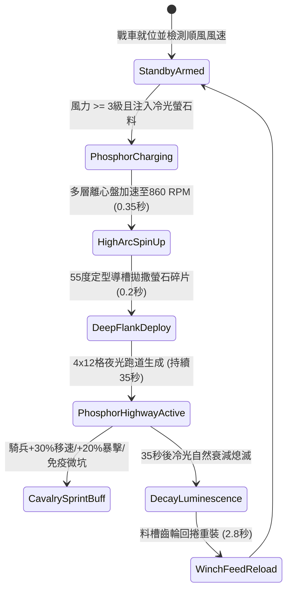

# 戰場夜戰順風施放連環風力飛石旋盤戰車扇面拋射磷光標記導引騎兵突擊第二階狀態機規格書

<!-- doc_id: doc_spec_1040 -->

## 1. 核心定位與設計理念

### 1.1 系統定位
本規格定義戰場夜戰大規模側翼包抄與夜間突襲作戰中，工兵部隊順風布署「連環風力飛石旋盤戰車第二階」（代碼：`WIND-ROTARY-STONE-PHOSPHOR-FLANK02`，WBS 代碼：`FORM-259`）之進階夜光跑道鋪設狀態機。第二階戰車於多層風輪離心盤加裝了聚光螢石研磨粉碎槽與 55 度拋物線定型導槽。在 3 級以上順風條件下，戰車將淬煉高純度冷光螢石塊與微細破片扇面拋射至前方 4x12 格極深戰術走廊，形成持久發光且標記清晰的夜光衝鋒跑道。友軍騎兵部隊沿此發光跑道奔馳突擊時，獲得 +30% 移動速度加成、+20% 衝鋒暴擊率，且 96% 機率免疫夜間地面微型坑窪造成的失足摔傷。

### 1.2 設計目標與單一真相
* **深縱深夜光走廊引導**：12 格極深縱深引導，確保突擊騎兵自後方直接無減速貫穿敵側翼。
* **微坑窪地形免疫**：高密度冷光石粉填平微小凹陷，解除夜戰隨機失足摔跌懲罰。
* **單一真相來源**：嚴禁於文件末端附加補丁，所有機制、數值與判定邏輯均在此統一定義。

---

## 2. 狀態機架構與轉換流程

---

## 3. 核心數值與計算公式

### 3.1 基礎參數配置表
| 參數名稱 | 基準數值 | 規格說明與限制條件 |
| :--- | :--- | :--- |
| **有效射程與走廊規格**| 3 ~ 14 格 / 4x12 格 | 55 度定型拋射，形成 4 格寬、12 格長夜光跑道 |
| **冷光螢石發光時效** | 35.0 秒 | 專用冷光礦石粉末，不受夜風吹散影響 |
| **騎兵移動速度加成** | +30% 友軍移速 | 部隊身處夜光走廊內時即時獲得速度增益 |
| **衝鋒破陣暴擊加成** | +20% 物理暴擊 | 藉助高初速與視野明晰度，提高第一擊暴擊率 |
| **微型坑窪免傷率** | 96% | 免疫夜戰地圖隨機生成的失足崴腳判定 |
| **敵軍盲目干擾** | -20% 敵軍命中 | 刺目冷光擾亂敵方側翼守軍之夜間瞄準 |
| **每輪彈料消耗** | 90 斤 高純螢石塊 | 研磨粉碎後均勻散佈於走廊地面 |
| **料槽回捲裝填間隔** | 2.8 秒 | 工兵雙速比絞盤回捲重填時間 |

### 3.2 奔馳加速與夜戰暴擊公式
$$V_{\text{boost}} = V_{\text{base}} \times \left(1 + 0.30 \times \Omega_{\text{highway}}\right)$$
$$\text{CritRate}_{\text{effective}} = \min\left(1.0, \, \text{CritRate}_{\text{base}} + 0.20 \times \Omega_{\text{highway}} \times \left(1 + \frac{W_{\text{wind}} - 3}{15}\right)\right)$$
* $\Omega_{\text{highway}}$：部隊位於夜光走廊標籤內（在範圍內為 1，脫離為 0）。
* $W_{\text{wind}}$：當前戰場順風等級（3 ~ 6 級）。
* 騎兵穿行走廊期間，衝鋒蓄力速度提升 50%，且不被輕步兵投擲物打斷加速狀態。

---

## 4. 戰術反制與例外判定

1. **生黑油覆蓋遮光**：若敵方投擲大量稠黑猛火油覆蓋走廊地面，螢光被污油遮蔽，加速效果即時解除。
2. **大雪封蓋暗化**：若處於鵝毛大雪天氣，積雪在 10 秒內覆蓋螢石，發光時效自 35 秒縮短為 12 秒。
3. **風向突變漂移**：若遭遇強烈側風偏角 > 45 度，拋射碎屑向側方漂移 1.5 格，需騎兵微調衝鋒軌跡。

---

## 5. 驗收測試案例（Test Cases）

* **TC-01（深縱深夜光跑道生成校驗）**：在 4 級順風下擊發，驗證前方 4x12 格區域精準標記為 `PHOSPHOR_SPEEDWAY`。
* **TC-02（突擊騎兵移速與暴擊加成驗證）**：引導重騎兵駛入夜光跑道，驗證移速即時增加 30%，暴擊率提升 20%。
* **TC-03（微坑窪失足免疫測試）**：在地圖密布坑窪地形激活跑道，測試 100 匹戰馬疾馳，驗證崴腳摔傷率低於 4%。
