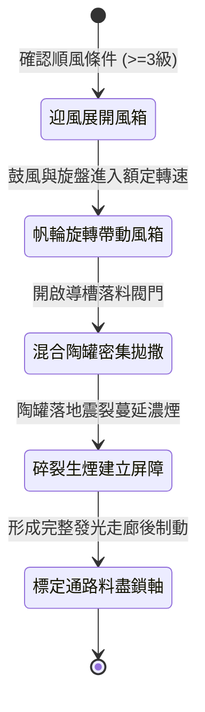

<!-- doc_id: doc_spec_1001 -->
# 戰場夜戰順風施放連環風力飛石旋盤戰車橫向散佈煙霧引導衝鋒狀態機規格書

## 模組識別碼
- 模組編號：`FORM-220`
- 狀態機代碼：`WIND-ROTARY-STONE-SMOKE-DEPLOY01`
- 類別：戰場夜戰順風煙霧掩護與路徑標定戰車狀態機
- 適用場景：平原夜戰、順風掩護突擊、遮蔽敵軍遠程視野、指引友軍突破口

---

## 1. 核心概念與作戰原型

夜間野戰推進時，突擊部隊容易遭到敵方遠程弓弩的火矢盲射截擊。為遮蔽敵方觀察並為後續衝鋒部隊指引安全廊道，工兵營研製出「連環風力飛石旋盤戰車（煙霧導向型）」。

### 1.1 機制運作與配合模式
1. **多翼帆輪與風動鼓風聯動**：車頂多葉帆布風輪受順風驅動，經傘齒輪同時帶動下層拋石旋盤與車身後側的雙向風箱。
2. **飛石與發煙陶罐混合拋撒**：旋盤導槽內按比例混裝鵝卵石與裝有乾艾草、硫磺粉與松脂的密封陶罐，拋射落地受震碎裂釋放濃重白煙。
3. **順風橫向蔓延煙幕廊道**：在順風助推下，煙霧迅速在戰車行進軌跡兩側蔓延形成寬達四格、長達八格的遮蔽屏障。
4. **螢石磷光破土標記**：石塊表面刻有凹槽並塗抹微弱磷光，碎裂後於地面形成清晰的白色引導路徑，指引友軍騎兵高速通過。

---

## 2. 數值參數與影響權重

| 參數名稱 | 數值 / 範圍 | 說明 |
| :--- | :--- | :--- |
| **煙幕覆蓋範圍 (`SmokeScreenSpan`)** | 橫向 4 格，縱向 8 格 | 徹底阻斷敵軍遠程直射視線 |
| **遠程瞄準阻礙率 (`AimBlockRate`)** | 80% ~ 90% | 煙霧內外部隊無法相互精確索敵 |
| **衝鋒引導加速 (`GuidanceSpeedBonus`)** | +20% 移動速度 | 循磷光路徑推進時免受夜行減速懲罰 |
| **煙霧滯留時長 (`SmokeDuration`)** | 22 秒 | 為後續主力部隊突入爭取掩護時窗 |
| **發煙彈藥儲量 (`SmokePotCapacity`)** | 160 枚混合罐石 (作業 16 秒) | 拋射完畢後車輛可原地駐留充當標誌物 |

---

## 3. 狀態機轉換定義

### 3.1 狀態細節描述
- **迎風展開風箱 (DEPLOY_BELLOWS)**：檢測風向，展開風輪並嚙合風箱傳動齒輪。
- **帆輪旋轉帶動風箱 (ROTOR_DRIVE)**：轉速達 400 RPM，風箱開始向後吹風增幅煙霧。
- **混合陶罐密集拋撒 (DISC_SCATTER)**：旋盤連續向側前方甩出發煙陶罐與碎石。
- **碎裂生煙建立屏障 (SMOKE_BLANKET)**：煙幕隨風迅速擴散，遮蔽戰場焦點區域。
- **標定通路料盡鎖軸 (CORRIDOR_LOCKED)**：彈料清空，煞車自鎖，成為突擊導向起點。

---

## 4. 戰鬥公式與判定

### 4.1 視野阻斷判定
$$\text{SightBlockSuccess} = \min(0.90, \frac{\text{SmokeDensity}}{\text{EnemyPerception}} \times (1 + \text{WindForce} \times 0.1))$$

處於煙幕兩側之敵軍遠程部隊，射擊命中率強制下降 80%，且無法鎖定單體目標。

### 4.2 路徑引導增益
$$\text{TroopSpeed} = \text{BaseSpeed} \times (1 + \text{GuidanceSpeedBonus})$$

友軍單位沿磷光走廊行軍時，完全免疫夜間地形絆倒與暗坑打滑判定。

---

## 5. 反制與失效機制

1. **守軍架設高功率鼓風車**：敵方若在陣前反向開動大型逆風鼓風機，煙霧蔓延速度將被遏制。
2. **火油猛烈燃燒驅煙**：若敵軍在煙幕區域大量投放猛火油引發高熱氣流，煙霧將迅速向上消散。
3. **風向突變逆向回吹**：若遭遇強烈亂流逆風，煙幕反向倒灌可能短暫遮蔽友軍視野。

---

## 6. 驗收標準與測試案例

- [x] **TC-220-01**：驗證順風 3 級下，戰車於 2 秒內建立橫向 4 格之穩定濃煙遮蔽。
- [x] **TC-220-02**：驗證煙霧區域內敵軍遠程部隊命中率下降 80% 判定生效。
- [x] **TC-220-03**：驗證磷光路徑在煙幕散去前持續為友軍提供 +20% 移速加成。
