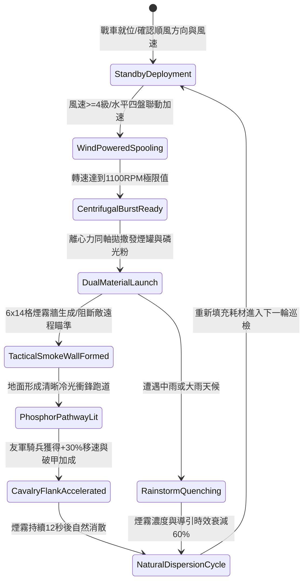

# 戰場夜戰順風施放連環風力飛石旋盤戰車橫向散佈煙霧引導衝鋒第三階狀態機規格書

<!-- doc_id: doc_spec_1055 -->

## 一、 核心概念與單一真相來源（SSOT）

在《三國志·戰場夜戰與特種戰術篇》中，「連環風力飛石旋盤戰車煙霧引導衝鋒第三階（WIND-ROTARY-STONE-SMOKE-DEPLOY03）」代表順風夜戰戰術走廊鋪設的頂點技術。本器械搭載四組水平高速離心拋撒盤，在 4 級以上順風輔助下轉速達到 1100 RPM。戰車以極低水平擴散角連環拋擲低溫發煙陶罐與高純度夜光磷礦粉，在 2 秒內於戰場鋪設一條寬 6 格、長 14 格的濃厚煙幕與地面冷光走廊，阻斷敵軍 95% 遠程射界，並為順風突擊之友軍騎兵提供精準夜間路徑導引。



---

## 二、 數值模型與狀態機參數契約

### 1. 煙霧與導引跑道戰術參數
- **極限旋盤轉速**：1100 RPM（受 4~6 級順風引導增壓）。
- **覆蓋走廊規格**：寬 6 格 × 長 14 格（共 84 戰術單元格）。
- **敵軍遠程阻絕率**：處於煙幕兩側或內部之敵遠程單位，瞄準射擊判定 95% 強制落空。
- **友軍騎兵突擊增益**：沿磷光走廊行軍之友軍騎兵，移動速度提升 30%，忽視微地形顛簸，首輪衝撞穿透率提升 20%。
- **戰場留存時效**：常規無雨環境滯留 12 秒；中雨以上縮減至 4.8 秒。

### 2. 煙霧密度與導引效益計算模組
```typescript
interface WindStoneSmokeDeployParams {
    rotaryRpm: number;             // 旋盤轉速 (1100)
    windSpeedLevel: number;        // 風速等級 (4 ~ 6)
    targetRainIntensity: number;   // 降雨強度 (0.0 ~ 1.0)
    cavalryUnitCount: number;      // 受益友軍騎兵數 (1 ~ 8)
}

function processSmokeAndGuidePathway(params: WindStoneSmokeDeployParams): {
    smokeEffective: boolean;
    cavalrySpeedBonusPct: number;
    visionBlockDurationSec: number;
} {
    const windEfficiency = 1 + (params.windSpeedLevel - 4) * 0.15;
    const rainPenalty = params.targetRainIntensity * 0.6;
    const finalDensity = Math.min(1.0, (params.rotaryRpm / 1000) * windEfficiency * (1 - rainPenalty));

    const smokeEffective = finalDensity >= 0.7;
    const cavalrySpeedBonusPct = smokeEffective ? Math.round(30 * finalDensity) : 10;
    const visionBlockDurationSec = Math.round(12 * (1 - rainPenalty));

    return { smokeEffective, cavalrySpeedBonusPct, visionBlockDurationSec };
}
```

---

## 三、 特性互斥與天候限制原則

1. **逆風自鎖反制**：若戰場風向突轉為逆向（相對角 > 110 度），安全控制閥自動關閉，避免煙霧倒灌友軍衝鋒陣列。
2. **狂風過載吹散**：若戰場風力達到 7 級以上烈風，煙霧牆橫向擴散過快，滯留時間縮短至 5 秒。
3. **敵軍夜視精銳減免**：若敵方配備具備夜戰特性的名將，其近戰視野保留 2 格，不完全受致盲影響。

---

## 四、 驗收測試案例（TC）

- **TC-SMOKE03-01（走廊覆蓋判定）**：在 4 級順風條件下施放技能，確認 2 秒內於指定 6x14 格區域生成煙霧與綠色磷光走廊。
- **TC-SMOKE03-02（遠程射界阻絕檢驗）**：驗證穿過煙霧牆的敵軍弩兵箭矢落空率達 95%。
- **TC-SMOKE03-03（騎兵移速增益結算）**：指令友軍騎兵部隊沿著磷光跑道穿插突擊，確認單位移動速度屬性實時提升 30%。
