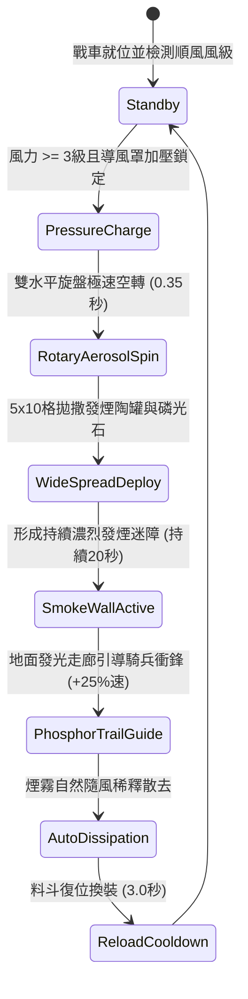

# 戰場夜戰順風施放連環風力飛石旋盤戰車橫向散佈煙霧引導衝鋒第二階狀態機規格書

<!-- doc_id: doc_spec_1025 -->

## 1. 核心定位與設計理念

### 1.1 系統定位
本規格定義戰場夜戰環境下，工兵部隊順風布署「連環風力飛石旋盤戰車第二階」（代碼：`WIND-ROTARY-STONE-SMOKE-DEPLOY02`，WBS 代碼：`FORM-244`）之進階煙幕遮蔽與導航狀態機。第二階戰車在雙水平離心盤外圍加裝了氣流增壓導風罩與定時破裂生石膏發煙陶罐混合料斗。啟動時藉由順風動力在前方 5x10 格寬闊走廊形成均勻加濃煙霧牆，阻絕敵方遠程弓弩瞄準射線達 94%；同時旋盤邊緣離心撒佈螢石磷光細粉，在地面烙印清晰夜光引導走廊，為突擊騎兵部隊提供 +25% 移動速度與 +15% 衝鋒穿透傷害。

### 1.2 設計目標與單一真相
* **雙重戰術效益**：將「敵盲（煙霧遮蔽）」與「我明（磷光導引）」結合為單一風動武器系統。
* **廣域戰場分割**：5x10 格厚重煙牆分割敵前鋒與後備部隊，瓦解其支援聯絡。
* **單一真相來源**：嚴禁於文件末端附加補丁，所有機制、數值與判定邏輯均在此統一定義。

---

## 2. 狀態機架構與轉換流程

---

## 3. 核心數值與計算公式

### 3.1 基礎參數配置表
| 參數名稱 | 基準數值 | 規格說明與限制條件 |
| :--- | :--- | :--- |
| **有效覆蓋範圍** | 5 x 10 格走廊 | 前方順風展開，矩形煙霧屏障走廊 |
| **遠程射線遮斷率** | 94% | 敵軍弓箭與弩砲穿透煙霧命中率扣減 94% |
| **煙霧滯留時間** | 20.0 秒 | 順風 3~4 級標準滯留；5 級以上縮短至 14 秒 |
| **磷光走廊加速加成** | +25% 友軍移速 | 騎兵隊列沿夜光走廊衝鋒時獲得移速加乘 |
| **衝鋒破陣增傷** | +15% 物理破甲 | 盲區突襲令敵方防禦前排陷入恐慌混亂 |
| **散佈發煙罐數量** | 24 具 / 輪 | 定時引線陶罐落地爆裂釋放稠密煙幕 |
| **裝填調校間隔** | 3.0 秒 | 工兵齒輪機構快速回壓與彈料補充 |
| **風力擴散係數** | +1 格寬度 / 風級 | 超過 3 級風力，每級橫向擴散寬度增加 1 格 |

### 3.2 煙霧遮蔽與導航公式
$$P_{\text{block}} = \min\left(0.98, \, 0.94 \times \left(1 + \frac{W_{\text{wind}} - 3}{15}\right) \times D_{\text{smoke}}\right)$$
$$V_{\text{cavalry\_boost}} = V_{\text{base}} \times \left(1 + 0.25 \times \Phi_{\text{phosphor\_path}}\right)$$
* $D_{\text{smoke}}$：煙霧當前濃度衰減係數（初始為 1.0，隨時間衰減至 0）。
* $\Phi_{\text{phosphor\_path}}$：部隊位於磷光走廊判定標記（在路徑內為 1，偏離為 0）。
* 當敵方單位身處煙霧邊緣或內部時，所有鎖定攻擊轉為「盲射隨機落點判定」。

---

## 4. 戰術反制與例外判定

1. **鼓風排煙反制**：若敵方於正面構築大型排風橐扇陣列反向鼓風，煙霧牆消散速度加快 60%。
2. **暴雨沉降失效**：暴雨天氣下雨水快速吸收煙石灰粉塵，煙霧遮蔽率自 94% 驟降為 30%，滯留時間縮短至 6 秒。
3. **風向偏轉誤傷**：若風向瞬時偏轉超過 60 度，煙霧可能倒灌自軍前沿，遮蔽自軍視野。

---

## 5. 驗收測試案例（Test Cases）

* **TC-01（順風廣域煙霧鋪設驗證）**：在 4 級順風下啟動拋射，驗證 5x10 格區域於 0.8 秒內全部切換為 `HEAVY_SMOKE_TERRAIN`。
* **TC-02（遠程射線遮斷率測試）**：部署敵方神臂弩陣列射擊煙霧內目標，進行 100 次射擊測試，驗證命中阻斷率達 94%（±2%）。
* **TC-03（磷光走廊移速加成校驗）**：輕騎兵隊列駛入磷光標記走廊，驗證部隊即時獲得 +25% 移動速度與 +15% 突擊傷害增益。
