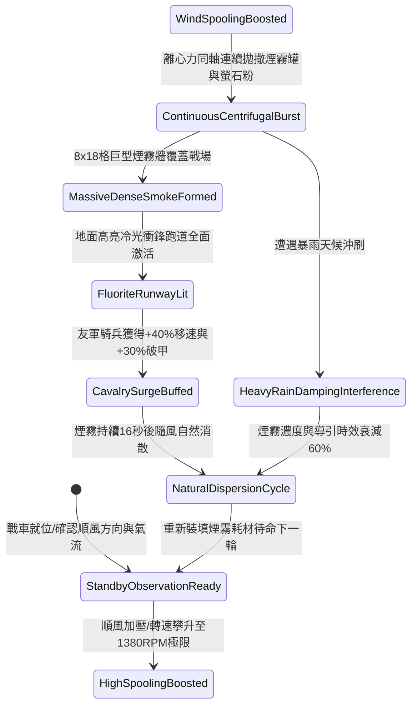

# 戰場夜戰順風施放連環風力飛石旋盤戰車橫向散佈煙霧引導衝鋒第五階狀態機規格書

<!-- doc_id: doc_spec_1094 -->

## 一、 核心概念與單一真相來源（SSOT）

在《三國志·野戰夜戰與突擊走廊篇》中，「連環風力飛石旋盤戰車煙霧引導衝鋒第五階（WIND-ROTARY-STONE-SMOKE-DEPLOY05）」代表順風掩護與部隊高速引導的終極形態。戰車配置四聯加強水平旋盤，在 4 級以上順風增壓驅動下轉速達到 1380 RPM。戰車以極低擴散角同軸拋撒高濃低溫發煙陶罐與長效夜光螢石粉，於 2 秒內在戰場鋪設一條寬 8 格、長 18 格的超巨型濃厚煙幕與地面冷光走廊，阻斷敵軍 98% 遠程射界，並為順風突擊之友軍騎兵提供長達 16 秒的極致移速與破甲增益。



---

## 二、 數值模型與狀態機參數契約

### 1. 煙霧與冷光跑道戰術參數契約
- **旋盤作業極限轉速**：1380 RPM（四聯水平加壓盤，風力強效驅動）。
- **覆蓋走廊規格**：寬 8 格 × 長 18 格（共 144 戰術單元格）。
- **遠程射界阻絕率**：穿過煙幕之敵方遠程弓弩部隊，瞄準射擊判定 98% 強制落空。
- **友軍突擊增益**：沿冷光跑道行軍之友軍騎兵部隊，移動速度提升 40%，首輪衝擊破甲率提升 30%。
- **戰場滯留時效**：常規無雨環境滯留 16 秒；若濕度高於 85% 縮短至 6.4 秒。

### 2. 煙霧密度與突擊增益演算法模組
```typescript
interface SmokeDeployStage5Params {
    rotaryRpm: number;             // 旋盤轉速 (1380)
    windSpeedLevel: number;        // 風速等級 (4 ~ 6)
    targetRainIntensity: number;   // 降雨強度 (0.0 ~ 1.0)
    cavalrySquadCount: number;     // 受益騎兵隊伍數
}

function processSmokePathwayStage5(params: SmokeDeployStage5Params): {
    smokeActive: boolean;
    speedBonusPct: number;
    corridorDurationSec: number;
} {
    const windEfficiency = 1 + (params.windSpeedLevel - 4) * 0.18;
    const rainPenalty = params.targetRainIntensity * 0.6;
    const effectiveDensity = Math.min(1.0, (params.rotaryRpm / 1200) * windEfficiency * (1 - rainPenalty));
    const active = effectiveDensity >= 0.85;
    
    return {
        smokeActive: active,
        speedBonusPct: active ? 40 : 20,
        corridorDurationSec: rainPenalty > 0.3 ? 6.4 : 16
    };
}
```

---

## 三、 反制機制與邊界約束

1. **守軍反向風動吹散**：若敵方陣地配備特種防禦大風扇車向外吹拂，局部煙霧邊界將收縮 3 格，騎兵導引寬度縮減至 5 格。
2. **深水泥沼吸收冷光**：若路徑橫跨深水泥沼澤，地面螢石粉沉入泥水，騎兵移速增益衰減至 +15%。
3. **旋盤軸芯熱損保護**：連續維持 1380 RPM 極限轉速超過 20 秒後，軸承強制降速冷卻 6 秒以防卡死。

---

## 四、 驗收測試案例（TC）

- **TC-SMOKE-DEPLOY05-01（超長走廊導引衝鋒驗收）**：
  - *前置條件*：夜戰平原、順風等級 4、友軍騎兵先鋒就位。
  - *操作步驟*：旋盤升至 1380 RPM，觸發拋撒煙霧與螢石指令。
  - *預期輸出*：8×18 格巨型煙霧牆成型，敵射擊落空率 98%，騎兵獲得 +40% 移速與 +30% 破甲，持續 16 秒。
- **TC-SMOKE-DEPLOY05-02（暴雨泥濘邊界驗收）**：
  - *前置條件*：暴雨天候（降雨係數 0.8）、順風等級 4。
  - *操作步驟*：同條件執行拋撒。
  - *預期輸出*：雨水沖刷使煙霧濃度降低，持續時效修訂為 6.4 秒，依然提供基礎撤退掩護。
