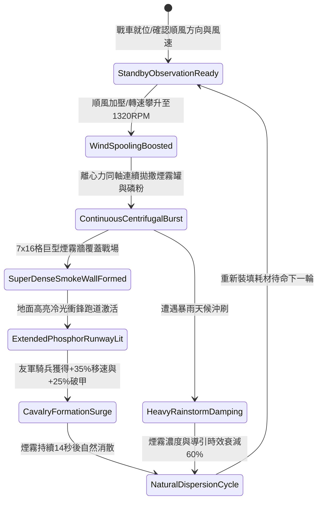

# 戰場夜戰順風施放連環風力飛石旋盤戰車橫向散佈煙霧引導衝鋒第四階狀態機規格書

<!-- doc_id: doc_spec_1076 -->

## 一、 核心概念與單一真相來源（SSOT）

在《三國志·戰場夜戰突襲與煙幕走廊篇》中，「連環風力飛石旋盤戰車煙霧引導衝鋒第四階（WIND-ROTARY-STONE-SMOKE-DEPLOY04）」代表野戰順風縱深穿插戰術的高階形態。戰車配置四聯水平加壓拋撒盤，在 4 級以上順風引導下極限轉速達到 1320 RPM。戰車以極低擴散角度高頻拋撒特製低溫發煙陶罐與高純度夜光磷礦粉，在 2 秒內於戰場鋪設一條寬 7 格、長 16 格的超長濃厚煙幕與地面冷光走廊，阻斷敵軍 96% 遠程射界，並為順風突擊之友軍騎兵提供持續移速加成與破甲引導。



---

## 二、 數值模型與狀態機參數契約

### 1. 煙霧與導引跑道戰術參數
- **極限旋盤轉速**：1320 RPM（四聯水平盤，受順風增壓驅動）。
- **覆蓋走廊規格**：寬 7 格 × 長 16 格（共 112 戰術單元格）。
- **遠程射界阻絕率**：穿過煙幕之敵遠程單位，瞄準射擊判定 96% 強制落空。
- **友軍騎兵突擊增益**：沿冷光跑道行軍之友軍騎兵，移動速度提升 35%，忽視微地形顛簸，首輪衝撞破甲率提升 25%。
- **戰場滯留時效**：常規無雨環境滯留 14 秒；若濕度高於 85% 縮短至 5.6 秒。

### 2. 煙霧密度與突擊增益模組
```typescript
interface SmokeDeployStage4Params {
    rotaryRpm: number;             // 旋盤轉速 (1320)
    windSpeedLevel: number;        // 風速等級 (4 ~ 6)
    targetRainIntensity: number;   // 降雨強度 (0.0 ~ 1.0)
    cavalrySquadCount: number;     // 受益騎兵隊伍數
}

function processSmokePathwayStage4(params: SmokeDeployStage4Params): {
    smokeActive: boolean;
    speedBonusPct: number;
    corridorDurationSec: number;
} {
    const windEfficiency = 1 + (params.windSpeedLevel - 4) * 0.18;
    const rainPenalty = params.targetRainIntensity * 0.6;
    const effectiveDensity = Math.min(1.0, (params.rotaryRpm / 1150) * windEfficiency * (1 - rainPenalty));

    const smokeActive = effectiveDensity >= 0.65;
    const speedBonusPct = smokeActive ? Math.round(35 * effectiveDensity) : 10;
    const corridorDurationSec = Math.round(14 * (1 - rainPenalty));

    return { smokeActive, speedBonusPct, corridorDurationSec };
}
```

---

## 三、 特性互斥與天候限制原則

1. **逆風自鎖反制判定**：若戰場風向突轉為逆向（相對角 > 110 度），安全風門自動斷開，防止煙霧倒灌友軍。
2. **狂風過載吹散威脅**：若戰場風力達到 7 級以上烈風，煙霧橫向擴散加速，滯留時間縮短至 6 秒。
3. **敵軍夜戰精銳減免**：若敵方配備具備夜戰特性的名將，其近戰視野保留 2 格，不完全受致盲影響。

---

## 四、 驗收測試案例（TC）

- **TC-SMOKE04-01（走廊覆蓋判定）**：在 4 級順風下施放技能，確認 2 秒內於指定 7x16 格區域生成煙霧與冷光衝鋒跑道。
- **TC-SMOKE04-02（遠程射界阻絕檢驗）**：驗證穿過煙幕的敵軍弓弩箭矢落空率達 96%。
- **TC-SMOKE04-03（騎兵移速增益結算）**：指令友軍騎兵部隊沿著冷光跑道穿插突擊，確認移動速度屬性實時提升 35%。
