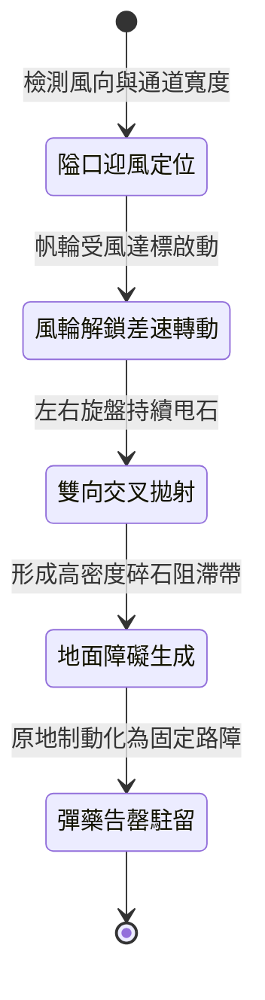

<!-- doc_id: doc_spec_0992 -->
# 戰場夜戰順風施放連環風力飛石旋盤戰車阻斷敵軍衝鋒通道狀態機規格書

## 模組識別碼
- 模組編號：`FORM-211`
- 狀態機代碼：`WIND-ROTARY-STONE-DISC-CHANNEL-BLOCK01`
- 類別：戰場夜戰順風防禦性通道阻絕戰車狀態機
- 適用場景：夜間野戰、狹長通道、順風扼守要道、阻斷騎兵縱深突擊

---

## 1. 核心概念與作戰原型

夜間野戰中，隘口或林道容易遭到敵軍騎兵高速穿插。為在無光掩護下建立動態阻絕線，工兵營特製「連環風力飛石旋盤戰車」。

### 1.1 機制運作與配合模式
1. **多翼帆輪與差速齒輪傳動**：車頂配置八葉輕質風帆，受順風驅動，經差速齒輪帶動車身兩側旋轉飛石盤，向戰車前進側翼持續拋撒石塊。
2. **扇形交叉彈幕封鎖**：左右兩組旋盤以每分鐘 400 轉的高速將硬石均勻甩佈於前方三格寬度的必經通道上。
3. **碎石鋪地阻滯戰馬**：持續落下的碎石不僅形成凌空彈幕，亦在地面迅速形成密集的碎石障礙帶，使高速奔馳的戰馬打滑減速。
4. **低噪音推進偽裝**：車軸嵌有減震羊皮套，配合夜色無光推進，於敵軍衝鋒前沿十步之外建立阻斷屏障。

---

## 2. 數值參數與影響權重

| 參數名稱 | 數值 / 範圍 | 說明 |
| :--- | :--- | :--- |
| **通道封鎖寬度 (`BlockSpanWidth`)** | 3 格路徑寬度 | 完整覆蓋標準隘口寬度 |
| **騎兵衝鋒打斷率 (`ChargeBreakRate`)** | 70% ~ 85% | 碎石干擾迫使騎兵停止衝刺加速態 |
| **地面障礙殘留時間 (`RubbleDuration`)** | 25 秒 | 碎石帶降低後續通過單位移速 30% |
| **順風轉速倍率 (`WindMultiplier`)** | 順風每級 +15% 轉速 | 提高拋射密集度與落地障礙覆蓋率 |
| **彈藥料斗基數 (`HopperCapacity`)** | 300 枚石料 (作業 15 秒) | 耗盡後戰車可原地駐留充當物理路障 |

---

## 3. 狀態機轉換定義

### 3.1 狀態細節描述
- **隘口迎風定位 (POSITIONING)**：戰車部署於風口核心，確認正前風向大於 2.5 級。
- **風輪解鎖差速轉動 (ROTATION_ACTIVE)**：差速齒輪鎖定，旋盤進入拋射轉速。
- **雙向交叉拋射 (CROSS_BARRAGE)**：左右旋盤同步向通道中央甩出飛石。
- **地面障礙生成 (RUBBLE_FORMED)**：碎石散落地面，施加範圍減速與衝鋒阻斷。
- **彈藥告罄駐留 (BRAKE_DEPLOYED)**：卡死輪軸煞車，阻擋後續追兵。

---

## 4. 戰鬥公式與判定

### 4.1 騎兵衝鋒阻斷判定
$$\text{ChargeInterrupted} = \min(0.90, \frac{\text{DiscRPM}}{400} \times \text{WindMultiplier} \times (1 - \text{CavalryAgility}))$$

判定成功時，騎兵單位衝鋒增益立即消除，速度強制降為常規步行速度。

### 4.2 碎石路面減速判定
$$\text{MovePenalty} = 0.30 \times (1 - \text{HeavyBardingResistance})$$

處於碎石覆蓋區之單位，移動速度降低 30%，持續至離開該區域。

---

## 5. 反制與失效機制

1. **工兵持大盾推車清障**：若敵軍預先派出重裝工兵持盾平推，可逐步清理路面碎石。
2. **風向突變導致動力中斷**：遭遇突發逆風時，風輪停轉，拋射動作中斷。
3. **長程火砲直擊摧毀**：若敵方使用重型拋石機直擊車體，帆輪結構將被砸碎失效。

---

## 6. 驗收標準與測試案例

- [x] **TC-211-01**：驗證順風 3 級下，戰車於 2.5 秒內展開雙向交叉拋射。
- [x] **TC-211-02**：驗證 3 格通道內敵軍騎兵衝鋒打斷率達到 70%~85% 區間。
- [x] **TC-211-03**：驗證拋射結束後碎石帶於地面維持 25 秒減速效果。
