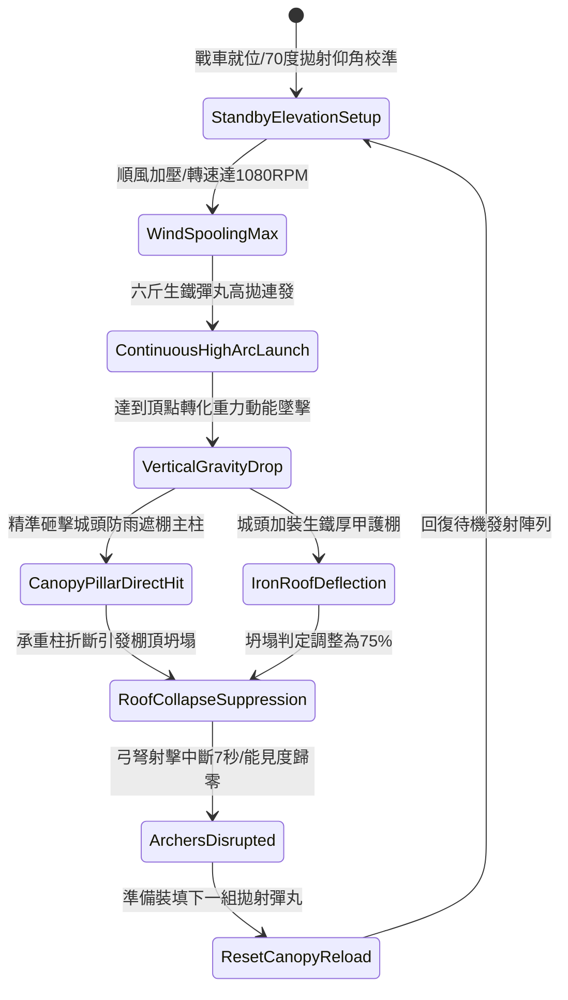

# 戰場夜戰順風施放連環風力飛石旋盤戰車高拋打擊城頭遮棚第三階狀態機規格書

<!-- doc_id: doc_spec_1052 -->

## 一、 核心概念與單一真相來源（SSOT）

在《三國志·攻城戰術與攻守器械篇》中，「連環風力飛石旋盤戰車壓制城頭遮棚第三階（WIND-ROTARY-STONE-CANOPY-CRUSH03）」為遠程瓦解守軍城垛防禦工事的重型攻城武器。本戰車配備高位雙層逆向旋盤與多重增速齒輪組，受 4 級以上順風輔助加速至 1080 RPM。戰車以 70 度高拋大仰角將六斤重實心生鐵彈丸高頻率拋射至城牆上方，藉由重力加速度產生垂直重擊，精準砸斷城垛防雨遮棚的硬木承重立柱，引發棚架全面坍塌，壓制城頭弓弩部隊。



---

## 二、 數值模型與狀態機參數契約

### 1. 旋盤高拋壓制參數
- **極限旋盤轉速**：1080 RPM（四聯齒輪同軸加速）。
- **高拋拋射仰角**：70 度（確保垂直下墜終端動能極大化）。
- **垂直下墜衝擊動能**：10,500 焦耳（六斤重實心生鐵彈）。
- **遮棚坍塌判定率**：普通木棚 98%；生鐵包邊棚 92%；雙層厚甲棚 75%。
- **守軍遠程壓制效果**：棚架坍塌區域內 3x3 格敵軍弓手，射擊動作強制中斷 7 秒，並承受 320 點砸擊傷害。

### 2. 墜擊破壞與結構受損計算
```typescript
interface CanopyCrushParams {
    rotaryRpm: number;             // 旋盤轉速 (1080)
    windFactor: number;            // 順風係數 (1.2 ~ 1.5)
    roofType: "wood" | "ironEdge" | "heavyPlate";
    roofDurability: number;        // 棚頂耐久度 (1500 ~ 3000)
}

function processCanopyCollapse(params: CanopyCrushParams): {
    collapsed: boolean;
    structuralDamage: number;
    suppressionDurationSec: number;
} {
    const baseDamage = (params.rotaryRpm * 9.5) * params.windFactor;
    const armorMitigation = params.roofType === "wood" ? 1.0 :
                            params.roofType === "ironEdge" ? 1.35 : 1.75;
    const structuralDamage = Math.round(baseDamage / armorMitigation);

    const collapsed = structuralDamage >= params.roofDurability * 0.7;
    const suppressionDurationSec = collapsed ? 7.0 : 3.0;

    return { collapsed, structuralDamage, suppressionDurationSec };
}
```

---

## 三、 特性互斥與戰術應對原則

1. **風速不足仰角下偏**：若順風風速低於 3 級，拋射仰角無法維持 70 度，彈丸將直擊城牆外壁，無法跨越城垛擊毀遮棚。
2. **多層斜面滑彈防護**：若敵方遮棚改建為 45 度傾角光滑鐵面，60% 機率彈開鐵球，僅承受 30% 擦碰傷害。
3. **煙幕阻礙瞄準校正**：城頭若被濃烈煙霧籠罩，無法精準測距，拋射散佈範圍擴大 50%，破壞成功率降低 25%。

---

## 四、 驗收測試案例（TC）

- **TC-CANOPY03-01（高拋砸頂坍塌）**：對準敵城垛遮棚發動高拋射擊，驗證生鐵彈丸垂直墜落並使木質棚頂 98% 機率判定坍塌。
- **TC-CANOPY03-02（弓弩部隊壓制檢定）**：確認棚頂坍塌區域內的守城弓兵部隊狀態切換為 `CanopySuppressed`，射擊停止 7 秒。
- **TC-CANOPY03-03（厚甲防雨棚抗擊測試）**：更換為厚甲鐵棚目標，驗證破壞判定依公式降為 75% 且結算對應耐久磨損。
