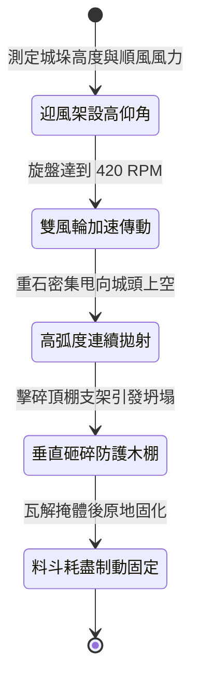

<!-- doc_id: doc_spec_1010 -->
# 戰場夜戰順風施放連環風力飛石旋盤戰車高拋打擊城頭防雨遮棚狀態機規格書

## 模組識別碼
- 模組編號：`FORM-229`
- 狀態機代碼：`WIND-ROTARY-STONE-CANOPY-CRUSH01`
- 類別：戰場夜戰順風高仰角打擊城防掩體狀態機
- 適用場景：攻城夜戰、要塞前沿、順風拋射、摧毀守軍垛口防雨防箭遮棚

---

## 1. 核心概念與作戰原型

攻城戰鬥中，城頭守軍常搭建傾斜的厚生牛皮與木板遮棚以抵禦外來拋射物。為摧毀其頂部掩體並剝奪掩蔽優勢，工兵營配置「連環風力飛石旋盤戰車（高拋砸棚型）」。

### 1.1 機制運作與配合模式
1. **高仰角滑軌與雙風輪傳動**：車頂配置雙向旋轉帆布風輪，透過傘齒輪系驅動兩組仰角達 60 度的離心拋石盤。
2. **重石高拋大弧度下墜**：將重逾兩斤之堅硬花崗岩石塊沿高弧線拋向城頭上空，利用高空重力勢能垂直砸擊守軍頂棚。
3. **砸斷支撐橫樑瓦解防護**：連續重石密集轟擊傾斜遮棚，砸碎其木質支架與榫卯，迫使遮棚塌陷壓制下方守軍。
4. **夜戰無光盲區覆蓋**：利用夜色掩護於順風 3 級條件下發動，無火光暴露戰車位置，精確瓦解敵防禦屏障。

---

## 2. 數值參數與影響權重

| 參數名稱 | 數值 / 範圍 | 說明 |
| :--- | :--- | :--- |
| **高拋拋射傾角 (`HighArcAngle`)** | 55 ~ 65 度高仰角 | 確保重石具備近垂直的墜落衝擊力道 |
| **遮棚支架瓦解率 (`CanopyShatterRate`)** | 80% ~ 92% | 高頻重砸使牛皮木棚支柱折斷坍塌 |
| **頂部衝擊動能 (`DropKineticEnergy`)** | 550 ~ 800 焦耳 | 遠超普通弓箭拋射的垂直破壞力 |
| **走馬道守軍壓制時長 (`SuppressionWindow`)** | 16 秒 | 遮棚坍塌迫使守軍清理廢墟暫停射擊 |
| **石料料斗容量 (`HeavyStoneCapacity`)** | 160 枚重石 (作業 16 秒) | 投射完畢後轉為地面固定防禦障礙 |

---

## 3. 狀態機轉換定義

### 3.1 狀態細節描述
- **迎風架設高仰角 (ANGLE_CALIBRATE)**：調整齒條升降機構，鎖定 60 度曲射拋射仰角。
- **雙風輪加速傳動 (ROTOR_DRIVE)**：雙風輪受順風驅動，經差速齒輪帶動兩組重拋盤。
- **高弧度連續拋射 (HIGH_ARC_FIRE)**：定量料斗開啟，重石以每秒十枚頻率連續升空。
- **垂直砸碎防護木棚 (CANOPY_COLLAPSE)**：落石砸爛牛皮遮棚，守軍失去頂部掩體。
- **料斗耗盡制動固定 (EMPTY_LOCK)**：彈藥排空，煞車自鎖，阻擋敵軍前鋒追擊。

---

## 4. 戰鬥公式與判定

### 4.1 遮棚砸毀判定
$$\text{CanopyCollapseChance} = \min(0.92, \frac{\text{DropKineticEnergy} \times \text{HitCount}}{\text{CanopyDurability}})$$

判定成功時，目標垛口遮棚狀態轉為「損毀坍塌」，守軍失去頂部防護減免。

### 4.2 掩體坍塌次級壓制
$$\text{SuppressionDelay} = 3.0 \times (1 + \text{WindForceMultiplier} \times 0.1)$$

坍塌區域內的守軍遠程單位，射擊冷卻時間延長 100%，持續 6 秒。

---

## 5. 反制與失效機制

1. **加裝生鐵斜樑緩衝**：若守軍遮棚外加生鐵斜撐角鐵，可抵消 45% 垂直重砸動能。
2. **守城巨弩盲射拋石盤**：敵方若精準命中戰車車頂帆輪，動力中斷將導致射程縮短。
3. **風向突變導致落點偏差**：遭遇強烈側向橫風時，落石容易偏出城垛外側。

---

## 6. 驗收標準與測試案例

- [x] **TC-229-01**：驗證 60 度仰角下，重石垂直墜落衝擊動能達到 550 焦耳以上。
- [x] **TC-229-02**：驗證連續投射 16 秒內，目標城垛防護遮棚坍塌率達 80%~92%。
- [x] **TC-229-03**：驗證坍塌後垛口守軍遠程反擊中斷且視野防護減免被清除。
