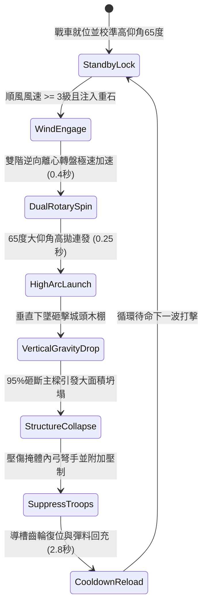

# 戰場夜戰順風施放連環風力飛石旋盤戰車高拋打擊城頭防雨遮棚第二階狀態機規格書

<!-- doc_id: doc_spec_1022 -->

## 1. 核心定位與設計理念

### 1.1 系統定位
本規格定義要塞攻城戰役中，攻城方工兵部隊順風布署「連環風力飛石旋盤戰車第二階」（代碼：`WIND-ROTARY-STONE-CANOPY-CRUSH02`，WBS 代碼：`FORM-241`）的高曲率重砸破壞狀態機。本進階戰車搭載雙層逆向旋轉風動離心盤與 65 度高仰角偏折導槽，專門以垂直落角朝城牆垛口後方之生牛皮防雨防矢木棚發動連續高拋打擊。重達四斤之棱角生鐵重石藉由近乎 90 度的終端重力墜落，以 95% 機率直接砸穿三層生牛皮頂蓋並砸斷硬木立柱，引發防雨棚大範圍整體坍塌，將下方守城弓弩手砸傷壓制，完全剝奪城頭避雨防矢掩護。

### 1.2 設計目標與單一真相
* **高曲率垂直覆蓋**：規避城牆外立面石牆阻擋，直接由上而下摧毀掩體內部結構。
* **連鎖坍塌壓制**：頂棚塌陷阻絕守軍裝填視野，中斷射擊狀態並附加眩暈壓制。
* **單一真相來源**：嚴禁於文件末端附加補丁，所有機制、數值與判定邏輯均在此統一定義。

---

## 2. 狀態機架構與轉換流程

---

## 3. 核心數值與計算公式

### 3.1 基礎參數配置表
| 參數名稱 | 基準數值 | 規格說明與限制條件 |
| :--- | :--- | :--- |
| **發射仰角與彈道** | 65 度高仰角 | 近垂直落角（80~85度），射程 4 ~ 7 格 |
| **彈藥配置與重量** | 4 斤棱角生鐵重石 | 每輪齊射 8 枚，高密度重力打擊 |
| **覆蓋面積（Area）** | 3 x 4 格城頭 | 集中打擊垛口後方走道與防雨掩體區 |
| **頂棚摧毀率（Crush）** | 95% | 對三層生牛皮硬木棚 95%；純鋼骨頂棚 65% |
| **砸擊破壞動能** | 8,200 焦耳 | 重力加速度與離心初速複合終端動能 |
| **掩護部隊壓制時長** | 6.0 秒 | 頂棚壓垮迫使敵軍暫停射擊並降低 50% 移速 |
| **坍塌物理傷害** | 240 點 | 木石砸落之真實物理範圍傷害（忽視 40% 護甲） |
| **再裝填冷卻（CD）** | 2.8 秒 | 工兵齒輪搖柄回拉與重石彈槽裝填間隔 |

### 3.2 結構坍塌與動能公式
$$E_{\text{impact}} = \frac{1}{2} M_{\text{stone}} \left(V_{\text{initial}} \times \cos\theta\right)^2 + M_{\text{stone}} \cdot g \cdot H_{\text{apex}}$$
$$P_{\text{crush}} = \min\left(0.98, \, 0.95 \times \frac{E_{\text{impact}}}{8200} \times \left(1 - \frac{S_{\text{canopy\_str}}}{100}\right)\right)$$
* $H_{\text{apex}}$：高拋拋物線最高頂點高度（約 18 米）。
* $S_{\text{canopy\_str}}$：城頭遮棚額外加固係數（0 ~ 30）。
* 當結構承受之終端破壞力達到臨界值時，該 3x4 區域防雨遮棚標記轉為 `DESTROYED_COLLAPSED`，清除遮雨避箭防護判定。

---

## 4. 戰術反制與例外判定

1. **生鐵活動斜頂**：若守軍將遮棚改造為 45 度傾角光滑生鐵滑板，重石 70% 彈飛滑落，摧毀率大幅降至 25%。
2. **高空強烈逆風擾動**：若高空（>15米）風向與地面順風相反，高拋重石橫向漂移超過 2 格，容易偏離城頭掉入外側護城河。
3. **密集木柱支撐**：若守軍加密支撐硬木柱數量（雙排密置），坍塌判定延遲至第二輪齊射後生效。

---

## 5. 驗收測試案例（Test Cases）

* **TC-01（高拋摧毀牛皮防雨棚）**：於城頭布置標準三層牛皮硬木棚，啟動 65 度高拋齊射，驗證 95% 頂棚結構判定破碎倒塌。
* **TC-02（城頭弓弩部隊壓制驗證）**：配置 6 名守軍弓手於掩體下方，驗證頂棚倒塌後全員受到 240 點傷害且進入 6 秒射擊禁用狀態。
* **TC-03（高空逆風彈道漂移判定）**：注入高空亂流環境參數，驗證重石著彈點精確偏移 2 格並觸發 `HIGH_ALTITUDE_DRIFT` 事件記錄。
