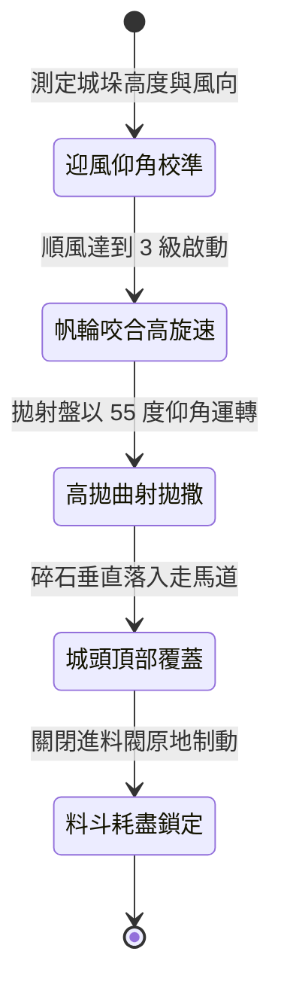

<!-- doc_id: doc_spec_0995 -->
# 戰場夜戰順風施放連環風力飛石旋盤戰車高拋打擊要塞垛口狀態機規格書

## 模組識別碼
- 模組編號：`FORM-214`
- 狀態機代碼：`WIND-ROTARY-STONE-DISC-HIGH-ARC01`
- 類別：戰場夜戰順風高仰角曲射壓制戰車狀態機
- 適用場景：夜間攻城野戰、要塞外緣、順風壓制城垛守軍、掩護雲梯部隊推進

---

## 1. 核心概念與作戰原型

夜間攻城作戰中，要塞女牆上的守軍常利用垛口掩護向外拋射箭雨。常規直射難以穿透女牆防護，為此工兵營改良出「連環風力飛石旋盤戰車（高拋曲射型）」。

### 1.1 機制運作與配合模式
1. **高仰角滑軌與雙風輪傳動**：車頂配置雙向旋轉帆布風輪，透過傘齒輪帶動傾角達 55 度的雙層離心甩盤。
2. **曲射高拋越障壓制**：利用高速旋轉離心力將拳頭大小之硬陶碎石以大拋物線甩向高空，精確越過城垛邊緣落入城頭走馬道。
3. **無光夜戰盲區覆蓋**：飛石藉由重力加速度由上方垂直砸落，迫使垛口守軍放棄探頭射擊，轉為舉盾護頭防禦姿態。
4. **雲梯掩護協同推進**：高拋彈幕持續覆蓋期間，攻城先鋒梯隊享有 40% 遠程箭雨豁免，平穩搭扣雲梯。

---

## 2. 數值參數與影響權重

| 參數名稱 | 數值 / 範圍 | 說明 |
| :--- | :--- | :--- |
| **高拋拋物線仰角 (`LaunchElevationAngle`)** | 50 ~ 60 度高仰角 | 確保石塊以 75 度以上近垂直角度落入城頭 |
| **城垛守軍壓制率 (`CrenelSuppressionRate`)** | 70% ~ 85% | 強制中斷垛口守軍的瞄準與射擊動作 |
| **掩護部隊遠程豁免 (`CoverDefenseBonus`)** | +40% 遠程防禦加成 | 為攻城梯隊爭取接近城牆之安全窗口 |
| **垂直落點傷害 (`VerticalImpactDamage`)** | 120 ~ 180 點頂部打擊 | 越過正面大盾直接結算頂部裝備防禦 |
| **儲石料斗作業時限 (`HopperDuration`)** | 16 秒 (共 280 枚石料) | 投射完畢後轉為地面固定步兵掩體 |

---

## 3. 狀態機轉換定義

### 3.1 狀態細節描述
- **迎風仰角校準 (ELEVATION_SETUP)**：調整支撐木架齒條，鎖定 55 度高拋角度。
- **帆輪咬合高旋速 (ROTOR_SPIN_UP)**：風力驅動雙風輪，旋盤轉速突破 420 RPM。
- **高拋曲射拋撒 (HIGH_ARC_RELEASE)**：料斗撥爪均勻送料，碎石連續甩向高空。
- **城頭頂部覆蓋 (CRENEL_RAIN_SUPPRESS)**：石雨密集落入城垛內側，全面壓制守軍。
- **料斗耗盡鎖定 (EMPTY_STOP)**：彈料拋盡，煞車鎖死輪軸，轉化為靜態護牆。

---

## 4. 戰鬥公式與判定

### 4.1 頂部越障壓制判定
$$\text{TopCoverSuppression} = \min(0.85, \frac{\text{DiscRPM}}{420} \times (1 + \text{WindForce} \times 0.15))$$

判定成功時，城垛守軍遠程攻擊冷卻時間延長 100%，且視野範圍縮減 50%。

### 4.2 頂部穿透傷害結算
$$\text{TopDamage} = \text{VerticalImpact} \times (1 - \text{HelmetArmorRatio})$$

由於石塊自高空墜落，正面大盾無法提供防護，僅按頭盔與肩甲防禦計算減免。

---

## 5. 反制與失效機制

1. **城頭搭設斜向生牛皮天棚**：若守軍預先架設傾斜牛皮軟棚，可將垂直落石引流滑出牆外。
2. **床弩高空吊射戰車風輪**：守軍若使用重型守城弩吊射破壞風輪帆布，將迅速中斷拋射動力。
3. **風向突變導致落點偏差**：遭遇側風擾動時，高拋彈幕散佈面擴大，有效壓制密度降低 40%。

---

## 6. 驗收標準與測試案例

- [x] **TC-214-01**：驗證 55 度仰角下，飛石落點精準覆蓋目標城牆走馬道深度 2 格。
- [x] **TC-214-02**：驗證壓制持續期間，城垛守軍射擊頻率下降 70% 以上。
- [x] **TC-214-03**：驗證料斗耗盡後，戰車平滑切換至靜態掩體模式無卡死。
