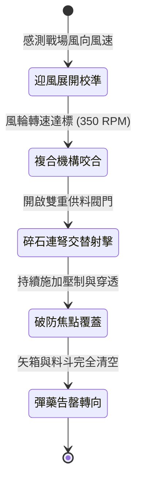

<!-- doc_id: doc_spec_0989 -->
# 戰場夜戰順風施放連環風力飛石連弩複合射擊車壓制敵陣狀態機規格書

## 模組識別碼
- 模組編號：`FORM-208`
- 狀態機代碼：`WIND-ROTARY-COMPOSITE-BALLISTA01`
- 類別：戰場夜戰遠近兼備風力連發射擊戰車狀態機
- 適用場景：平原野戰、夜間交鋒、順風協同壓制、敵軍前鋒密集隊列

---

## 1. 核心概念與作戰原型

夜戰混戰中，單純飛石射擊難以對裝備堅盾的先鋒敵兵造成致命破防。為融合面殺傷與點穿透，工兵營打造「連環風力飛石連弩複合射擊車」。

### 1.1 機制運作與配合模式
1. **雙輪傳動風輪複合機構**：車身兩側設有大型旋轉帆輪，戰車推進時，藉由傘齒輪同時驅動上層連弩絞盤與下層碎石拋射盤。
2. **飛石彈幕與短弩交替齊射**：下層以每秒十五枚碎石鋪開三十度扇形面壓制，上層四聯裝重型連弩則每隔兩秒向扇面中央發射精鋼穿甲短矢。
3. **視界干擾與精準破盾**：碎石撞擊迫使敵軍不得不舉盾格擋視線，緊隨其後的短矢則乘隙直擊盾牌握柄與護甲接合處。
4. **夜戰火光隱蔽推進**：車體軸承均塗抹動物油脂消音，並包裹厚毛氈布，於無光條件下平穩滑入戰鬥射程。

---

## 2. 數值參數與影響權重

| 參數名稱 | 數值 / 範圍 | 說明 |
| :--- | :--- | :--- |
| **複合射程覆蓋 (`EffectiveRange`)** | 4 ~ 6 格扇形深度 | 兼顧面壓制與弩矢點穿透的黃金射程 |
| **面壓制打斷率 (`SuppressionInterruption`)** | 65% ~ 75% | 飛石密集干擾打斷敵方蓄力動作 |
| **連弩穿甲傷害 (`BallistaBoltDamage`)** | 350 ~ 500 點穿刺 | 忽略敵軍 40% 基礎護甲值 |
| **順風動能加成 (`WindSpeedBonus`)** | 每級順風 +12% 射速 | 增強齒輪轉速與弩矢初速度 |
| **作業持續時間 (`OperationalTime`)** | 16 秒 (共 8 輪弩矢齊射) | 彈藥射盡後轉為步兵前進掩體 |

---

## 3. 狀態機轉換定義

### 3.1 狀態細節描述
- **迎風展開校準 (CALIBRATING)**：確認順風風速大於 2.5 級，帆輪自動解鎖展開。
- **複合機構咬合 (ENGAGED)**：離合器帶動上層弩機與下層拋盤同時運轉。
- **碎石連弩交替射擊 (DUAL_FIRING)**：面壓制與點穿透形成波浪式覆蓋。
- **破防焦點覆蓋 (FOCUS_COVERAGE)**：集中火力打擊敵軍陣型核心節點。
- **彈藥告罄轉向 (DEPLETED_RETREAT)**：弩矢射盡，戰車釋放防逆轉鎖定並調頭。

---

## 4. 戰鬥公式與判定

### 4.1 複合打擊破盾判定
$$\text{ShieldShatterProb} = \min(0.80, \frac{\text{BoltImpact} + \text{StoneImpact}}{\text{ShieldMaxDurability}})$$

若判定成功，目標持盾步兵之盾牌耐久度歸零並扣除 30% 當前護甲。

### 4.2 壓制延遲係數
$$\text{ActionDelay} = \text{BaseDelay} \times (1 + \text{WindForce} \times 0.12)$$

處於彈幕中心區域之敵軍，普攻冷卻時間延長 50%，持續 3 秒。

---

## 5. 反制與失效機制

1. **生鐵大盾重疊防禦**：若敵軍採用重型生鐵大盾且前後兩排重疊，可減免 70% 穿透傷害。
2. **側翼伏兵近戰破壞**：戰車兩側齒輪機構外露，易受敵方側翼輕騎或游擊步兵破壞。
3. **風向突變齒輪空轉**：若風向轉為逆風，帆輪阻力激增導致連弩絞盤上弦停滯。

---

## 6. 驗收標準與測試案例

- [x] **TC-208-01**：驗證順風 3 級下，複合射擊車於 3 秒內啟動雙層連發機制。
- [x] **TC-208-02**：驗證 4 聯裝短弩對目標造成穿甲忽視 40% 護甲的穿透傷害。
- [x] **TC-208-03**：驗證 16 秒作業結束後，狀態機正常切換至終止流程無死鎖。
