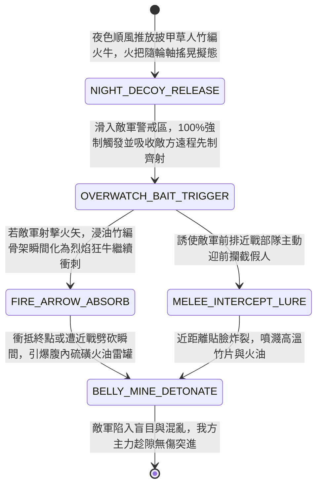

<!-- doc_id: doc_spec_0953 -->
# 戰場夜戰順風施放雙層油浸竹編火牛假人誘敵箭雨與引爆埋伏火雷狀態機規格書

> **文件編號**：`doc_spec_0953`
> **模組代碼**：`DECOY-FIRE-OX-ARROW-BAIT-MINE01`
> **對應 WBS**：`FORM-172`（M7 戰場進階機關、城防滾筒絞殺與精銳步兵拖刀迴旋斬）
> **單一真相來源（SSOT）**：本文件直接定義雙層油浸竹編火牛假人誘敵箭雨與引爆埋伏火雷之完整物理與戰鬥狀態機，嚴禁於檔尾附加補丁。

---

## 一、 戰術定位與歷史工程原型

在夜間攻防戰中，敵軍前線常部署大量處於「警戒齊射（Overwatch）」狀態的強弩兵與埋伏重步兵，使我方突擊部隊一旦踏入射程即遭受毀滅性集火。**雙層油浸竹編火牛假人（Decoy Fire-Ox & Straw-Man Bait Cart）** 結合了「草人借箭誘敵」與「火牛引爆埋伏地雷」的雙重詭道機關：
1. **竹編木輪假牛與披甲草人**：以雙層浸油老竹篾編製成昂首狂奔的巨牛骨架，底下安裝四輪木軸，牛背上捆綁披著破舊鐵甲、手持搖晃火把的稻草假人；遠看宛如一支夜襲騎兵或火牛敢死隊。
2. **下坡順風滑行與騙取警戒齊射**：工兵於夜色掩護下，順風或順緩坡推放竹編火牛假人；當假人高速滑入敵軍弓弩手的警戒射程時，會強制誘發敵方所有遠程單位的「先制警戒齊射（Overwatch Volley）」，將敵軍寶貴的連弩匣與火箭消耗在竹架草人身上。
3. **借火自燃與引爆預埋火雷**：若敵軍射出火箭，或假牛滑行至預設戰區（也可提前在路徑埋設硫磺火雷），浸油竹篾瞬間爆燃，並在衝入敵軍前排陣列時引爆腹內暗藏的生鐵火藥瓦罐，炸碎前來攔截的敵軍步兵。

---

## 二、 觸發條件與建造部署參數

| 參數項目 | 規格數值與限制條件 | 備註說明 |
| :--- | :--- | :--- |
| **環境與氣象要求** | 限 **夜戰 / 濃霧** 且處於 **順風或下坡** 地形 | 白晝晴天敵軍視野清晰，無法觸發強制誘騙（嘲諷無效） |
| **建造資源消耗** | 竹材 80、稻草麻布 60、松脂火油 75、火雷瓦罐 40、工兵 EP 30 | 每場夜戰最多施放 3 具火牛假人 |
| **推進距離與誘敵範圍** | 直線滑行 `3 ~ 5` 格；強制吸引沿途左右 `3 格` 內敵方遠程警戒火力 | 假人本體無攻擊力，純粹依靠誘射與終點引爆殺傷 |
| **假人耐久（HP）** | `650` 點（對普通箭矢具備 `85%` 穿刺減免，插滿箭矢亦不倒塌） | 遭受火矢命中時不扣血，反而使終點爆炸傷害 `+35%` |

---

## 三、 核心狀態機（State Machine）

---

## 四、 數值結算與戰鬥公式

### 1. 強制消耗敵方警戒齊射（Mandatory Overwatch Depletion）
當火牛假人在夜間順風滑入敵方遠程單位（弓兵、連弩兵、井闌、投石機）的警戒範圍時：
- **100% 嘲諷誘射**：夜間視野受限下，敵方 AI 與警戒狀態（`OVERWATCH_STANDBY`）會將搖晃火把的披甲假牛判定為高威脅突擊騎兵，`100%` 強制對假牛開火，從而清空敵方本回合所有的先制攔截次數。
- **箭矢回收（Arrow Harvest）**：若假牛未被燒毀而自然停駐，我方步兵踏入該格可回收敵軍射在草人上的箭矢，立即補充我方弓弩部隊 `30%` 彈藥量。

### 2. 腹內火雷引爆與火矢增幅（Belly-Mine Detonation）
當火牛假人滑行至終點撞擊敵陣，或遭到敵方近戰部隊揮刀劈砍時，立即觸發 `BELLY_MINE_DETONATE`，對周圍九宮格（`3 × 3`）造成爆炸火傷：
$$\text{Damage}_{\text{mine}} = \text{BaseATK}_{\text{engineer}} \times 1.95 \times \left(1 + 0.35 \times \text{IsHitByFireArrow}\right)$$
- **破甲竹片與混亂**：爆炸飛散的燃燒竹篾與鐵甲碎片使範圍內敵軍附加 `DECOY_BLAST_CONFUSION`（混亂率 `60%`，持續 1 回合；且防禦力下降 `25%`，持續 2 回合）。

---

## 五、 反制手段與戰術克制

1. **白磷長明火球 / 城堞懸燈照亮**：若敵軍先以白磷照明火球（`doc_spec_0864`）或銅鏡月光照射識破假牛偽裝，敵方遠程部隊將不會觸發強制誘射。
2. **長槍拒馬遠距挑翻**：若敵軍以二格長槍在爆炸半徑外挑翻竹輪，可提前引爆火雷而僅承受邊緣 `50%` 傷害。

---

## 六、 驗收測試案例（Acceptance Tests）

| 測試案例 ID | 測試情境與輸入條件 | 預期狀態轉移與數值輸出 |
| :--- | :--- | :--- |
| **TC-DECOY-01** | 夜戰順風推放火牛假人滑過敵方 2 隊處於「警戒齊射」之諸葛連弩兵前方 | 100% 強制誘發並耗盡 2 隊連弩兵之警戒齊射次數，假人憑 85% 箭矢減免存活通過 |
| **TC-DECOY-02** | 敵方弓兵對火牛假人射出「火箭」，假人隨後撞入敵方前排刀盾兵陣列 | 觸發火矢增幅（傷害 $+35\%$），對 3x3 範圍造成 $1.95 \times 1.35$ 倍爆炸火傷並附加 60% 混亂 |
| **TC-DECOY-03** | 敵軍先投擲白磷照明火球照亮區域後，我方再推放火牛假人 | 偽裝被照明識破，敵方警戒齊射不會被假人觸發 |
