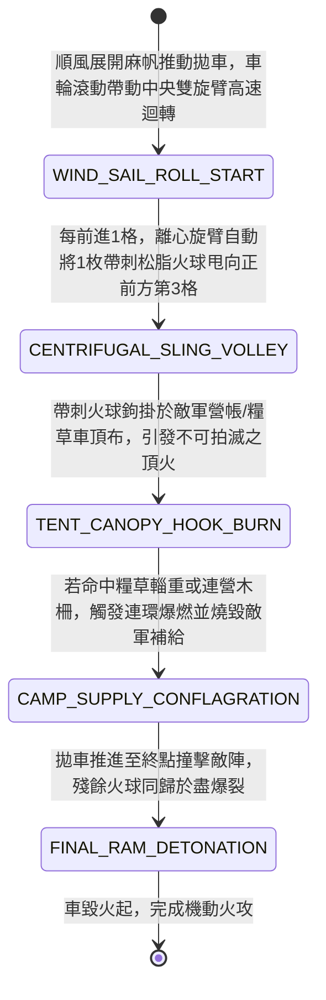

<!-- doc_id: doc_spec_0965 -->
# 戰場夜戰順風施放雙輪連環風力旋轉火球拋車引燃敵軍糧草營帳狀態機規格書

> **文件編號**：`doc_spec_0965`
> **模組代碼**：`WIND-ROTARY-FIREBALL-SLING-CAMP-BURN01`
> **對應 WBS**：`FORM-184`（M7 戰場進階機關、城防千斤鐵柵與精銳步兵喪門釘耙）
> **單一真相來源（SSOT）**：本文件直接定義風力旋轉火球拋車引燃敵軍糧草營帳之完整物理與戰鬥狀態機，嚴禁於檔尾附加補丁。

---

## 一、 戰術定位與歷史工程原型

在夜襲敵軍連營或圍攻外圍木柵時，傳統固定式投石機拆裝耗時，而一般火獸車噴火距離僅限近身三格。**雙輪連環風力旋轉火球拋車（Wind-Driven Rotary Fireball Sling Cart）** 結合了「順風帆車推進」與「車軸曲柄連動旋轉甩石兜（離心式拋射機）」，實現邊衝鋒邊連續拋射火球的機動火攻：
1. **風帆推進與車軸離心旋轉臂**：雙輪包鐵輕木車身張掛順風麻帆，車軸中央透過青銅棘輪帶動兩根長八尺的對稱旋轉木臂；車輪每滾動半周，便將裝有浸油麻布火球的皮兜甩至最高點利用離心力拋出。
2. **移動中連續拋射火球雨**：不同於必須駐定才能開火的傳統砲車，旋轉火球拋車在順風直線推進的過程中，每移動 1 格即可自動向前方拋射一枚松脂硫磺火球，形成一道向前延伸的「移動火球彈幕」。
3. **穿透氈帳與引燃糧垛**：高初速甩出的松脂火球外部纏繞帶刺鐵絲，砸中敵軍營帳或糧草垛時會直接鉤掛在帳篷頂布上劇烈燃燒，極難拍滅，迅速引發連營大火。

---

## 二、 觸發條件與建造部署參數

| 參數項目 | 規格數值與限制條件 | 備註說明 |
| :--- | :--- | :--- |
| **環境與氣象要求** | 限平坦開闊地形且處於 **順風（風速 $\ge 2$ 級）** | 逆風或森林地形無法累積車輪轉速與離心拋射力 |
| **建造資源消耗** | 硬木 95、松脂硫磺火球 120、精鐵棘輪 60、工兵戰技點（EP）35 | 每場戰鬥最多部署 2 輛旋轉火球拋車 |
| **推進與拋射距離** | 每回合順風推進 `3 格`；每推進 1 格自動向正前方第 `3` 格拋射火球 | 單回合移動中可連續拋射 3 枚火球（覆蓋直線 3 格） |
| **車體耐久（HP）** | `740` 點（輕量化車身，正面設斜置生牛皮擋箭板減免 `65%` 箭傷） | 車載火球可供連續推進拋射 `3 回合`（共 9 枚） |

---

## 三、 核心狀態機（State Machine）

---

## 四、 數值結算與戰鬥公式

### 1. 移動離心連珠拋射（Moving Centrifugal Volley）
當拋車於順風回合推進 `3 格` 時，會在第 1、2、3 格位置依序對各自正前方第 `3` 格拋射火球（即無需消耗額外行動力，邊走邊炸）：
$$\text{Damage}_{\text{sling}} = \text{BaseATK}_{\text{engineer}} \times 1.35 \times \left(1 + 0.10 \times \text{WindLevel}\right) \times \text{CampBonus}$$
- **營帳與糧草特攻（Camp & Supply Breaker）**：若命中的目標為「敵軍營帳 / 糧草輜重車 / 鹿角木柵」，$\text{CampBonus} = 2.5$，且每次命中直接燒毀敵軍 `12%` 隨軍糧草儲備。

### 2. 帶刺火球鉤掛與終點自爆（Barbed Fireball & Final Ram）
- **鉤掛黏著燃燒**：受帶刺鐵絲鉤掛影響，被火球命中的敵軍步騎無法透過移動拍滅火焰，強制附加 `BARBED_FIREBALL_CLING`（每回合流失最大兵力 `8%`，防禦力下降 `20%`，持續 2 回合）。
- **終點衝撞殉爆**：當拋車推進結束若正好撞上敵方單位或障礙物，車內剩餘火球將一併引爆，對撞擊格造成 `180% ATK` 的終結火傷。

---

## 五、 反制手段與戰術克制

1. **鐵蒺藜地毯 / 陷馬坑阻斷車輪**：離心拋射完全依賴車輪高速滾動提供動力；若敵軍在地面撒佈生鐵蒺藜（`doc_spec_0863`）或掘設陷馬井卡住車輪，旋臂將立即失去離心力停止拋射。
2. **重裝長柄大斧側面劈車**：拋車側面無護板，若被敵方騎兵或大斧兵從側翼攔腰劈砍，極易當場解體。

---

## 六、 驗收測試案例（Acceptance Tests）

| 測試案例 ID | 測試情境與輸入條件 | 預期狀態轉移與數值輸出 |
| :--- | :--- | :--- |
| **TC-SLING-01** | 夜戰順風（風速 3 級），拋車直線前進 3 格，前方第 4~6 格為敵方「連營木柵與糧草車」 | 移動中自動拋出 3 枚火球依序命中第 4~6 格，觸發 $2.5$ 倍特攻並燒毀敵軍 $3 \times 12\% = 36\%$ 糧草 |
| **TC-SLING-02** | 敵方步兵被帶刺火球命中後試圖移動滅火 | 因 `BARBED_FIREBALL_CLING` 鉤掛特性，移動無法滅火，仍承受每回合 8% 火傷與 -20% 防禦 |
| **TC-SLING-03** | 拋車推進第 1 格時壓中敵軍預撒之「生鐵蒺藜地毯」 | 車輪受損卡死停止滾動，後續第 2、3 枚離心火球無法拋出 |
