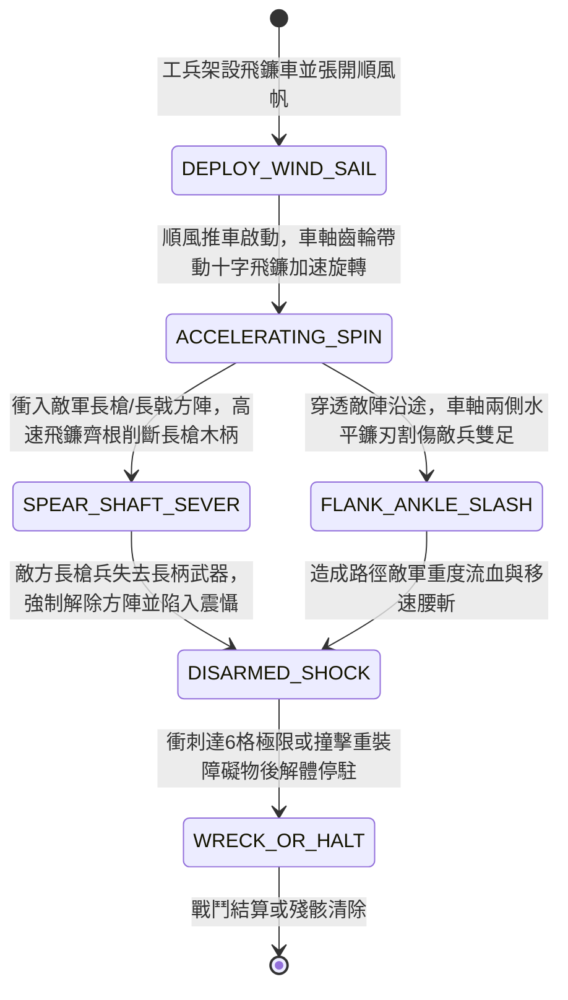

<!-- doc_id: doc_spec_0947 -->
# 戰場夜戰順風施放雙輪連環風力旋轉飛鐮車割裂敵軍長槍方陣狀態機規格書

> **文件編號**：`doc_spec_0947`
> **模組代碼**：`WIND-ROTARY-SCYTHE-CART-SPEAR-BREAK01`
> **對應 WBS**：`FORM-166`（M7 戰場進階機關、城防網罩與精銳步兵重鈍器破甲）
> **單一真相來源（SSOT）**：本文件直接定義風力旋轉飛鐮車割裂長槍方陣之完整物理與戰鬥狀態機，嚴禁於檔尾附加補丁。

---

## 一、 戰術定位與歷史工程原型

在三國野戰對抗中，密集列陣的「長槍方陣（如拒馬長矛陣、大戟士方陣）」憑藉正面兩格的先制穿刺與密集槍林，使我方步騎難以正面突破。**雙輪連環風力旋轉飛鐮車（Wind-Driven Rotary Scythe Cart）** 結合順風帆力與車軸錐齒輪傳動：
1. **車軸齒輪連動雙層十字飛鐮**：車體雙輪包鑲鐵皮，車軸中央設置青銅傘齒輪組，將車輪滾動動能加上車頂順風麻布風帆的推力，轉化為車頭前方水平與垂直交錯的「雙層精鋼十字飛鐮」高速旋轉動能（每車輪轉一圈，飛鐮高速旋斬 4 周）。
2. **削斷木柄與破除長槍先制**：當飛鐮車順風高速衝入敵軍長槍方陣時，前方高速旋轉的精鋼彎鐮會像割麥一般，瞬間將敵軍伸出的白蠟木或梣木長槍桿齊根削斷，徹底廢除敵軍的「長槍拒馬先制（First-Strike）」與「反騎加乘」。
3. **車側雙翼割足鐮刀**：車軸兩側向外延伸三尺長的水平鐮刃，穿入敵陣時高速割傷兩側敵兵小腿，造成大範圍流血與減速。

---

## 二、 觸發條件與建造部署參數

| 參數項目 | 規格數值與限制條件 | 備註說明 |
| :--- | :--- | :--- |
| **環境與地形限制** | 僅限「平原 / 緩坡 / 乾涸河床」且處於 **順風（風速 $\ge 3$ 級）** | 泥濘、森林或逆風無法啟動高速旋斬 |
| **建造資源消耗** | 木材 110、精鐵 125、粗麻帆布 40、工兵戰技點（EP）35 | 每場戰鬥每支工兵部隊最多部署 2 輛 |
| **推進距離與寬度** | 順風直線衝刺 `4 ~ 6` 格；車體連同側翼飛鐮有效殺傷寬度 `1 格 + 兩側半格` | 撞擊城牆、巨石或深溝立即解體 |
| **車體耐久（HP）** | `780` 點（正面受高速旋轉飛鐮保護，遠程箭矢減傷 `75%`） | 火攻傷害承受 `140%`（木架帆布易燃） |

---

## 三、 核心狀態機（State Machine）

---

## 四、 數值結算與戰鬥公式

### 1. 長槍木柄削斷與廢除先制（Spear-Shaft Severing）
當飛鐮車推進至少 `2 格` 進入高速旋轉態（`ACCELERATING_SPIN`），正面撞擊敵方「長槍兵 / 長戟兵 / 拒馬陣」時：
- **長柄削斷判定**：以 `100%` 必中機率削斷正面敵軍的長柄木桿，立即清除敵方 `SPEAR_WALL_FIRST_STRIKE`（長槍先制刺擊）與 `ANTI_CAVALRY_BONUS`（反騎傷害加成）狀態。
- **武器降級（Weapon Downgrade）**：敵方長槍兵被迫拔出隨身短刀作戰，基礎攻擊力永久下降 `40%`，攻擊距離由 `2 格` 強制縮減為 `1 格`（持續至本場戰鬥結束）。

### 2. 正面旋斬與兩翼割足傷害（Rotary Scythe Cleave）
飛鐮車穿透敵軍陣列路徑上，對正面目標格與左右相鄰格（共 3 格寬截面）造成機械切割傷害：
$$\text{Damage}_{\text{scythe}} = \text{BaseATK}_{\text{engineer}} \times 2.15 \times \left(1 + 0.12 \times \text{WindLevel}\right) \times \left(1 - \text{TargetLegArmor} \times 0.45\right)$$
- **斷筋流血（Hamstring Bleed）**：受擊敵軍附加 `ANKLE_SLASH_BLEED`，移動力（MOV）下降 `50%`，且每回合流失最大兵力 `7%`（持續 2 回合）。
- **方陣瓦解（Phalanx Collapse）**：被飛鐮車直接貫穿的中心格敵軍，陣型完整度直接歸零，防禦力（DEF）下降 `35%`（持續 2 回合）。

---

## 五、 反制手段與戰術克制

1. **重型投石與陷馬坑攔截**：若敵軍在飛鐮車衝刺路徑前預掘「陷馬坑（Pitfall）」或以重型投石機直接命中車體，飛鐮車將直接翻覆解體。
2. **鐵甲重盾兵硬抗**：若敵軍前排為手持全鐵大盾的重裝刀盾兵（非木柄長槍），飛鐮砍中厚鐵盾會發生「崩刃卡死」，僅造成 `60%` 傷害並強制停止推進。

---

## 六、 驗收測試案例（Acceptance Tests）

| 測試案例 ID | 測試情境與輸入條件 | 預期狀態轉移與數值輸出 |
| :--- | :--- | :--- |
| **TC-SCYTHE-01** | 夜戰順風（風速 4 級），飛鐮車推進 3 格撞擊敵方「精銳長槍方陣」 | 狀態轉入 `SPEAR_SHAFT_SEVER`，100% 清除敵方長槍先制與反騎加成，敵攻擊力 -40%、射程降為 1 格 |
| **TC-SCYTHE-02** | 飛鐮車穿透敵軍密集步兵群（正面與左右兩翼共 3 隊） | 路徑敵軍承受 $2.15 \times 1.48$ 倍切割傷，全數附加 `ANKLE_SLASH_BLEED`（移速 -50%、每回合損兵 7%） |
| **TC-SCYTHE-03** | 飛鐮車推進途中掉入敵軍預置之「梅花陷馬井」 | 車輪陷落導致飛鐮觸地折斷，狀態直接轉入 `WRECK_OR_HALT`，不觸發後續穿透傷害 |
