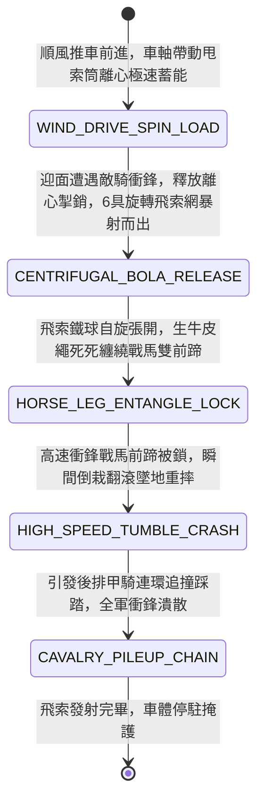

<!-- doc_id: doc_spec_0977 -->
# 戰場夜戰順風施放雙輪連環風力飛石拋索車橫向絆倒敵軍衝鋒甲騎狀態機規格書

> **文件編號**：`doc_spec_0977`
> **模組代碼**：`WIND-ROTARY-BOLA-SLING-TRIP-CAVALRY01`
> **對應 WBS**：`FORM-196`（M7 戰場進階機關、城防夾壁擠碎與精銳步兵雙頭兩段槍）
> **單一真相來源（SSOT）**：本文件直接定義風力飛石拋索車橫向絆倒衝鋒甲騎之完整物理與戰鬥狀態機，嚴禁於檔尾附加補丁。

---

## 一、 戰術定位與歷史工程原型

面對敵方具裝重騎兵（如虎豹騎、西涼鐵騎）排山倒海的密集衝鋒，單兵投擲絆馬索往往距離過短、且力量不足以拉倒高速奔馳的千斤戰馬。塞外獵騎與北方邊軍常使用「飛石流星索（Bola / 絆馬飛索）」。**雙輪連環風力飛石拋索車（Wind-Driven Rotary Bola-Sling Chariot）** 結合「順風帆車推動力」與「車軸連動多管離心甩索桶」：
1. **車軸齒圈驅動四聯裝離心甩索筒**：車體雙輪向前滾動時，透過傳動齒圈帶動車廂上方四組直立式旋轉甩索筒；筒內預置數十具由生牛皮繩兩端繫緊生鐵重球的「連環絆馬飛索（每索重八斤，兩端各栓四斤生鐵球）」。
2. **高速離心旋轉甩射飛索網**：當拋索車順風衝刺時，離心力將飛索自發射筒中高速甩出，兩顆生鐵重球在空中自旋張開成丈二寬的旋轉繩網，迎面射向衝鋒中的敵方騎兵隊列。
3. **戰馬四蹄死死纏繞摔跌**：旋轉飛索一旦接觸戰馬前肢，生鐵重球的慣性會使皮繩瞬間繞著馬腿纏繞數圈並死死打結；高速奔馳的戰馬雙蹄被鎖，瞬間失去平衡向前翻滾撲倒，連帶將身後緊隨的甲騎絆倒成一片。

---

## 二、 觸發條件與建造部署參數

| 參數項目 | 規格數值與限制條件 | 備註說明 |
| :--- | :--- | :--- |
| **環境與地形限制** | 陸地開闊平原；處於 **順風（風速 $\ge 2$ 級）** 時飛索射程 $+1$ 格 | 泥濘或森林地形中飛索易被樹木阻擋 |
| **建造資源消耗** | 硬木 80、生鐵球與熟牛皮索 130、棘輪齒圈 50、工兵 EP 35 | 每場戰鬥最多部署 2 輛飛石拋索車 |
| **射程與覆蓋範圍** | 直線拋射距離 `3 ~ 5` 格；橫向覆蓋寬度 `3 格` | 專克「衝鋒中（MOV $\ge 3$）之各類騎兵」 |
| **車體耐久（HP）** | `820` 點（正面安裝雙層生牛皮傾斜擋箭板，減免 `65%` 箭傷） | 滿載可供發射 `3` 輪（每輪 6 具飛索） |

---

## 三、 核心狀態機（State Machine）

---

## 四、 數值結算與戰鬥公式

### 1. 飛索纏腿與絆倒傷害（Bola Leg Entanglement & Crash）
當飛索網覆蓋目標格內正在衝鋒的騎兵部隊時：
$$\text{Damage}_{\text{crash}} = \text{BaseATK}_{\text{engineer}} \times 2.05 + \text{TargetCurrentMOV} \times 55$$
- **速度反噬真傷**：敵方戰馬當前移動速度（MOV）越高，摔跌的動能反噬越大，直接無視目標馬鎧防禦造成巨量摔傷。
- **100% 絆倒落馬**：目標部隊 `100%` 附加 `BOLA_ENTANGLED_CRASH`（倒地不起 `1 回合`，移動力清零，且喪失騎兵衝鋒特權）。

### 2. 連環追尾踩踏（Chain Pileup Stumble）
若被絆倒的騎兵身後相鄰格有另一隊騎兵，後隊以 `75%` 機率觸發「追撞連鎖」：
- 後隊移動強制中斷，承受 `110% ATK` 碰撞傷害，且士氣下降 `20` 點。

---

## 五、 反制手段與戰術克制

1. **短刀死士隨騎突前割繩**：若敵騎前方配有輕裝刀手，可在飛索射來時揮刀凌空劈斷皮繩。
2. **駐定步戰迎敵**：若敵方騎兵提前勒馬停步（MOV=0），飛索僅能造成普通鈍擊，無法觸發高速翻滾摔傷。

---

## 六、 驗收測試案例（Acceptance Tests）

| 測試案例 ID | 測試情境與輸入條件 | 預期狀態轉移與數值輸出 |
| :--- | :--- | :--- |
| **TC-BOLA-01** | 對以 MOV=5 高速衝鋒而來的西涼甲騎發射旋轉飛索網 | 戰馬前蹄遭鎖，扣除基礎傷害外追加 $5 \times 55 = 275$ 點摔傷，100% 絆倒落馬 |
| **TC-BOLA-02** | 被絆倒騎兵身後緊跟 1 隊長槍騎兵 | 後隊觸發連環追尾，移動強制中斷，承受 110% 碰撞傷且士氣 -20 |
| **TC-BOLA-03** | 敵方騎兵處於靜止駐定狀態（MOV=0） | 飛索命中僅造成基礎傷害，不觸發高速摔傷與追撞連鎖 |
