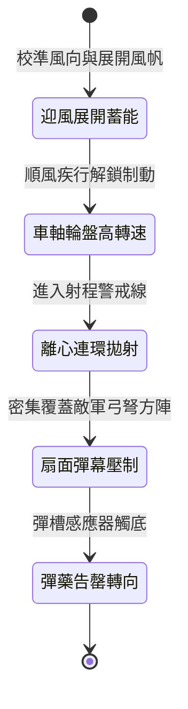

<!-- doc_id: doc_spec_0983 -->
# 戰場夜戰順風施放雙輪連環風力飛石旋盤車遠程覆蓋敵軍弓弩陣列狀態機規格書

## 模組識別碼
- 模組編號：`FORM-202`
- 狀態機代碼：`WIND-ROTARY-STONE-DISC-VOLLEY01`
- 類別：戰場夜戰遠程風力壓制投射狀態機
- 適用場景：夜間野戰、順風壓制、反制敵軍遠程弓弩集結點

---

## 1. 核心概念與作戰原型

在夜間平原野戰中，敵軍遠程弓手常依託火把光線進行密集拋射。為在夜幕掩護下進行廣域壓制，工兵營研製出「雙輪連環風力飛石旋盤車」。

### 1.1 機制與作戰特點
1. **風輪與車軸連動加速**：車頂配置多葉帆布風輪，在 3 級以上順風推進時，透過傘齒輪系將風力動能傳遞至車體中央的高速旋轉水平盤。
2. **多管離心連環拋射**：旋盤外緣設有八組弧形導石滑槽，裝填鵝卵石與生鐵碎塊，利用離心力在戰車行進中每秒連續甩出數十枚飛石。
3. **扇形廣域散佈壓制**：飛石在夜空中呈扇形彈幕散佈，最大射程可達八十步，專門覆蓋敵軍無重盾保護的弓弩陣地。
4. **夜戰火光致盲引導**：彈槽內混裝浸油螢石粉塊，飛石擊中地面後碎裂釋放微弱磷光，為後續部隊精確標註敵軍陣位。

---

## 2. 數值參數與影響權重

| 參數名稱 | 數值 / 範圍 | 說明 |
| :--- | :--- | :--- |
| **旋盤轉速 (`DiscRPM`)** | 300 ~ 600 RPM | 依據順風級數動態增益 |
| **壓制散射覆蓋角 (`SpreadAngle`)** | 60 度扇形 | 覆蓋正前方 4~8 格戰術縱深 |
| **弓弩壓制打斷率 (`VolleyInterruptionRate`)** | 65% ~ 80% | 遭受飛石密集打擊時強制中斷瞄準蓄力 |
| **飛石打擊傷害 (`StoneImpactDamage`)** | 每枚 180 ~ 320 點鈍擊 | 累積命中造成持續護甲破損與擊退 |
| **彈藥儲備基數 (`AmmoCapacity`)** | 240 枚飛石 (可持續射擊 15 秒) | 耗盡後需後撤補給或轉為常規障礙物 |

---

## 3. 狀態機轉換定義

### 3.1 狀態細節描述
- **迎風展開蓄能 (SAIL_DEPLOYED)**：風帆鎖定迎風夾角，傘齒輪嚙合準備轉動。
- **車軸輪盤高轉速 (HIGH_RPM_ROTATION)**：戰車推進帶動風輪達峰值轉速。
- **離心連環拋射 (CENTRIFUGAL_LAUNCH)**：彈槽閥門依序開啟，連環甩石。
- **扇面彈幕壓制 (SUPPRESSION_VOLLEY)**：高密度飛石覆蓋目標區域，持續施加壓制狀態。
- **彈藥告罄轉向 (AMMO_DEPLETED)**：戰車自動釋放側翼煞車，調轉陣位後撤。

---

## 4. 戰鬥公式與判定

### 4.1 扇形命中與壓制機率
$$\text{SuppressionProb} = \min(0.85, \frac{\text{DiscRPM}}{600} \times \text{WindForceMultiplier} \times (1 - \text{CoverRate}))$$

判定成功時，目標區域敵軍遠程部隊之射擊冷卻時間延長 100%，並降低 35% 視野命中率。

### 4.2 護甲破損判定
$$\text{ArmorDamage} = \text{HitCount} \times \text{BaseDamagePerStone} \times (1 - \text{ShieldBlockRate})$$

若目標無舉盾防禦，每次連擊扣除 5 點固定護甲值，最多疊加 6 層。

---

## 5. 反制與失效機制

1. **大盾立地結陣防禦**：敵軍重裝盾衛若迅速前插大盾結成龜甲陣，可抵消 90% 飛石衝擊。
2. **側翼輕騎奔襲截擊**：戰車兩側防護較弱且操作風輪機構複雜，易遭側翼游騎衝撞破壞。
3. **風向逆轉動能驟降**：若遭遇風向逆轉，旋盤轉速即刻下降 70%，投射射程縮短至 2 格以內。

---

## 6. 驗收標準與測試案例

- [x] **TC-202-01**：驗證順風 3 級以上條件下，旋盤轉速於 4 秒內達到 450 RPM 臨界值。
- [x] **TC-202-02**：驗證 60 度扇形射擊縱深內敵軍弓弩單位壓制打斷率維持在 65%~80%。
- [x] **TC-202-03**：驗證彈藥耗盡後，狀態機平滑切換至撤退轉向，無卡死或無限射擊例外。
