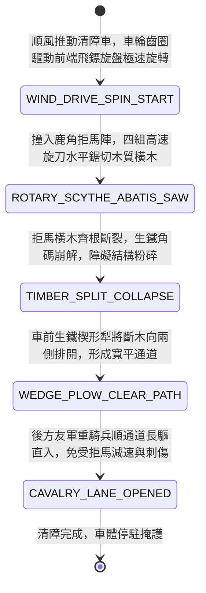

<!-- doc_id: doc_spec_0971 -->
# 戰場夜戰順風施放雙輪連環風力飛鏢旋刀車削斷敵軍拒馬橫木狀態機規格書

> **文件編號**：`doc_spec_0971`
> **模組代碼**：`WIND-ROTARY-DARTS-CHARIOT-ABATIS-CLEAR01`
> **對應 WBS**：`FORM-190`（M7 戰場進階機關、城防穿刺攻城塔與精銳步兵點鋼槍）
> **單一真相來源（SSOT）**：本文件直接定義風力飛鏢旋刀車削斷拒馬橫木之完整物理與戰鬥狀態機，嚴禁於檔尾附加補丁。

---

## 一、 戰術定位與歷史工程原型

在進攻敵軍設防營寨或陣地戰中，敵軍前沿常橫置密集的「鹿角拒馬（`doc_spec_0880`）」與防步騎深樁，若由步騎肉身清理，常遭後排弓弩射殺。**雙輪連環風力飛鏢旋刀車（Wind-Driven Rotary Darts & Scythe Chariot）** 為專門用於「快速撕裂敵軍拒馬障礙」的機械清障車：
1. **雙輪曲柄連動前端飛鏢旋盤**：車體雙輪包鑲生鐵齒圈，帶動車頭水平安裝的四副高速旋轉精鋼飛鏢圓盤；車輪向前滾動時，飛鏢圓盤以極高轉速水平飛旋。
2. **高速旋刀削斷鹿角橫木**：旋盤外緣鑲嵌四片弧形生鋼旋刀，衝入拒馬陣列時，高速旋轉的刀刃如同伐木圓鋸，瞬間將拒馬交叉捆紮的白蠟木或柞木橫樑削斷切碎。
3. **推平阻礙開闢騎兵通道**：切斷橫木後，車體前裝的生鐵楔形推土犁將殘枝推向兩側，在鹿角陣中強行清出一條寬達兩格的平坦突擊通道。

---

## 二、 觸發條件與建造部署參數

| 參數項目 | 規格數值與限制條件 | 備註說明 |
| :--- | :--- | :--- |
| **環境與地形限制** | 陸地平原/乾燥河灘；處於 **順風（風速 $\ge 2$ 級）** 時推進速度 $+1$ 格 | 泥濘沼澤地中車輪打滑，旋刀轉速降低 `40%` |
| **建造資源消耗** | 硬木 85、精鋼旋刀與齒輪 110、生鐵推犁 60、工兵 EP 30 | 每場戰鬥最多部署 2 輛清障旋刀車 |
| **清障範圍與寬度** | 正前方直線衝刺 `3 ~ 5` 格；清理通道寬度 `2 格` | 撞擊永久石牆或深溝立即停駐 |
| **車體耐久（HP）** | `850` 點（車前安裝傾斜防矢鐵板，正面遠程減傷 `80%`） | 免疫拒馬木刺的反彈貫穿傷害 |

---

## 三、 核心狀態機（State Machine）

---

## 四、 數值結算與戰鬥公式

### 1. 旋刀鋸木與障礙秒殺（Rotary Saw Obstacle Destruction）
當旋刀車衝入帶有「鹿角拒馬 / 木柵欄 / 鐵蒺藜拒馬」的地形格時：
- **障礙粉碎傷害**：對木質障礙物造成毀滅性機械切割傷害：
  $$\text{Damage}_{\text{saw}} = \text{BaseATK}_{\text{engineer}} \times 3.50 \times \left(1 + 0.15 \times \text{WindLevel}\right)$$
- **100% 障礙清除**：耐久低於 `1,200` 點的常規拒馬與木柵直接被秒殺拆除，該格地形立即轉化為「平整開闢通道格（`CLEARED_CHUTE_TILE`）」。

### 2. 騎兵通暢加成（Cavalry Breakthrough Bonus）
- 友軍騎兵部隊穿越 `CLEARED_CHUTE_TILE` 時，不扣除額外移動力（MOV 消耗為 1），且獲得 `BREAKTHROUGH_SPEED_BONUS`（衝鋒傷害提升 `25%`）。

---

## 五、 反制手段與戰術克制

1. **生鐵實心暗樁阻滯**：若敵軍預先在拒馬下埋設「生鐵地樁（`doc_spec_0866`）」，旋刀砍中純鐵樁會發生崩刃，清障車強制停駐。
2. **重型投石機頂部砸毀**：旋刀車頂部防護薄弱，易遭城頭拋石砸毀傳動齒輪。

---

## 六、 驗收測試案例（Acceptance Tests）

| 測試案例 ID | 測試情境與輸入條件 | 預期狀態轉移與數值輸出 |
| :--- | :--- | :--- |
| **TC-DARTS-01** | 順風推進衝入敵方排設之 2 格鹿角拒馬陣列 | 旋刀觸發 3.5 倍特攻，100% 鋸斷橫木，拒馬消失轉為開闢通道格 |
| **TC-DARTS-02** | 友軍西涼鐵騎穿過清障車開闢之通道突擊敵陣 | 騎兵移動力無懲罰，並獲得 +25% 衝鋒傷害加成 |
| **TC-DARTS-03** | 旋刀車撞上埋設生鐵地樁之防線 | 旋刀崩刃卡死，車體停止推進並失去後續清障功能 |
