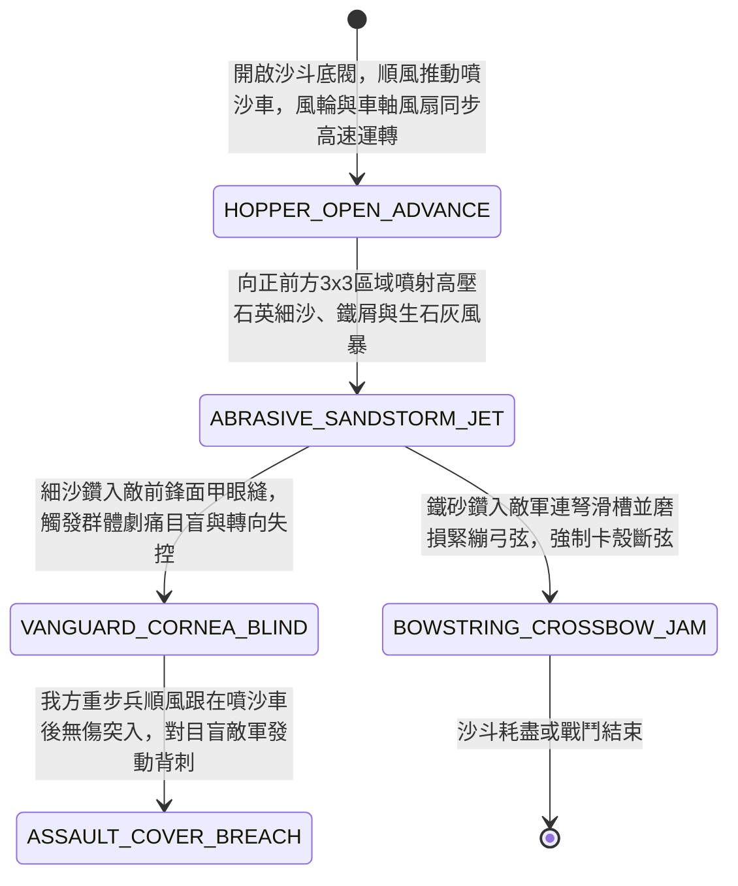

<!-- doc_id: doc_spec_0959 -->
# 戰場夜戰順風施放雙輪連環風力鼓風噴沙車致盲敵軍前鋒與磨損弓弦狀態機規格書

> **文件編號**：`doc_spec_0959`
> **模組代碼**：`WIND-BELLOWS-SAND-BLASTER-BLIND01`
> **對應 WBS**：`FORM-178`（M7 戰場進階機關、城防狼牙擺錘與精銳步兵雙鐵戟）
> **單一真相來源（SSOT）**：本文件直接定義風力鼓風噴沙車致盲敵軍前鋒與磨損弓弦之完整物理與戰鬥狀態機，嚴禁於檔尾附加補丁。

---

## 一、 戰術定位與歷史工程原型

在北方荒漠、乾燥黃土高原或河灘野戰中，若無火油資源或遇敵軍預先防火覆泥，傳統火攻車威力受限。《梁書》與唐宋兵書記載守邊名將常造「揚塵車 / 鼓風飛沙車」，借風勢將炒乾的石英細沙混合生石灰粉吹向敵陣。**雙輪連環風力鼓風噴沙車（Wind-Driven Bellows Sand-Blaster Cart）** 為專司「大範圍物理致盲與機械磨損」的戰術壓制車輛：
1. **風輪葉片與車軸雙重鼓風**：車頂安裝六葉順風木製風輪，車底則由雙輪車軸曲柄連動大型四扇木製旋轉風扇（木風車），車廂漏斗內滿載三百斤經烈火焙乾的「稜角石英細沙、鐵砂屑與生石灰粉」。
2. **飛沙走石致盲風暴**：當噴沙車順風推進時，漏斗底閥開啟，高壓強風將細沙鐵屑以極高初速向前方噴射，形成一道席捲三格寬的「黃沙暴障」，直接灌入敵軍前鋒的面甲眼孔與口鼻，使其睜不開眼陷入嚴重目盲。
3. **磨損牛筋弓弦與卡死連弩**：高速飛旋的石英細沙與鐵砂屑會鑽入敵軍諸葛連弩的木製箭匣滑槽，並劇烈摩擦緊繃的絲製或牛筋弓弦，導致敵方連弩卡殼、弓弦脆化繃斷。

---

## 二、 觸發條件與建造部署參數

| 參數項目 | 規格數值與限制條件 | 備註說明 |
| :--- | :--- | :--- |
| **環境與氣象要求** | 限乾燥地形（平原/荒漠/黃土/乾河床）且處於 **順風（風速 $\ge 2$ 級）** | 雨天或泥濘沼澤細沙受潮結塊，無法施放 |
| **建造資源消耗** | 硬木 90、石英細沙與鐵屑 140、生石灰 50、工兵戰技點（EP）30 | 每場戰鬥最多部署 3 輛鼓風噴沙車 |
| **推進與噴射範圍** | 每回合推進 `2 格`；持續向正前方扇形 `3 格 × 3 格` 噴射高壓飛沙 | 不消耗火油，亦不會被雨水或防火泥漿克制 |
| **車體耐久（HP）** | `880` 點（車體前設斜木擋沙板，遠程箭矢減傷 `75%`） | 沙斗裝載量可供連續噴射 `4 回合` |

---

## 三、 核心狀態機（State Machine）

---

## 四、 數值結算與戰鬥公式

### 1. 飛沙迷目與前鋒失向（Abrasive Sandstorm Blinding）
處於噴沙車正前方 `3 × 3` 飛沙風暴區內的敵軍，每回合自動承受飛沙刮擦傷害並進行致盲判定：
$$\text{Damage}_{\text{sand}} = \text{BaseATK}_{\text{engineer}} \times 0.85 \times \left(1 + 0.15 \times \text{WindLevel}\right)$$
- **角膜刮傷致盲（Cornea Blindness）**：範圍內敵軍以 `90%` 機率附加 `ABRASIVE_SAND_BLIND`（物理命中率下降 `60%`、暴擊率歸零、視野縮減為 `1 格`，持續 2 回合）。
- **騎兵衝鋒偏折**：敵方騎兵若試圖迎著飛沙風暴發動直線衝鋒，戰馬因眼鼻進沙驚慌偏航，衝鋒動能加成強制歸零並隨機向側方偏離 `1 格`。

### 2. 弓弦磨損與連弩卡殼（Bowstring Abrasion & Crossbow Jamming）
飛沙中的石英顆粒與鐵屑對精密遠程武器具有致命破壞力：
- **連弩滑槽卡死**：範圍內的「諸葛連弩兵 / 床弩 / 井闌」受到飛沙灌入，觸發 `MECHANISM_SAND_JAM`（連射次數強制降為單發，且每次射擊有 `50%` 機率卡殼失敗，持續 2 回合）。
- **弓弦磨損繃斷**：敵方一般弓兵在飛沙區內強行開弓射擊時，有 `40%` 機率因細沙割裂弓弦觸發「斷弦反彈」，不僅攻擊失效，更損失 `8%` 兵力且本回合無法再射擊。

---

## 五、 反制手段與戰術克制

1. **戰馬防驚皮罩與溼布蒙面**：若敵軍配備「雙耳裹布眼戴狹縫皮罩（`doc_spec_0882`）」或步兵以水囊打濕布巾蒙住眼鼻，飛沙致盲率降低 `50%`。
2. **城門高壓注水或人工降雨**：若在城門下遭守軍高壓注水孔（`doc_spec_0927`）淋溼，飛沙瞬間化為泥水沉降，失去致盲與卡弩效果。

---

## 六、 驗收測試案例（Acceptance Tests）

| 測試案例 ID | 測試情境與輸入條件 | 預期狀態轉移與數值輸出 |
| :--- | :--- | :--- |
| **TC-SAND-01** | 夜戰順風（風速 3 級），噴沙車對正前方 3x3 敵方「先登重步兵與騎兵」噴沙 | 90% 機率附加 `ABRASIVE_SAND_BLIND`（命中 -60%、視野降為 1 格），敵騎衝鋒動能歸零並偏航 |
| **TC-SAND-02** | 飛沙覆蓋敵方「諸葛連弩兵」，且連弩兵試圖發動三段齊射 | 觸發 `MECHANISM_SAND_JAM`，三段連射被廢除降為單發，且有 50% 機率直接卡殼啞火 |
| **TC-SAND-03** | 敵方騎兵已裝備 `doc_spec_0882` 防驚狹縫皮眼罩迎向噴沙車 | 受皮罩保護，飛沙致盲觸發率由 90% 大幅降至 40% |
