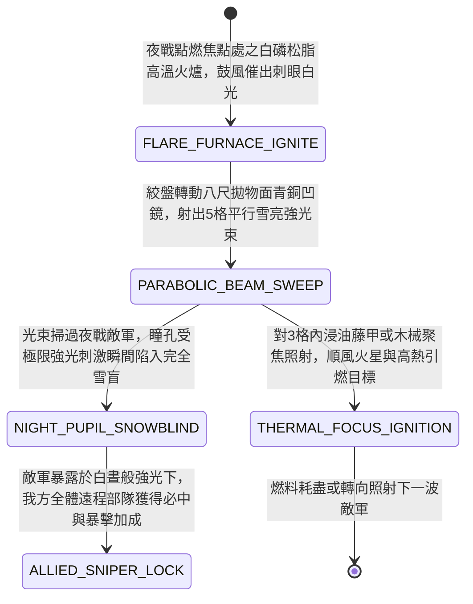

<!-- doc_id: doc_spec_0962 -->
# 戰場夜戰順風施放雙馬絞盤火油銅鏡聚光車強光致盲與點燃敵軍藤甲狀態機規格書

> **文件編號**：`doc_spec_0962`
> **模組代碼**：`PARABOLIC-BRONZE-MIRROR-FLAME-GLARE01`
> **對應 WBS**：`FORM-181`（M7 戰場進階機關、城防門洞地刺沸油與精銳步兵擂鼓甕金錘）
> **單一真相來源（SSOT）**：本文件直接定義火油銅鏡聚光車強光致盲與點燃藤甲之完整物理與戰鬥狀態機，嚴禁於檔尾附加補丁。

---

## 一、 戰術定位與歷史工程原型

在夜戰中，傳統「銅鏡月光晃刺（`doc_spec_0893`）」受限於滿月天氣，遇陰雲無月即失效。**雙馬絞盤火油銅鏡聚光車（Parabolic Bronze-Mirror & Oil-Flare Glare Cart）** 結合「白磷松脂烈焰火盆」與「八尺拋物面青銅凹面反射鏡（陽燧放大版）」，創造不受月相限制的夜間強光與熱輻射束：
1. **拋物面青銅巨鏡**：四輪重木車架安裝直徑八尺、打磨如雪的青銅拋物面凹鏡，可透過絞盤自由旋轉方向與俯仰角。
2. **焦點白磷松脂火爐**：於凹鏡正前方焦點處懸掛鼓風燃燒的「白磷、鎂石粉與松脂猛火油」高溫火爐；刺眼白熾強光經八尺拋物面銅鏡平行聚焦反射，化為直射百步、亮如白晝的「雪亮強光熱束」。
3. **黑夜瞬間雪盲與熱焦點引燃藤甲**：敵軍瞳孔於黑夜放大狀態猛然被平行強光掃中，全軍瞬間陷入「強光雪盲」；若光束持續聚焦鎖定近距浸油藤甲兵或塗油木盾，高溫熱輻射連同順風火星將直接引燃敵軍油浸護甲。

---

## 二、 觸發條件與建造部署參數

| 參數項目 | 規格數值與限制條件 | 備註說明 |
| :--- | :--- | :--- |
| **環境與氣象要求** | 限 **夜戰**（無論晴雨陰雲皆可運作）；**順風** 時熱輻射與火星射程 $+1$ 格 | 白晝環境下敵軍瞳孔收縮，強光致盲效果衰減 `70%` |
| **建造資源消耗** | 精銅與水銀錫膏 140、白磷松脂油 90、硬木 80、工兵 EP 35 | 每場夜戰最多部署 2 輛火油銅鏡聚光車 |
| **照射距離與範圍** | 直線光束長達 `5 格`（寬 `1 格`）；或調整焦距為前方扇形 `3 格` 廣角強光 | 光束可穿透地面低矮拒馬，直接照射敵方後排弓弩與騎兵 |
| **車體耐久（HP）** | `800` 點（青銅鏡面可彈開普通箭矢，但遭重型投石命中會使鏡面碎裂失焦） | 火爐燃料可供連續強光照射 `4 回合` |

---

## 三、 核心狀態機（State Machine）

---

## 四、 數值結算與戰鬥公式

### 1. 夜戰瞳孔強光雪盲與暴露標記（Night Snow-Blindness & Exposure）
當聚光車於夜戰對直線 `5 格`（或扇形 `3 格`）射出強光束時：
- **100% 破除夜隱與強制雪盲**：光束路徑上所有敵軍立即喪失「夜間隱匿（Night Stealth）」狀態，並以 `95%` 機率附加 `PARABOLIC_GLARE_BLIND`（強光雪盲：物理與遠程命中率下降 `65%`、無法執行「警戒齊射」，持續 1 回合）。
- **白晝標靶引導（Daylight Target Lock）**：被強光束籠罩的敵軍在黑夜中纖毫畢現，我方所有弓弩手、連弩與投石車對該目標發動遠程攻擊時，無視夜戰射程懲罰，且命中率提升 `40%`、暴擊率提升 `25%`。

### 2. 熱焦點聚焦引燃藤甲（Thermal Focus Ignition）
若聚光車將青銅鏡焦距鎖定在距離 `1 ~ 3 格` 的單一目標，配合順風吹出的白磷火星：
$$\text{Damage}_{\text{thermal}} = \text{BaseATK}_{\text{engineer}} \times 1.45 \times \text{OilArmorMult}$$
- **油浸藤甲與木盾引燃**：若目標為「藤甲兵（`doc_spec_0916`）」、「火牛假人」或攜帶油浸木盾的部隊，$\text{OilArmorMult} = 3.2$，且 `100%` 觸發 `SPONTANEOUS_OIL_IGNITION`（全身油甲爆燃，每回合流失 `15%` 兵力並傳染相鄰格）。

---

## 五、 反制手段與戰術克制

1. **鼓風噴沙車 / 竹筒毒煙遮蔽光路**：若敵軍施放高濃度「鼓風噴沙車（`doc_spec_0959`）」或濃密黑煙擋在光束前方，強光束會被沙塵濃煙散射吸收，無法穿透至後排。
2. **重石砸裂青銅鏡面**：一旦被敵方投石車或床弩巨矢正面擊中青銅凹鏡（承受超過 `400` 點單次鈍擊/穿刺傷害），鏡面凹度變形失焦，照射射程永久縮減為 `2 格`。

---

## 六、 驗收測試案例（Acceptance Tests）

| 測試案例 ID | 測試情境與輸入條件 | 預期狀態轉移與數值輸出 |
| :--- | :--- | :--- |
| **TC-MIRROR-01** | 無月黑夜，聚光車對前方 5 格直線上的敵方「夜行死士與連弩兵」射出強光 | 100% 破除夜隱，95% 機率附加 `PARABOLIC_GLARE_BLIND`（命中 -65%、廢除警戒），我方遠程對其暴擊 +25% |
| **TC-MIRROR-02** | 順風狀態下，聚光車對距離 2 格的敵方「浸油黑藤甲兵」進行熱焦點聚焦 | 觸發 $3.2$ 倍油甲特攻，並 100% 點燃藤甲引發每回合 15% 兵力流失與連鎖傳染 |
| **TC-MIRROR-03** | 光束路徑第 2 格被敵方「鼓風毒煙車」噴出的濃密黑煙覆蓋 | 強光束在第 2 格被黑煙阻斷，第 3~5 格的敵軍不受強光雪盲影響 |
