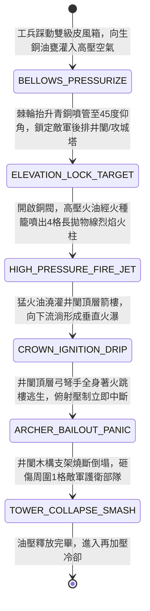

<!-- doc_id: doc_spec_0950 -->
# 戰場夜戰順風施放雙馬絞盤火油風箱車噴射高壓火柱焚毀敵軍井闌狀態機規格書

> **文件編號**：`doc_spec_0950`
> **模組代碼**：`HIGH-PRESSURE-OIL-BELLOWS-TOWER-BURN01`
> **對應 WBS**：`FORM-169`（M7 戰場進階機關、城防垛口狼牙翻板與精銳步兵開山大鉞）
> **單一真相來源（SSOT）**：本文件直接定義雙馬絞盤火油風箱車噴射高壓火柱焚毀井闌之完整物理與戰鬥狀態機，嚴禁於檔尾附加補丁。

---

## 一、 戰術定位與歷史工程原型

在攻城與陣地對峙戰中，敵軍常推來高聳的「井闌（高空俯射箭樓）」或「臨衝呂公車」，憑藉兩丈高度優勢以拋射箭雨壓制我方，且普通地面步兵難以觸及頂部。**雙馬絞盤火油風箱車（High-Pressure Oil-Bellows Fire-Column Cart）** 專為「仰角遠距焚毀高大攻城木械」而設計：
1. **雙級皮風箱與生銅蓄壓甕**：車身搭載密封厚壁生銅蓄壓油甕（裝填石油瀝青與松脂混合猛火油），後方由工兵踩動雙級牛皮風箱持續灌入高壓空氣。
2. **仰角四十五度青銅水龍管**：車頭裝有棘輪調角（$0^\circ \sim 60^\circ$）青銅長噴管，管口設常明硫磺火種籠。
3. **高壓仰射火柱焚頂**：敵軍井闌進入射程時開啟銅閥，高壓空氣將猛火油化為長達 4 格的「高壓拋物線火柱」，越過敵軍前排地面盾兵，精準澆灌在井闌頂層箭樓與射手頭頂，使高樓自上而下化為火炬崩塌。

---

## 二、 觸發條件與建造部署參數

| 參數項目 | 規格數值與限制條件 | 備註說明 |
| :--- | :--- | :--- |
| **環境與氣象加成** | 任意陸地地形皆可施放；若處於 **順風（風速 $\ge 2$ 級）** 射程 $+1$ 格 | 暴雨天氣下火柱溫度降低，傷害衰減 `25%` |
| **建造資源消耗** | 精銅 120、猛火油 150、硬木 100、工兵戰技點（EP）45 | 每場戰鬥最多部署 2 輛火油風箱車 |
| **射程與彈道特性** | 高壓拋物線仰射 `3 ~ 4` 格（順風可達 `5` 格）；**無視前排地面單位阻擋** | 專精打擊高空箭樓（井闌）、攻城塔、木構營樓 |
| **車體耐久與儲油量** | 耐久 `860` 點；滿載儲油可供高壓噴射 `3` 次（耗盡需工兵裝填 1 回合） | 若車體被火矢擊破且耐久歸零，將引發原地油甕殉爆 |

---

## 三、 核心狀態機（State Machine）

---

## 四、 數值結算與戰鬥公式

### 1. 高壓仰射火柱與破空打擊（High-Pressure Elevated Fire-Jet）
當火油風箱車完成加壓並對距離 `3 ~ 5` 格的目標噴射高壓火柱時：
- **越障直擊（Over-Obstacle Strike）**：拋物線高壓火柱直接越過路徑上的敵方前排盾牆，對目標格造成烈焰噴射傷害：
  $$\text{Damage}_{\text{jet}} = \text{BaseATK}_{\text{engineer}} \times 2.40 \times \left(1 + 0.10 \times \text{WindLevel}\right) \times \text{WoodStructureMult}$$
- **高空木械特攻（Siege-Tower Breaker）**：若目標為「井闌 / 臨衝高樓 / 箭塔 / 投石車」，$\text{WoodStructureMult} = 2.8$；若為一般步騎則為 $1.0$。

### 2. 頂層火瀑流淌與射手跳樓潰散（Crown Ignition & Archer Bailout）
被高壓火柱命中的井闌或箭塔，立即附加 `CROWN_BLAZE_WATERFALL`（頂層火瀑燃燒，持續 3 回合）：
- **俯射機能癱瘓**：猛火油自頂層平台向下流淌燃燒，井闌頂部的弓弩手無法站立拉弓，敵方井闌的「高空俯射射程加成」與「多重齊射」立即被強制封禁，射程縮減為 `0`（完全喪失遠程攻擊能力）。
- **結構崩塌砸傷（Tower Collapse）**：每回合對井闌本體造成最大耐久 `30%` 的真實燃燒損毀；當井闌耐久歸零倒塌時，巨大的燃燒木架向四周傾覆，對井闌周圍九宮格（`3 × 3`）內的敵方護衛步兵造成 `160% ATK` 的砸擊與火燒複合傷害。

---

## 五、 反制手段與戰術克制

1. **輕騎兵繞後突襲與引爆銅甕**：火油風箱車仰角噴管轉向較慢（無法攻擊貼身 `1 格` 內的敵人）；若敵方輕騎兵繞後擊毀風箱車，生銅油甕破裂將對風箱車周圍 `1 格` 友軍造成 `150%` 殉爆火傷。
2. **城門注水孔與濕泥覆蓋**：若目標預先塗抹厚層黃泥或生牛皮濕氈（如 `doc_spec_0945`），火柱造成的持續燃燒傷害降低 `60%`。

---

## 六、 驗收測試案例（Acceptance Tests）

| 測試案例 ID | 測試情境與輸入條件 | 預期狀態轉移與數值輸出 |
| :--- | :--- | :--- |
| **TC-BELLOWS-01** | 夜戰順風（風速 3 級），風箱車隔著敵前排重盾兵對後排第 4 格「攻城井闌」噴射 | 拋物線火柱越過重盾兵直擊井闌，觸發 $2.8$ 倍木械特攻，附加 `CROWN_BLAZE_WATERFALL` |
| **TC-BELLOWS-02** | 敵方井闌處於 `CROWN_BLAZE_WATERFALL` 頂層火瀑狀態下輪到其行動 | 井闌弓弩手跳樓逃生，遠程攻擊與高空俯射完全封禁（射程歸零），並承受 30% 最大耐久真傷 |
| **TC-BELLOWS-03** | 敵方井闌因燃燒耐久歸零倒塌，其周圍 1 格內有 2 隊敵方護衛槍兵 | 觸發 `TOWER_COLLAPSE_SMASH`，倒塌火架對周圍 2 隊敵軍造成 160% 砸擊與火燒複合傷害 |
