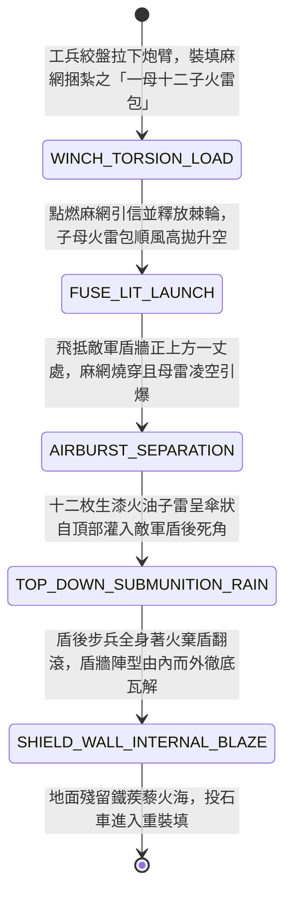

<!-- doc_id: doc_spec_0956 -->
# 戰場夜戰順風施放雙馬絞盤火雷連環投石車拋射子母散彈破除敵軍盾牆狀態機規格書

> **文件編號**：`doc_spec_0956`
> **模組代碼**：`CLUSTER-FIRE-BOMB-CATAPULT-SHIELD-BREAK01`
> **對應 WBS**：`FORM-175`（M7 戰場進階機關、城防排叉推刺與精銳步兵丈八蛇矛）
> **單一真相來源（SSOT）**：本文件直接定義火雷連環投石車拋射子母散彈破除敵軍盾牆之完整物理與戰鬥狀態機，嚴禁於檔尾附加補丁。

---

## 一、 戰術定位與歷史工程原型

在攻堅戰中，面對敵軍前排緊密排列的「魚鱗大盾陣（龜甲陣）」或深釘地樁的包鐵立盾牆，單顆實心巨石雖能砸穿一點，卻難以瓦解整條盾牆防線；而普通火箭又會被覆皮鐵盾彈開。**雙馬絞盤火雷連環投石車（Cluster Fire-Bomb Catapult Cart）** 結合了扭力投石機與「子母連環火雷包」設計：
1. **雙馬機動炮架與皮索絞盤**：四輪硬木車架由雙馬牽引，炮臂採用多股浸油牛筋皮索蓄力，尾部設棘輪絞盤快速拉桿。
2. **麻網子母火雷包（Cluster Bomb）**：皮兜內不放單顆巨石，而是裝入一個由浸透松脂的粗麻網袋捆紮而成的「子母火雷包」——中心為一枚裝滿硫磺與黑火藥引信的大陶甕（母雷），外圍緊密包裹十二枚拳頭大小、裝填生漆猛火油與生鐵蒺藜的薄殼小瓷球（子雷）。
3. **半空解體與跨盾頂爆（Airburst & Top-Down Scatter）**：拋射升空後，麻網袋被母雷引信燒穿於敵軍盾牆正上方一丈處解體，母雷凌空炸裂將十二枚燃燒子雷呈傘狀向下猛烈迸射，直接繞過正面的大立盾，從盾牌後上方的盲區灌入敵軍陣列內部爆燃。

---

## 二、 觸發條件與建造部署參數

| 參數項目 | 規格數值與限制條件 | 備註說明 |
| :--- | :--- | :--- |
| **環境與氣象加成** | 陸地皆可施放；處於 **順風（風速 $\ge 2$ 級）** 時散彈散布半徑擴大且火傷 $+15\%$ | 強逆風（$\ge 4$ 級）會導致子雷提前飄散，命中率 `-25%` |
| **建造資源消耗** | 硬木 100、牛筋皮索 70、硫磺猛火油 130、生鐵瓷球 80、工兵 EP 40 | 每場戰鬥最多部署 2 輛火雷連環投石車 |
| **射程與覆蓋範圍** | 拋射射程 `4 ~ 7` 格（最小射程盲區 `3 格`）；凌空解體覆蓋十字 `5 格` | 屬於高空頂部打擊（Top-Attack），無視正面舉盾格擋 |
| **車體耐久與彈藥** | 耐久 `820` 點；攜帶子母火雷包 `4` 組 | 每次發射後需冷卻裝填 `1 回合` |

---

## 三、 核心狀態機（State Machine）

---

## 四、 數值結算與戰鬥公式

### 1. 凌空解體頂爆與無視舉盾（Airburst Top-Attack）
當子母火雷包飛抵目標格上方觸發 `AIRBURST_SEPARATION` 時，對中心格及上下左右相鄰格（共 5 格十字範圍）降下子雷火雨：
- **100% 繞過正面盾牌**：由於子雷自頭頂垂直或高仰角落下，敵軍前排的「正面舉盾減傷（Front Shield Block）」與「盾車掩護」完全失效（視為 `0%` 格擋）。
- **母雷震波與子雷散射傷害**：
  $$\text{Damage}_{\text{cluster}} = \text{BaseATK}_{\text{engineer}} \times 2.05 \times \left(1 + 0.08 \times \text{WindLevel}\right) \times \left(1 - \text{TargetHelmetDEF} \times 0.40\right)$$
  （中心格承受 `100%` 傷害，周圍 4 格承受 `75%` 散射傷害）。

### 2. 棄盾瓦解與鐵蒺藜火海（Shield-Drop & Caltrop Blaze）
- **燙手棄盾（Burning Shield-Drop）**：生漆猛火油噴濺在盾牌內側握把與步兵雙臂上，使範圍內「持盾步兵」以 `90%` 機率強制附加 `SHIELD_ABANDONED`（因烈火灼燒被迫丟棄木盾，防禦力下降 `40%`，且失去舉盾狀態，持續 2 回合）。
- **鐵蒺藜火海殘留**：子雷碎裂後散落的生鐵蒺藜與火油在中心格形成持續 `2 回合` 的「火蒺藜區」，踏入或停留的敵軍每回合承受 `10%` 最大兵力火傷且移動力減半。

---

## 五、 反制手段與戰術克制

1. **城頭活動木製遮矢棚 / 散開陣型**：若敵軍處於帶有頂棚的「城牆活動遮矢棚（`doc_spec_0930`）」下方，或提前切換為「散開陣型（Loose Formation）」，子雷頂爆傷害減免 `55%`。
2. **輕騎兵突入近身盲區**：投石車無法攻擊 `3 格` 以內的近身目標，一旦被敵方輕騎突入內圈即無還手之力。

---

## 六、 驗收測試案例（Acceptance Tests）

| 測試案例 ID | 測試情境與輸入條件 | 預期狀態轉移與數值輸出 |
| :--- | :--- | :--- |
| **TC-CLUSTER-01** | 夜戰順風（風速 3 級），對距離 5 格處於「龜甲舉盾態」之敵方重盾方陣拋射 | 觸發 `TOP_DOWN_SUBMUNITION_RAIN`，100% 無視正面舉盾減傷，對十字 5 格造成 $2.05 \times 1.24$ 倍火傷 |
| **TC-CLUSTER-02** | 中心格敵方持盾步兵遭子雷頂爆命中 | 90% 機率觸發 `SHIELD_ABANDONED` 被迫棄盾（防禦 -40%），中心格留下 2 回合火蒺藜區 |
| **TC-CLUSTER-03** | 對躲在城牆「覆皮活動遮矢棚」下方的守軍拋射子母火雷包 | 子雷被斜頂牛皮濕氈木棚彈開，守軍承受傷害大幅減免 55% |
