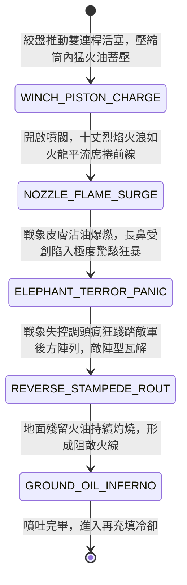

<!-- doc_id: doc_spec_0968 -->
# 戰場夜戰順風施放雙馬絞盤猛火油噴筒戰車噴吐十丈火浪破除敵軍象兵陣狀態機規格書

> **文件編號**：`doc_spec_0968`
> **模組代碼**：`FIRE-SIPHON-CHARIOT-ELEPHANT-ROUT01`
> **對應 WBS**：`FORM-187`（M7 戰場進階機關、城防斷軸陷阱與精銳步兵棗陽槊）
> **單一真相來源（SSOT）**：本文件直接定義猛火油噴筒戰車噴吐十丈火浪破除象兵陣之完整物理與戰鬥狀態機，嚴禁於檔尾附加補丁。

---

## 一、 戰術定位與歷史工程原型

在南征或邊陲野戰中，敵軍常驅使龐大的「南蠻戰象（象兵陣）」衝擊中原步騎，普通刀箭難以射穿厚實象皮，戰馬聞象氣味亦本能驚退。但巨象天性畏火懼熱與刺鼻硫磺氣息。**雙馬絞盤猛火油噴筒戰車（Fire-Siphon Chariot & Elephant-Rout Cart）** 將水戰噴火唧筒改裝於重裝雙馬戰車上：
1. **雙管銅唧筒與雙連桿活塞**：車身加裝兩具長一丈的生銅高壓唧筒，車內四名工兵以絞盤推動雙連桿皮碗活塞交替加壓，將特調石油、松脂與硫磺液壓向噴嘴。
2. **十丈連續火浪平流噴吐**：噴嘴外設長明火種籠，強壓噴出長達三至四格（十丈）的高溫火浪，在車頭形成一道扇形火牆，且燃燒火油隨風平流貼地蔓延。
3. **戰象劇痛發狂反踏敵陣**：巨象皮膚沾染黏稠猛火油後劇痛難忍，長鼻高卷驚駭長鳴，徹底脫離馭象手控制，調頭向敵軍後排瘋狂踩踏，引發敵軍陣線全面崩潰。

---

## 二、 觸發條件與建造部署參數

| 參數項目 | 規格數值與限制條件 | 備註說明 |
| :--- | :--- | :--- |
| **環境與氣象要求** | 陸地皆可施放；處於 **順風（風速 $\ge 2$ 級）** 時火浪射程 $+1$ 格且覆蓋寬度擴大 | 暴雨天火浪射程縮短 1 格且燃燒時間減半 |
| **建造資源消耗** | 精銅 130、猛火油 160、硬木 100、工兵戰技點（EP）45 | 每場戰鬥最多部署 2 輛猛火油噴筒戰車 |
| **射程與覆蓋範圍** | 正前方扇形 `3 ~ 4` 格；有效燃燒寬度 `3 格` | 專精剋制「象兵 / 藤甲兵 / 木質器械」 |
| **車體耐久（HP）** | `920` 點（車前加裝生牛皮防火鐵板，正面遠程減傷 `70%`） | 滿載儲油可供連續噴射 `3 回合` |

---

## 三、 核心狀態機（State Machine）

---

## 四、 數值結算與戰鬥公式

### 1. 十丈火浪噴吐傷害（Ten-Zhang Fire Surge）
對前方扇形 `3 ~ 4` 格範圍內的所有敵軍部隊造成持續高溫烈焰傷害：
$$\text{Damage}_{\text{siphon}} = \text{BaseATK}_{\text{engineer}} \times 2.30 \times \left(1 + 0.12 \times \text{WindLevel}\right) \times \text{BeastBonus}$$
- **巨獸與藤甲特攻（Beast & Rattan Multiplier）**：若目標為「象兵」或「藤甲兵」，$\text{BeastBonus} = 3.0$；普通步騎則為 $1.0$。

### 2. 戰象發狂反踩連鎖（Elephant Frenzy Trample）
被火浪擊中的「象兵部隊」立即進行意志檢定：
- **100% 狂暴反踏**：`100%` 強制附加 `ELEPHANT_FIRE_FRENZY`，馭象手控制失效，象兵立即向後方倒退奔跑 `3 格`，對沿途經過的所有敵方友軍部隊造成其自身最大攻擊力 `180%` 的「踐踏真實碾壓傷害」。
- **恐慌連鎖蔓延**：象兵反踏路徑周圍 `1 格` 內的敵軍步兵，士氣立即暴跌 `25` 點，並有 `60%` 機率陷入潰退狀態。

---

## 五、 反制手段與戰術克制

1. **先制重型床弩直射油箱**：若敵方以八牛床弩（`doc_spec_0847`）於噴火射程外狙擊戰車生銅油箱，可引爆油箱對噴筒車周圍 `1 格` 造成自爆傷害。
2. **挖設深溝斷車輪推進**：若噴火車陷入深溝，活塞加壓機構受震動錯位將暫停噴火。

---

## 六、 驗收測試案例（Acceptance Tests）

| 測試案例 ID | 測試情境與輸入條件 | 預期狀態轉移與數值輸出 |
| :--- | :--- | :--- |
| **TC-SIPHON-01** | 順風狀態下，噴筒車對正前方 3 格內之敵方「南蠻象兵隊」噴吐火浪 | 觸發 $3.0$ 倍特攻，造成極高火傷，象兵 100% 附加 `ELEPHANT_FIRE_FRENZY` |
| **TC-SIPHON-02** | 狂暴象兵倒退 3 格踩過敵方後排 2 隊弓兵陣列 | 沿途 2 隊敵軍各自承受象兵 180% 踐踏真傷，士氣暴跌 25 點並判定潰退 |
| **TC-SIPHON-03** | 敵方床弩於第 6 格遠距直射命中噴筒車油箱耐久歸零 | 車體爆炸解體，對噴筒車周圍 1 格敵我部隊造成範圍火傷 |
