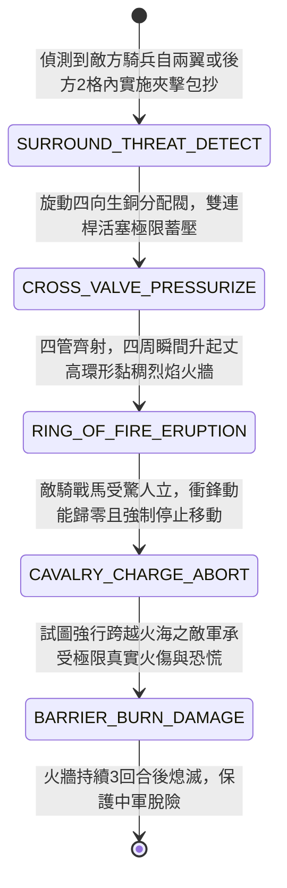

<!-- doc_id: doc_spec_0974 -->
# 戰場夜戰順風施放雙馬絞盤猛火油噴筒戰車噴射環形火海阻絕敵軍騎兵夾擊狀態機規格書

> **文件編號**：`doc_spec_0974`
> **模組代碼**：`FIRE-SIPHON-RING-OF-FIRE-FLANK-BLOCK01`
> **對應 WBS**：`FORM-193`（M7 戰場進階機關、城防排爪翻板與精銳步兵鉤鐮長矛）
> **單一真相來源（SSOT）**：本文件直接定義猛火油噴筒戰車噴射環形火海阻絕騎兵夾擊之完整物理與戰鬥狀態機，嚴禁於檔尾附加補丁。

---

## 一、 戰術定位與歷史工程原型

在平原大兵團作戰中，我方中軍大營或遠程弩陣極易遭敵方精銳輕騎兵自左右兩翼或後方實施「包抄夾擊（Flank & Rear Pincer Attack）」。單向噴火戰車轉向遲緩，難以兼顧四面。**雙馬絞盤猛火油噴筒戰車（Ring-of-Fire Flank-Denial Fire-Siphon Chariot）** 特別配備了「四向旋轉噴頭與環形火油擴散槽」：
1. **十字交叉四向旋轉銅噴管**：戰車頂部安裝一口可 $360^\circ$ 環旋的生銅分配閥，連接四根指向東南西北的噴火長管；工兵以高壓絞盤推動活塞，瞬間向四周同時噴出狂暴火浪。
2. **地面環形火溝與黏稠火油帶**：戰車周圍預先或隨車撒佈特調生漆與桐油，四向火浪落地後瞬間引燃直徑五格的「圓形火海隔離帶（Ring of Fire）」，烈焰高達丈餘。
3. **絕對隔絕騎兵衝鋒與高溫灼退**：戰馬天生畏火懼高溫，面對烈焰火牆強制剎蹄人立，敵方騎兵的側翼夾擊動能瞬間歸零，並被迫繞行或承受高溫燒傷。

---

## 二、 觸發條件與建造部署參數

| 參數項目 | 規格數值與限制條件 | 備註說明 |
| :--- | :--- | :--- |
| **環境與氣象要求** | 陸地皆可施放；處於 **順風** 時下風處火牆延伸 `1 格` | 大雨天氣下火牆燃燒時間由 3 回合縮減為 1 回合 |
| **建造資源消耗** | 精銅分配閥 110、猛火油 150、硬木 90、工兵戰技點（EP）40 | 每場戰鬥最多部署 2 輛環形噴火戰車 |
| **火海範圍與持續** | 以戰車為中心之自身九宮格至外圍 `5 × 5` 環形火帶；持續 `3 回合` | 戰車內部為防火安全核心區（車體塗生牛皮泥漿） |
| **車體耐久（HP）** | `900` 點（自帶防火塗料，免疫自身引燃火傷） | 燃料可供啟動一次環形火海噴射 |

---

## 三、 核心狀態機（State Machine）

---

## 四、 數值結算與戰鬥公式

### 1. 環形火牆爆發與夾擊動能清零（Ring of Fire Burst & Momentum Wipe）
當環形火海噴發瞬間，周圍 `5 × 5` 範圍內的敵軍承受烈焰衝擊：
$$\text{Damage}_{\text{ring}} = \text{BaseATK}_{\text{engineer}} \times 2.10 \times \left(1 - \text{TargetFireResist}\right)$$
- **夾擊衝鋒中斷（Charge Abort）**：周圍所有試圖發動「側翼夾擊 / 衝鋒」的敵方騎兵，其衝鋒傷害加成直接歸零，並 `100%` 附加 `FIRE_PANIC_STOP`（戰馬驚駭停滯 `1 回合`，無法前進）。

### 2. 火海阻絕與跨越懲罰（Barrier Burning Penalty）
在火牆存在的 `3 回合` 內，該火海區域成為高危險阻滯區：
- 敵軍若強行踏入火海格，每移動 1 格立即承受最大兵力 `15%` 的真實燃燒傷害，並有 `70%` 機率觸發「戰馬狂奔失控」，隨機掉頭奔逃。

---

## 五、 反制手段與戰術克制

1. **遠程拋石散彈越火轟擊**：火牆僅能阻絕地面近戰與騎兵，敵方投石車（`doc_spec_0885`）仍可從火牆外拋射碎石壓制戰車。
2. **重甲盾車直接硬推**：全鐵盾車或浸濕泥漿木幔可減免 `75%` 火傷，強行壓滅局部火牆開闢通道。

---

## 六、 驗收測試案例（Acceptance Tests）

| 測試案例 ID | 測試情境與輸入條件 | 預期狀態轉移與數值輸出 |
| :--- | :--- | :--- |
| **TC-RING-01** | 敵方 2 隊重騎兵自兩翼 2 格處發動包抄衝鋒，噴火戰車啟動環形火海 | 四周升起火海，2 隊騎兵衝鋒動能清零，100% 附加 `FIRE_PANIC_STOP` 停止前進 |
| **TC-RING-02** | 敵方步兵強行穿越燃燒中的火海地帶追擊我方遠程陣列 | 每移動 1 格扣除 15% 最大兵力真傷，並有 70% 機率混亂逃竄 |
| **TC-RING-03** | 敵方以厚塗濕泥的生牛皮木幔車推入火海 | 木幔車減免 75% 火傷，火牆被局部壓滅，後隨部隊安全通過 |
