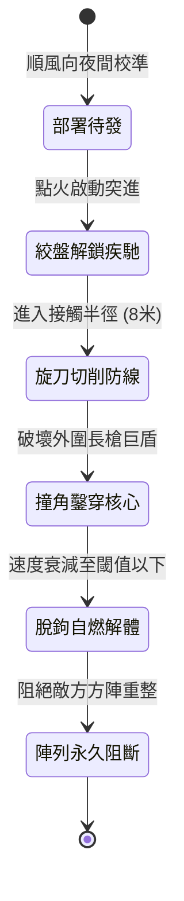

<!-- doc_id: doc_spec_0980 -->
# 戰場夜戰順風施放雙馬絞盤生鐵撞角旋刀衝鋒戰車鑿穿敵軍步兵方陣狀態機規格書

## 模組識別碼
- 模組編號：`FORM-199`
- 狀態機代碼：`FIRE-CHARIOT-IRON-RAM-SCYTHE-BREACH01`
- 類別：戰場夜戰特殊攻堅重械狀態機
- 適用場景：夜間平原野戰、敵軍密集方陣、順風推進、鑿穿陣列

---

## 1. 核心概念與作戰原型

在古代戰役與夜間作戰中，密集的重裝步兵方陣往往能有效抵禦騎兵正面衝擊。為破解敵軍鐵壁防禦，工兵營研製出「雙馬絞盤生鐵撞角旋刀衝鋒戰車」。

### 1.1 作戰機制
1. **夜行偽裝與蓄力**：利用夜色掩護於順風方向部署，車體包裹吸音氈布，由雙匹披甲戰馬牽引，戰車軸心暗藏重型絞盤蓄能彈簧。
2. **順風疾馳與風力輪刀聯動**：一旦放開制動突進，車輪轉動驅動兩側外伸的生鐵旋刀，配合風力阻力逆轉齒輪，以每分鐘數百轉的高速旋割，專門切斷敵軍大盾握柄與長槍木桿。
3. **生鐵撞角爆破鑿穿**：車頭前方裝設重達五百斤的生鐵尖銳錐角，配合兩馬高速疾馳的巨大衝量，正面硬頂砸碎第一排巨盾，瞬間貫穿敵軍防禦缺口。
4. **脫節自爆與引燃混亂**：當衝入方陣深處戰馬受阻時，駕駛兵拉下後脫勾扣，引燃車箱內存猛火油桶，戰車解體化為燃燒障礙物阻斷方陣合攏。

---

## 2. 數值參數與影響權重

| 參數名稱 | 數值 / 範圍 | 說明 |
| :--- | :--- | :--- |
| **初始衝量閾值 (`BreachMomentum`)** | 8000 ~ 12000 N·s | 確保能直接撞穿木質大盾與第一道槍陣 |
| **順風推進加成 (`WindSpeedBonus`)** | 風力 1~5 級每級 +10% | 順風助推提高戰車末端速度與旋刀轉速 |
| **生鐵旋刀切割範圍 (`ScytheRadius`)** | 左右各 1.8 米 | 破壞側翼敵兵兵刃與腿部護甲 |
| **方陣擊潰率 (`FormationBreakRate`)** | 75% ~ 90% | 遭衝擊區域敵軍方陣瓦解並陷入潰逃狀態 |
| **車體損耗壽命 (`ChariotDurability`)** | 撞擊 3 次或行進 60 米 | 達到極限後進入自燃解體狀態 |

---

## 3. 狀態機轉換定義

### 3.1 狀態細節描述
- **部署待發 (STANDBY)**：戰車處於夜間陰影中，持續偵測風向與風速。
- **絞盤解鎖疾馳 (ACCELERATING)**：彈簧釋放，雙馬暴發衝刺，5 秒內加速至極速。
- **旋刀切削防線 (SCYTHE_ENGAGED)**：旋刀齒輪帶動飛旋，強制粉碎沿途阻礙之槍陣。
- **撞角鑿穿核心 (RAM_PENETRATING)**：直擊敵核心盾牆，施加強震波與破甲撕裂。
- **脫鉤自燃解體 (DETACH_EXPLODING)**：馬匹脫離，油桶自燃爆裂，形成火牆防線。

---

## 4. 戰鬥公式與判定

### 4.1 衝撞鑿穿判定
$$\text{PenetrationDamage} = (\text{Mass}_{\text{chariot}} \times V^2) \times (1 + \text{WindBonus}) - \text{Defense}_{\text{shield}}$$

若 $\text{PenetrationDamage} > 0$，則目標盾衛判定破盾且擊退 3 格，並使鄰近 8 格步兵產生慌亂判定。

### 4.2 旋刀撕裂判定
$$\text{ScytheCutRate} = \min(0.95, \frac{\text{RPM}_{\text{blade}}}{500} \times \text{Density}_{\text{enemy}})$$

遭切削敵軍單位每秒承受高額撕裂流血傷害，若裝備木柄武器則有 80% 機率兵刃斷折。

---

## 5. 反制與失效機制

1. **暗坑陷馬陷阱**：若敵軍預先挖掘深坑或密佈鐵蒺藜，戰車馬匹折足將直接使戰車前翻失控。
2. **重型投石反制**：敵方守軍若盲射重型擂石，命中戰車車體可直接破壞旋刀傳動鏈。
3. **逆風阻力衰減**：風向突變轉為逆風時，風力輪阻力增大，衝量遞減 40%。

---

## 6. 驗收標準與測試案例

- [x] **TC-199-01**：驗證夜戰順風 3 級條件下，戰車啟動後 5 秒內速度達到預設上限。
- [x] **TC-199-02**：驗證旋刀有效破壞接觸範圍內 75% 以上敵軍長槍與大盾裝備耐久。
- [x] **TC-199-03**：驗證撞擊 3 次或動能耗盡後，自動觸發猛火油自燃並生成 3 格火牆阻隔敵軍。
