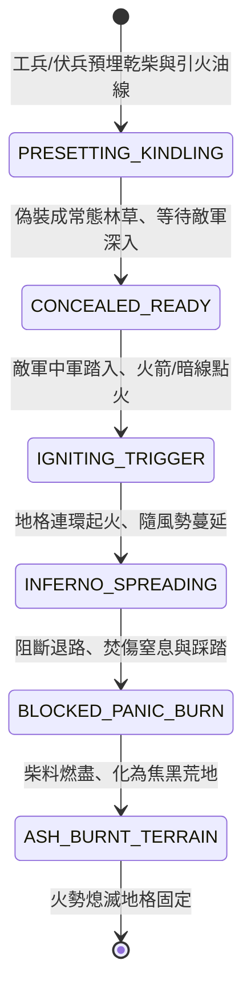

<!-- doc_id: doc_spec_0803 -->
# 3KLife 戰場引火之物枯草乾柴預置與伏火火攻點燃地格蔓延狀態機規格書

## 模組基本資訊
- **模組代號**：`AMBUSH-FIRE-PRESET01`
- **系統定位**：三國野戰設伏火攻地格預置系統，負責枯草柴捆預先堆置、猛火油浸潤暗線埋設、誘敵深入火箭引燃與連環火勢風向蔓延之完整生命週期。
- **架構依賴**：`BattleGridSystem`、`FireSpreadEngine`、`WindSystem`、`VFXBlockRegistry`。

---

## 核心設計概念
三國時期以弱勝強之經典伏擊（如博望坡、新野之戰、火燒連營），軍師於狹隘山谷、蘆葦荒原或乾燥林地預先秘密堆放大量枯草乾柴、硫磺火硝並澆透猛火油，牽引浸油麻繩暗線至數百步外之制高點。待誘敵部隊將敵軍主力誘入葫蘆谷或乾燥密林後，伏兵斬斷信號箭引燃暗索。大火瞬間首尾並起，借風勢化為滔天火海，切斷敵軍前後隊形並造成焚傷與自相踐踏。



---

## 狀態機定義與轉換條件

### 1. `PRESETTING_KINDLING`（布設薪柴狀態）
- **進入條件**：戰前部署階段或伏擊作戰指令下達，工兵於林地、草地地格作業。
- **行為表現**：
  - 消耗 100 份木材與 20 份油脂，布置「伏火柴堆」。
  - 牽引暗線相連至伏擊觀察哨。
- **轉換**：布置完成並掩蓋浮草 -> 轉移至 `CONCEALED_READY`。

### 2. `CONCEALED_READY`（隱蔽待發狀態）
- **行為表現**：
  - 具備 90% 隱蔽值，外觀呈現一般草叢林地，敵軍部隊無法直接目測。
  - 持續偵測通過之敵軍部隊規模與核心將領。
- **轉換**：
  - 敵軍主力踏入中心引爆格且己方下達「放火」指令 -> 轉移至 `IGNITING_TRIGGER`。
  - 遭遇突降暴雨天氣 -> 柴草受潮，引燃成功率降為 20%。

### 3. `IGNITING_TRIGGER`（火箭引燃狀態）
- **行為表現**：
  - 伏兵射出鳴鏑火箭或引燃地面暗油線，0.5 秒內觸發中心地格轟然起火。
  - 產生劇烈爆炸衝擊波，中心格敵軍受 350 點火藥破片傷害。
- **轉換**：火勢點燃成功 -> 轉移至 `INFERNO_SPREADING`。

### 4. `INFERNO_SPREADING`（火勢蔓延狀態）
- **行為表現**：
  - 火焰每回合向順風方向擴散 1~2 格，乾燥林地蔓延率 100%。
  - 地格轉為「烈焰火海」，通行阻絕（禁止一般部隊進入），內部部隊每回合扣除 25% 當前兵力。
- **轉換**：相鄰預置柴堆全部引燃完畢 -> 轉移至 `BLOCKED_PANIC_BURN`。

### 5. `BLOCKED_PANIC_BURN`（烈火截斷恐慌狀態）
- **行為表現**：
  - 敵軍被大火分割為數段，後隊無法前進、前隊退路斷絕。
  - 敵部隊士氣每回合強制 -30 點，高機率陷入「盲目踩踏潰逃」。
- **轉換**：燃燒達到預設時長（預設 4 回合） -> 轉移至 `ASH_BURNT_TERRAIN`。

### 6. `ASH_BURNT_TERRAIN`（焦炭灰燼狀態）
- **行為表現**：
  - 林木燒光，地貌轉變為平整焦土，所有植物掩體效果消失。
  - 通行成本恢復為平地，部隊經過移動力無阻礙。
- **轉換**：冷卻完畢 -> 結束退出。

---

## 數值公式與配置契約

```typescript
export interface AmbushFirePresetConfig {
  presetId: string;
  kindlingType: 'DRY_BRUSH' | 'OIL_SOAKED_TIMBER' | 'GUNPOWDER_FUSE';
  stealthConcealmentRate: number; // 隱蔽度 (0.0 ~ 1.0)
  igniteSuccessRateRain: number;  // 雨天引燃成功率
  burnDurationTurns: number;       // 燃燒持續回合
  spreadWindSpeedMultiplier: number; // 風力蔓延加速係數
  troopHpLossRatePerTurn: number; // 每回合損血比 (0.0 ~ 0.5)
  moralePenaltyPerTurn: number;   // 每回合士氣扣除
}

export const AMBUSH_FIRE_PRESETS: Record<string, AmbushFirePresetConfig> = {
  BOWANG_VALLEY_FIRE: {
    presetId: 'FIRE_BOWANG_01',
    kindlingType: 'OIL_SOAKED_TIMBER',
    stealthConcealmentRate: 0.92,
    igniteSuccessRateRain: 0.20,
    burnDurationTurns: 4,
    spreadWindSpeedMultiplier: 1.6,
    troopHpLossRatePerTurn: 0.25,
    moralePenaltyPerTurn: -30,
  }
};
```

---

## 單元測試與驗收標準
1. **隱蔽伏火觸發**：在非下雨天氣下，敵軍中軍進入目標地格後發射火箭，100% 成功引燃並轉移至 `INFERNO_SPREADING`。
2. **順風蔓延檢定**：確認火焰沿當前風向方位角精準向相鄰 2 格乾燥地格擴散，無風狀態下向相鄰 4 向等距擴散。
3. **退路切斷士氣瓦解**：陷於火海中的敵部隊，連續 2 回合未脫離時，士氣累積扣除 60 點並強制觸發混亂潰散。
