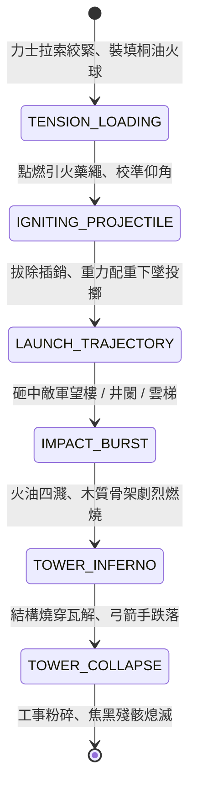

<!-- doc_id: doc_spec_0802 -->
# 3KLife 戰場擂石霹靂車拋擲重油火球與點燃敵軍望樓雲梯狀態機規格書

## 模組基本資訊
- **模組代號**：`SIEGE-TREBUCHET-FIREBALL01`
- **系統定位**：三國攻城戰重型槓桿投石機與燃燒彈投射系統，負責霹靂車填裝重油火球、拋物線彈道計算、高聳望樓精準破壞與烈焰蔓延結算。
- **架構依賴**：`SiegeCombatController`、`CatapultBallisticsEngine`、`FireSpreadEngine`、`VFXBlockRegistry`。

---

## 核心設計概念
官渡之戰中，袁紹築土山起高樓，於其上居高臨下俯射曹操營盤。曹操採納劉曄之計製造「發石車」（因發石聲如雷震，名曰霹靂車）。該機械運用重力配重與槓桿原理，不僅可拋擲巨型礌石擊碎土山木樓，更能換裝包裹麻布、浸透重油與硫磺之「烈火飛球」。火球在空中劃過熾熱弧線，砸中敵軍望樓、井闌或雲梯後四分五裂，重油飛濺引燃木架，使敵軍俯射工事瞬間化為火海。



---

## 狀態機定義與轉換條件

### 1. `TENSION_LOADING`（裝填蓄力狀態）
- **進入條件**：霹靂車處於架設完畢之穩定地格，操作力士就位。
- **行為表現**：
  - 6 名力士合力扳動絞盤拉索，將長臂梢頭下拉至底座鎖定栓。
  - 將重達 80 斤、浸透桐油之陶罐火球安放於皮窩投兜內（需時 3 秒）。
- **轉換**：裝填鎖定完畢 -> 轉移至 `IGNITING_PROJECTILE`。

### 2. `IGNITING_PROJECTILE`（點火校正狀態）
- **行為表現**：
  - 引燃火球外層硫磺火引，梢頭騰起熾熱烈焰。
  - 根據敵軍高樓座標調整投射仰角與配重比例。
- **轉換**：擊發指令下達 -> 轉移至 `LAUNCH_TRAJECTORY`。

### 3. `LAUNCH_TRAJECTORY`（飛越拋物線狀態）
- **行為表現**：
  - 拔除機關栓，重石箱急速下墜，長臂反甩破空發出霹靂巨響。
  - 火球劃出高拋物線軌跡（射程 120~260 步），空中拖曳長長濃煙與火光尾跡。
- **轉換**：火球抵達落點碰撞體 -> 轉移至 `IMPACT_BURST`。

### 4. `IMPACT_BURST`（撞擊爆裂狀態）
- **行為表現**：
  - 陶罐砸碎，造成 450 點純物理鈍擊傷害；重油四向飛濺，覆蓋目標及相鄰 1 格範圍。
  - 產生高溫燃燒判定（火勢蔓延機率 90%）。
- **轉換**：若命中目標為高聳木質建築（望樓/井闌） -> 轉移至 `TOWER_INFERNO`。

### 5. `TOWER_INFERNO`（樓閣熊熊火海狀態）
- **行為表現**：
  - 望樓每秒持續扣除耐久 120 點；頂層射手陷入「高溫灼傷」狀態，射擊精度下降 80%。
  - 木柱結構碳化，發出吱呀斷裂聲響。
- **轉換**：建築耐久歸零 -> 轉移至 `TOWER_COLLAPSE`。

### 6. `TOWER_COLLAPSE`（坍塌覆滅狀態）
- **行為表現**：
  - 望樓失衡崩塌傾覆，頂部駐守弓箭手摔落地面受 400 點墜落重傷。
  - 敵軍遠程制高點威脅徹底解除，周遭敵軍士氣扣除 20 點。
- **轉換**：殘骸燃燒完畢轉為焦炭 -> 結束退出。

---

## 數值公式與配置契約

```typescript
export interface TrebuchetFireballConfig {
  catapultId: string;
  maxRangeMeters: number;         // 最大射程 (公尺)
  minRangeMeters: number;         // 最小盲區射程 (公尺)
  bluntImpactDamage: number;      // 撞擊實體傷害
  splashFireRadiusGrid: number;   // 重油飛濺半徑 (格)
  burnDamagePerSecond: number;    // 每秒燃燒傷害
  woodenStructureBonusMult: number;// 對木質工事傷害倍率
  accuracyDeviationRadius: number;// 彈道落點散布半徑
}

export const TREBUCHET_PRESETS: Record<string, TrebuchetFireballConfig> = {
  PILICHE_HEAVY: {
    catapultId: 'TREB_PILI_01',
    maxRangeMeters: 260,
    minRangeMeters: 80,
    bluntImpactDamage: 450,
    splashFireRadiusGrid: 1.5,
    burnDamagePerSecond: 120,
    woodenStructureBonusMult: 2.5,
    accuracyDeviationRadius: 1.2,
  }
};
```

---

## 單元測試與驗收標準
1. **盲區射程防呆**：目標距離小於 80 步（最小射程）時，霹靂車禁止擊發，提示「目標處於投石盲區」。
2. **木質建築傷害倍率**：火球擊中木質井闌與望樓時，傷害乘上 2.5 倍且每秒扣減 120 點持續燃燒耐久。
3. **樓體坍塌墜落結算**：望樓耐久歸零時，即刻觸發 `TOWER_COLLAPSE`，頂層駐守單位受重傷並墜落地表，視野制高點加成清除。
