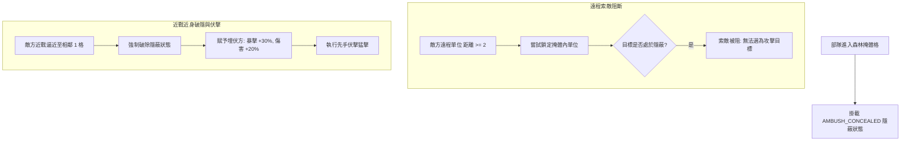

<!-- doc_id: doc_spec_0601 -->
# 戰場森林掩體格隱蔽伏擊與遠程索敵阻斷規格書

> 標記：Single Source of Truth（單一真相來源）  
> 涵蓋工作包：`GRD-04`  
> 狀態：正式發布 / 核心邏輯規格

---

## 1. 系統定位與架構

本模組規範 $5 \times 8$ 戰術棋盤中「掩體隱蔽地格（Stealth / Ambush Tile）」的視野迷霧阻斷與伏擊暴擊加成演算法。以「密林伏擊（Ambush Field）」與「蘆葦蕩（Reed Field）」為代表，部隊進入掩體地格後自動獲得「林下隱蔽（Concealed）」狀態。該狀態在戰鬥中構成遠程鎖定防火牆，全面阻斷敵方弓箭手與投石車的遠程點殺；同時賦予埋伏部隊在近身迎敵時的「破隱先手致命突襲」優勢。



---

## 2. 掩體地格資料模型（GRD-04）

```typescript
export interface IStealthTileData {
  readonly tileX: number;
  readonly tileY: number;
  readonly isForest: boolean;
  readonly critBonusOnAmbush: number;   // 破隱突襲暴擊加成（預設 0.30）
  readonly damageBonusOnAmbush: number; // 破隱突襲傷害加成（預設 0.20）
}
```

---

## 3. 遠程索敵阻斷與破隱規則

### 3.1 遠程鎖定阻斷機制
- 當防守方部隊駐留於 `isForest === true` 之地格時，標記為 `isConcealed = true`。
- 敵方單位若發起「遠程物理攻擊」或「單體指向性遠程計策」：
  - 若雙方曼哈頓距離 $|X_1 - X_2| + |Y_1 - Y_2| \ge 2$，目標選擇器（`BattleSkillTargetSelector`）強制將該目標自可選名單中剔除。
  - 只有非指向性全屏 AOE 或隨機落點火攻可對掩體格產生波及傷害。

### 3.2 破隱條件與先手伏擊暴擊
1. **破隱觸發**：當敵方部隊移動至與掩體格相鄰 1 格（距離 $= 1$）時，部隊立即現身，清除 `isConcealed`。
2. **伏擊反擊權**：隱蔽方在破隱回合進行的首次攻擊或反擊，自動享有：
   $$\text{CritRate}_{\text{ambush}} = \text{CritRate}_{\text{base}} + 0.30$$
   $$\text{FinalDamage}_{\text{ambush}} = \lfloor \text{NormalDamage} \times 1.20 \rfloor$$
3. **主動離開**：若部隊主動移動出森林掩體格，隱蔽狀態立即解除，不享有伏擊加成。

---

## 4. 核心演算法介面實作

```typescript
export function canTargetUnit(
  attackerPos: { x: number; y: number },
  targetPos: { x: number; y: number },
  isTargetInStealthTile: boolean,
  isRangedAttack: boolean
): boolean {
  if (!isTargetInStealthTile) {
    return true; // 非掩體目標正常可索敵
  }

  const distance = Math.abs(attackerPos.x - targetPos.x) + Math.abs(attackerPos.y - targetPos.y);
  if (isRangedAttack && distance >= 2) {
    return false; // 遠程索敵遭森林掩體阻斷
  }

  return true; // 相鄰近戰可索敵
}

export function calculateAmbushAttackBonus(
  baseDamage: number,
  baseCritRate: number,
  isAmbushFirstStrike: boolean
): { damage: number; critRate: number } {
  if (!isAmbushFirstStrike) {
    return { damage: baseDamage, critRate: baseCritRate };
  }

  return {
    damage: Math.floor(baseDamage * 1.20),
    critRate: Math.min(1.0, baseCritRate + 0.30),
  };
}
```

---

## 5. 驗收與測試標準

1. **遠程索敵阻斷測試（TC-GRD-04-01）**：
   - 弓箭手在座標 $(0, 2)$，目標在 $(0, 4)$ 森林掩體格（距離 2），檢核 `canTargetUnit` 回傳 `false`。
2. **近戰相鄰可見測試（TC-GRD-04-02）**：
   - 近戰步兵在座標 $(0, 3)$，目標在 $(0, 4)$ 森林掩體格（距離 1），檢核 `canTargetUnit` 回傳 `true`。
3. **破隱首擊暴擊加成（TC-GRD-04-03）**：
   - 驗證埋伏方破隱第一擊暴擊率精確由 0.10 躍升至 0.40，且傷害獲得 1.2 倍增幅。
