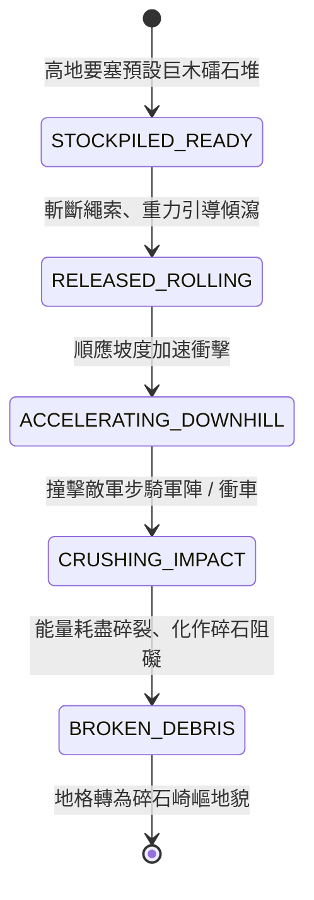

<!-- doc_id: doc_spec_0798 -->
# 3KLife 戰場滾木礌石順坡傾瀉與砸碎步騎軍陣物理狀態機規格書

## 模組基本資訊
- **模組代號**：`ROLLING-LOG-BOULDER01`
- **系統定位**：三國山地、峽谷與城隘高地防禦之重力動能打擊系統，負責滾木礌石儲備釋放、坡度加速度模擬、直線滾動碰撞碾壓與軍陣骨折潰散判定。
- **架構依賴**：`BattleGridSystem`、`TerrainHeightMap`、`BattleDamageEngine`、`VFXBlockRegistry`。

---

## 核心設計概念
三國時期峽谷設伏或高關據守（如陳倉、劍閣、博望坡），守軍於懸崖峭壁與陡峭高地預先囤積帶生鐵銳刺之巨型檑木與百斤花崗礌石。當敵方攻城部隊或騎兵隊列進入谷道仰攻時，守軍揮刀斬斷牽引麻索。巨木與礌石在重力加速度下如雷霆滾滾而下，橫掃山道，直接將敵軍雲梯、盾牌、戰馬砸成齏粉，造成毀滅性碾壓傷害與軍心崩潰。



---

## 狀態機定義與轉換條件

### 1. `STOCKPILED_READY`（高地儲備待發狀態）
- **進入條件**：高地要塞地格（高度差 >= 2 階）預先配置「滾木礌石機關」。
- **行為表現**：
  - 由 2 名守備工兵看管牽引機關索。
  - 呈隱蔽狀態，敵軍若無精銳斥候攀爬探查無法偵測。
- **轉換**：守將下達「推落滾木」指令 -> 轉移至 `RELEASED_ROLLING`。

### 2. `RELEASED_ROLLING`（釋放滾動初速狀態）
- **行為表現**：
  - 繩索被斬斷，巨木或礌石脫離木架，獲得初始動能（初速 3.0 m/s）。
  - 發出劇烈震地轟鳴聲，周圍 3 格敵軍士氣下降 5 點。
- **轉換**：進入相鄰斜坡地格 -> 轉移至 `ACCELERATING_DOWNHILL`。

### 3. `ACCELERATING_DOWNHILL`（順坡加速俯衝狀態）
- **行為表現**：
  - 計算地勢落差：高度每降低 1 階，滾動速度遞增 2.5 m/s，衝擊動能平方增長。
  - 滾動軌跡沿地圖等高線之最大降坡梯度延伸，遇巨岩障礙則產生 15~30 度折射。
- **轉換**：路徑地格接觸到任何敵軍單位、車輛或建築 -> 轉移至 `CRUSHING_IMPACT`。

### 4. `CRUSHING_IMPACT`（碾壓碎陣打擊狀態）
- **行為表現**：
  - **傷害判定**：基礎動能傷害 500~900 點，無視普通輕甲與木盾防禦；若為步兵直接觸發「骨折擊飛」（擊退 2 格）；若為騎兵則戰馬受驚踏空摔翻。
  - **器械摧毀**：撞擊衝車、雲梯或井闌，直接削扣器械 50% 以上耐久，並有 40% 機率直接砸毀散架。
  - 滾木礌石每穿透擊中 1 個單位，動能損耗 30%。
- **轉換**：動能完全衰減（連續穿透 3 支部隊或撞擊巨石懸崖） -> 轉移至 `BROKEN_DEBRIS`。

### 5. `BROKEN_DEBRIS`（碎木碎石殘留狀態）
- **行為表現**：
  - 滾木撞成碎木碎石堆，原地生成「崎嶇亂石堆」地形。
  - 後續行經該地格之所有部隊，移動力消耗增加 2 點。
- **轉換**：地貌屬性固定完成 -> 結束退出。

---

## 數值公式與配置契約

```typescript
export interface RollingLogConfig {
  trapId: string;
  trapType: 'IRON_SPIKE_LOG' | 'HEAVY_BOULDER' | 'BUNDLE_TIMBER';
  initialMassKg: number;           // 質量 (kg)
  baseDamage: number;              // 平地基礎動能傷害
  heightSlopeMultiplier: number;   // 坡度高度差動能放大係數 (每階)
  maxPenetrationUnits: number;     // 最大連續碾壓穿透部隊數
  knockbackGrids: number;          // 擊退格數
  debrisTerrainDurationTurns: number; // 崎嶇地形維持回合
}

export const ROLLING_OBSTACLE_PRESETS: Record<string, RollingLogConfig> = {
  SPIKED_HEAVY_LOG: {
    trapId: 'LOG_SPIKED_01',
    trapType: 'IRON_SPIKE_LOG',
    initialMassKg: 650,
    baseDamage: 550,
    heightSlopeMultiplier: 1.45,
    maxPenetrationUnits: 3,
    knockbackGrids: 2,
    debrisTerrainDurationTurns: 5,
  },
  GIGANTIC_BOULDER: {
    trapId: 'BOULDER_HEAVY_01',
    trapType: 'HEAVY_BOULDER',
    initialMassKg: 1200,
    baseDamage: 850,
    heightSlopeMultiplier: 1.80,
    maxPenetrationUnits: 4,
    knockbackGrids: 3,
    debrisTerrainDurationTurns: 8,
  }
};
```

---

## 單元測試與驗收標準
1. **重力加速度倍率**：高度差為 3 階的高地釋放礌石，撞擊首個目標時傷害必須為基礎值乘上 `(1 + 1.80 * 3)`，動能遞增計算無溢位。
2. **穿透動能衰減**：滾木穿透第一個敵軍小隊後，對第二個目標造成傷害扣減 30%，第三個扣減 60%，第四個因動能耗盡轉入 `BROKEN_DEBRIS`。
3. **殘留地形轉變**：滾動停止後，原停留地格屬性即時轉為 `ROCKY_OBSTACLE`，通過部隊消耗額外 2 點移動力。
