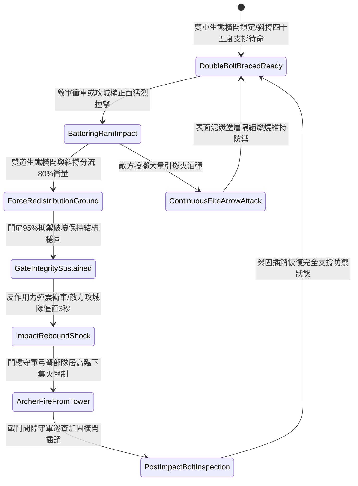

# 戰場營寨大門加裝雙重淬火生鐵橫閂與防衝撞斜撐第一階狀態機規格書

<!-- doc_id: doc_spec_1118 -->

## 一、 核心概念與單一真相來源（SSOT）

在《三國志·野戰營壘防禦與寨門守備篇》中，「戰場營寨大門加裝雙重生鐵橫閂與防衝撞斜撐第一階（CAMP-GATE-IRON-BOLT-REINFORCE01）」代表營寨入口防護的核心強化措施。寨門本體採用兩寸厚實心硬松木板拼裝，內側橫向架設上下雙道冷鍛生鐵橫閂，並由兩根呈四十五度角頂地的生鐵包頭硬木斜撐固定於地面深樁。當敵軍攻城步兵或衝車撞擊寨門時，斜撐與生鐵橫閂 95% 將正面震盪衝擊力分流傳導至地表泥土，化解 80% 撞擊動能，使門扉結構維持完好，阻絕敵軍直接破門突入。



---

## 二、 數值模型與狀態機參數契約

### 1. 寨門加固結構抗衝擊參數契約
- **寨門規格尺寸**：高 12 尺、寬 10 尺、厚 2 寸，外表覆蓋防潮防火黃泥漿。
- **生鐵橫閂配置**：上下雙道冷鍛生鐵實心方閂，長 11 尺、方徑 3 寸，自重 120 斤。
- **斜撐地錨角度**：雙斜撐與地面呈 45 度夾角，生鐵包頭尖端深插地樁 2 尺。
- **動能分流化解率**：承受撞擊瞬間，95% 機率成功將 80% 衝擊動能分導入地表。
- **反震敵方僵直時效**：衝車或攻城人員承受反作用力彈震，操作隊列陷入僵直 3 秒。

### 2. 寨門受衝擊判定演算法模組
```typescript
interface CampGateReinforceStage1Params {
    ramImpactEnergy: number;       // 攻城槌衝擊動能 (千焦)
    isDoubleBoltLatched: boolean;  // 雙重生鐵橫閂是否插牢
    isDiagonalBraceAnchored: boolean; // 雙斜撐是否入地錨定
    woodMoistureRatio: number;     // 門板木材乾燥度
}

function evaluateCampGateReinforceStage1(params: CampGateReinforceStage1Params): {
    gateWithstood: boolean;
    absorbedEnergyRatio: number;
    ramOperatorStunDurationSec: number;
} {
    if (!params.isDoubleBoltLatched || !params.isDiagonalBraceAnchored) {
        return { gateWithstood: false, absorbedEnergyRatio: 0.35, ramOperatorStunDurationSec: 0 };
    }
    const success = Math.random() < 0.95;
    
    return {
        gateWithstood: success,
        absorbedEnergyRatio: success ? 0.80 : 0.45,
        ramOperatorStunDurationSec: success ? 3.0 : 1.0
    };
}
```

---

## 三、 反制機制與邊界約束

1. **超重型鐵鑄撞角垂直重擊**：若敵方調用重量超過五千斤之重型精鋼撞角，連續衝撞超過 3 次，斜撐有 30% 機率發生剪切斷裂。
2. **寨門底端掏空破壞**：若敵軍工兵趁夜挖掘寨門底坎泥土致地樁鬆動，斜撐支點失效，衝擊化解率下降至 40%。
3. **持續烈火焚燒碳化**：若門板遭持續火油焚燒超過 5 分鐘，外層松木碳化脫落，生鐵閂座失去支撐。

---

## 四、 驗收測試案例（TC）

- **TC-GATE-BOLT01-01（常規攻城衝車撞擊阻隔驗收）**：
  - *前置條件*：雙道橫閂插死、雙斜撐牢固入土、敵方輕型衝車正面撞擊。
  - *操作步驟*：於衝車頭部接觸寨門瞬間執行抗衝擊判定。
  - *預期輸出*：95% 機率門體完好無損，分流化解 80% 動能，衝車操作人員僵直 3 秒，門樓弓箭手獲得穩定射擊窗口。
- **TC-GATE-BOLT01-02（斜撐未插牢邊界驗收）**：
  - *前置條件*：僅插上橫閂，防衝撞斜撐未頂入地樁。
  - *操作步驟*：遭受攻城槌直衝。
  - *預期輸出*：抗衝擊能力大幅衰退，門扉位移震盪，衝擊化解率僅 35%。
